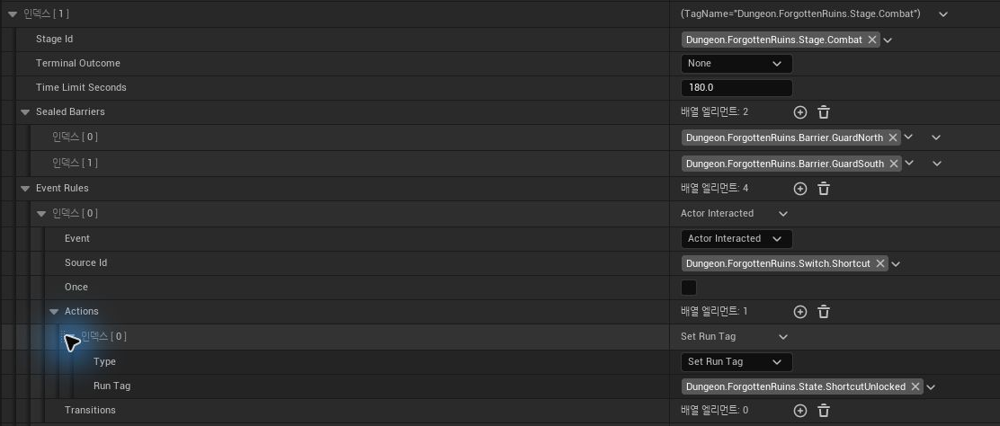
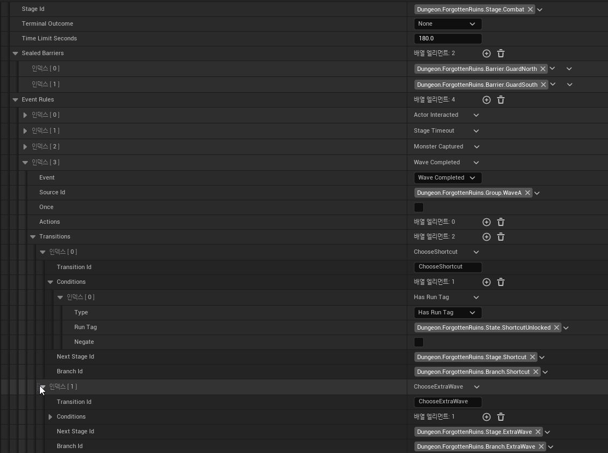
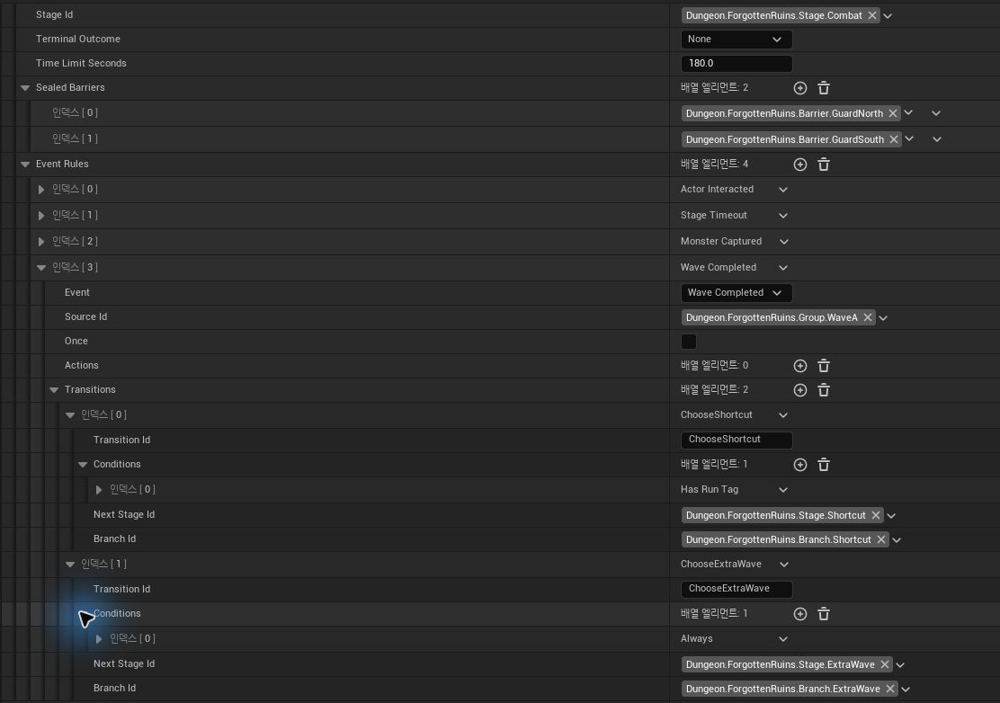

# 09. Branching Dungeon Runtime

던전의 Stage·목표·분기·장벽을 `UDungeonDefinitionDataAsset`에 정의하고, 서버 `UDungeonStageRuntimeSubsystem`이 Event·Action·Transition으로 진행합니다. 레버는 RunTag를 기록하고, Wave 완료 시점에 분기 조건을 평가합니다.

## 분기 플레이 영상

### 지름길 — 레버를 사용한 경우

https://github.com/user-attachments/assets/29858da6-7d13-4297-9d71-41f53272a952

전투 중 레버를 사용해 `State.ShortcutUnlocked`를 기록한 뒤 Wave A를 완료하면 **`Branch.Shortcut`으로 이동**합니다.

### 추가 웨이브 — 레버를 사용하지 않은 경우

https://github.com/user-attachments/assets/af8228c3-f403-41e1-947b-ba3f3d3f5da6

같은 Wave A를 완료해도 RunTag가 없다면 **`Branch.ExtraWave`를 선택하고 Wave B 목표를 생성**합니다.

## 핵심 구현

| 구성 요소 | 실제 역할 |
|---|---|
| `UDungeonDefinitionDataAsset` | Stage, EventRule, Action, Transition, Grade 정의 |
| `UDungeonStageRuntimeSubsystem` | 입장·비동기 로드, Event Queue, 조건 평가, 스테이지 전환 |
| `UDungeonObjectiveTracker` | 생성된 그룹의 처치·포획·완료 집계 |
| `FDungeonStageRuntimeState` | 현재 Stage·RunTag·Branch·Barrier·진행도·보상·참가자 |
| `ASonheimGameState` | 서버 Run State를 Revision이 있는 Snapshot으로 복제 |
| `ADungeonBarrier` | Snapshot의 `SealedBarriers`를 읽어 충돌·시각 효과·내비게이션 영역 갱신 |
| `UDungeonProgressSubsystem` | `DungeonNumber` 기준 클리어·실패·최고 기록 저장 |

## 목차

- [실제 스테이지 그래프](#실제-스테이지-그래프)
- [Event·Action·Transition으로 분기 구성](#eventactiontransition으로-분기-구성)
- [서버 Event Queue와 RunId](#서버-event-queue와-runid)
- [입장·Stage 시작·제한 시간](#입장stage-시작제한-시간)
- [몬스터 목표와 포획 연동](#몬스터-목표와-포획-연동)
- [Stage별 장벽과 월드 상태](#stage별-장벽과-월드-상태)
- [종료·보상·기록](#종료보상기록)
- [Snapshot과 클라이언트 표시](#snapshot과-클라이언트-표시)
- [데이터 검증과 구현 선택](#데이터-검증과-구현-선택)
- [관련 코드 및 문서](#관련-코드-및-문서)

---

## 실제 스테이지 그래프

아래는 **Forgotten Ruins의 Dungeon Definition에서 `BuildStageGraph()`가 생성한 그래프 중 주요 스테이지 전환만 발췌한 도식**입니다. Action·제한 시간 등 전체 주석까지 포함한 원본은 아래 링크에서 확인할 수 있습니다.

~~~mermaid
flowchart TD
  Stage_Enter -->|"AreaEntered Zone.GuardRoom"| Stage_Combat
  Stage_Enter -->|"StageTimeout"| Stage_Failed
  Stage_Combat -->|"StageTimeout"| Stage_Failed
  Stage_Combat -->|"WaveCompleted Group.WaveA + HasRunTag State.ShortcutUnlocked"| Stage_Shortcut
  Stage_Combat -->|"WaveCompleted Group.WaveA + Always"| Stage_ExtraWave
  Stage_Shortcut -->|"StageEntered"| Stage_Boss
  Stage_ExtraWave -->|"WaveCompleted Group.WaveB"| Stage_Boss
  Stage_Boss -->|"BossDefeated Group.Boss + SpawnGroupCompleted"| Stage_Result
  Stage_Result[["Stage.Result / 성공"]]
  Stage_Failed[["Stage.Failed / 실패"]]
~~~

[Dungeon Definition이 생성한 전체 Stage Graph](../Media/Wiki/09_Branching_Dungeon_Runtime/09_dungeon_stage_graph.mmd)

| Stage | 실행 내용 | 다음 조건 |
|---|---|---|
| **Enter** | GuardRoom 진입 시 Wave A 생성 | 지역 진입 → Combat |
| **Combat** | Wave A 목표, 지름길 레버, Guard 장벽 | Wave A 완료 시 RunTag로 분기 |
| **Shortcut** | 지름길 경로 | Stage 진입 후 Boss로 전환 |
| **ExtraWave** | Wave B 생성·추가 목표·Store 장벽 | Wave B 완료 후 Boss |
| **Boss** | BossHall에서 보스 그룹 생성·Treasure 장벽 | 보스 그룹 완료 → Result |
| **Result / Failed** | 실행 결과 확정 | 종료 |

**Graph의 화살표는 스테이지 전환을 나타냅니다.** 레버 상호작용은 스테이지 이동이 아니라 현재 실행의 RunTag를 변경하므로 별도 화살표로 표시하지 않습니다.

---

## Event·Action·Transition으로 분기 구성

### 정의 데이터가 실행 규칙을 소유

`FDungeonStageDefinition`은 Stage ID·제한 시간·닫힌 장벽·EventRule 목록을 보유합니다. `FDungeonStageEventRule`은 **어떤 이벤트와 SourceId가 들어왔을 때 수행할 Action 및 평가할 Transition**을 정의합니다.

~~~mermaid
flowchart LR
    STAGE["FDungeonStageDefinition StageId · EventRules"] --> RULE["Event + SourceId"]
    RULE --> ACTION["Actions SpawnGroup · SetRunTag · GrantReward"]
    RULE --> TRANS["Transitions Condition 평가"]
    TRANS --> NEXT["NextStageId + BranchId"]
~~~

| 요소 | 구현 타입 | 예 |
|---|---|---|
| **Event** | `EDungeonStageEvent` | `ActorInteracted`, `WaveCompleted`, `MonsterCaptured` |
| **Condition** | `EDungeonStageCondition` | `Always`, `HasRunTag`, `SpawnGroupCompleted` |
| **Action** | `EDungeonStageAction` | `SpawnGroup`, `SetRunTag`, `ClearRunTag`, `EmitEvent`, `GrantReward` |
| **Transition** | `FDungeonStageTransition` | 조건 배열, `NextStageId`, `BranchId` |

### 하나의 레버 입력이 분기 조건으로 바뀌는 과정

~~~text
① 레버 입력
   ADungeonShortcutSwitch::Interact
      → TryInteractSwitch(..., SourceId)
      → QueueEvent(ActorInteracted, Switch.Shortcut)

② 현재 Combat Stage의 EventRule
   ActorInteracted / Switch.Shortcut
      → Action: SetRunTag(State.ShortcutUnlocked)
      → Combat Stage 유지

③ Wave A 마지막 몬스터 처치·포획
   ObjectiveTracker → WaveCompleted(Group.WaveA)

④ Combat Stage의 Transition 평가 (배열 순서)
   HasRunTag(State.ShortcutUnlocked)
      → Stage.Shortcut / Branch.Shortcut
   그 외 Always
      → Stage.ExtraWave / Branch.ExtraWave
~~~

`ProcessQueue`는 Definition의 Transition을 배열 순서대로 검사하고, 처음 만족한 경로로 전환합니다. 따라서 위 설정에서 `HasRunTag` 전환이 `Always`보다 먼저 와야 합니다. 레버 Actor는 RunTag 이벤트만 전달합니다.

### GameplayTag로 연결하는 콘텐츠 ID

~~~text
Dungeon.ForgottenRuins.Stage.*
Dungeon.ForgottenRuins.Group.*
Dungeon.ForgottenRuins.Branch.*
Dungeon.ForgottenRuins.Zone.*
Dungeon.ForgottenRuins.Switch.*
Dungeon.ForgottenRuins.Barrier.*
Dungeon.ForgottenRuins.PointSet.*
~~~

`FGameplayTag`는 Definition과 월드에 배치한 스위치·지역·장벽, Runtime State를 연결하는 식별자입니다. `TransitionId`는 해당 Definition 안에서 전환 로그를 식별하는 `FName`으로, 저장 기록의 키는 `DungeonNumber`로 분리했습니다.

실제 DataAsset과 Catalog 구성 기준은 [03. Data & Content Architecture](03_Data_Content_Architecture.md)에서 설명합니다.

---

## 서버 Event Queue와 RunId

### 이벤트를 큐에 넣고 순서대로 해석

`UDungeonStageRuntimeSubsystem`은 World Actor·목표 추적기에서 받은 이벤트를 바로 재귀 처리하지 않고 `QueueEvent`와 `ProcessQueue`를 사용합니다.

~~~cpp
// DungeonStageRuntimeSubsystem.cpp — 핵심 코드
void UDungeonStageRuntimeSubsystem::QueueEvent(
    EDungeonStageEvent Event, const FGameplayTag& Source)
{
    if (!IsAuthority() ||
        State.RunStatus != EDungeonRunStatus::Running) return;
    Queue.Add({State.RunId, Event, Source});
    if (!bProcessing) ProcessQueue();
}
~~~

~~~mermaid
flowchart TB
    EVENT["World Actor / ObjectiveTracker Event + SourceId"] --> QUEUE["Queue (RunId 포함)"]
    QUEUE --> CHECK["ProcessQueue 현재 RunId · Stage Rule 검사"]
    CHECK --> ACTION["Actions 순서대로 실행"]
    ACTION --> CONDITION["Transitions 조건 평가"]
    CONDITION -->|"조건 충족"| ENTER["EnterStage"]
    CONDITION -->|"전환 없음"| PUBLISH["Publish Run State"]
    ENTER --> PUBLISH
    ACTION -. "EmitEvent" .-> QUEUE
~~~

실제 `ProcessQueue`는 각 이벤트에 대해 **현재 Stage에서 Event와 SourceId가 일치하는 첫 번째 Rule**을 찾고, Action을 차례로 실행한 뒤 Transition을 순서대로 검사합니다.

| 보호 장치 | 현재 구현 |
|---|---|
| **RunId** | 큐에 넣은 당시의 `RunId`와 현재 `RunId`가 다르면 이벤트 무시 |
| **bOnce** | 같은 Stage·Event·SourceId 조합의 Rule을 한 Run에서 한 번만 실행 |
| **bProcessing** | 실행 중 추가 이벤트가 발생하면 재귀 호출 대신 큐에 추가 |
| **Cascade Budget** | 한 처리 주기 내 최대 128회 수준으로 이벤트 연쇄 제한 |
| **Action 실패** | 실패 사유 `Error`를 기록하고 Run 종료 |

~~~cpp
// ProcessQueue — 이벤트 처리 경계 발췌
const auto Event = Queue[0];
Queue.RemoveAt(0);
if (Event.RunId != State.RunId || !Definition) continue;

const auto* Stage = Definition->FindStage(State.StageId);
const auto* Rule = Stage->EventRules.FindByPredicate(
    [&](const auto& R)
    {
        return R.Event == Event.Type &&
               R.SourceId == Event.SourceId;
    });
~~~

`EnterStage`도 `StageEntered`를 큐에 넣습니다. 진입 Action이 후속 이벤트를 발생시켜도 `ProcessQueue`가 재귀 호출하지 않고 순차적으로 처리합니다.

---

## 입장·Stage 시작·제한 시간

### Catalog에서 Definition을 비동기 로드

`ADungeonTestArea`에서 시작한 요청은 `TryStart`로 전달됩니다. 서버는 입장 플레이어의 생존·거리·레벨, 실행 중 여부를 검사한 후 Catalog에서 `DefinitionAssetId`를 조회합니다.

~~~text
ADungeonTestArea
    → TryStart(Player)
    → FDungeonCatalogRow
       DungeonId · DungeonNumber · DefinitionAssetId · RequiredLevel
    → RunId 생성 / RunStatus = Loading
    → UDungeonAssetSubsystem::LoadDefinition
    → RunId · Loading 상태 재확인
    → ObjectiveTracker 바인딩
    → StartStageId 진입
~~~

`TryStart`는 입장 플레이어를 Run Owner로 지정하고 입구 주변의 참가자들을 `State.Participants`에 등록합니다. 이후 포털을 통해 참가자가 입장하거나 나가면 `NotifyPortal`에서 참가자 목록을 갱신합니다.

비동기 로드 콜백은 캡처한 `RunId`와 현재 `State.RunId`를 비교해 **이미 끝났거나 교체된 실행에 이전 에셋 로드 결과가 적용되지 않도록** 합니다.

### 서버 타이머와 스테이지 진입

`EnterStage`는 `StageId`·`SealedBarriers`·`StageStartedServerTime`을 설정하고, 제한 시간이 있다면 `StageDeadlineServerTime`과 Server Timer를 구성합니다.

~~~text
Stage.TimeLimitSeconds
    ├─ 서버 Timer 만료 → StageTimeout 이벤트
    └─ StageDeadlineServerTime → GameState Snapshot → HUD 카운트다운
~~~

Timer 콜백에서는 `RunId`와 `StageId`를 함께 확인합니다. 이미 다른 스테이지로 이동했거나 재시작한 실행에 이전 타이머가 영향을 주지 않도록 한 처리입니다.

---

## 몬스터 목표와 포획 연동

### 웨이브 생성과 목표 등록

`SpawnGroup` Action은 `PointSetId`로 배치 위치를 가져오고 `FDungeonSpawnService::Spawn`으로 몬스터를 생성합니다. 생성 결과는 `UDungeonObjectiveTracker::RegisterGroup`에 전달됩니다.

~~~mermaid
flowchart LR
    SPAWN["SpawnGroup Action"] --> MONSTER["FDungeonSpawnService Monster 생성"]
    MONSTER --> TRACK["UDungeonObjectiveTracker 그룹 등록"]
    TRACK --> DEATH["OnMonsterDeathConfirmed"]
    TRACK --> CAPTURE["OnMonsterBecamePartner"]
    DEATH --> TALLY["Resolved Count 갱신"]
    CAPTURE --> TALLY
    TALLY --> COMPLETE["OnCompleted WaveCompleted / BossDefeated"]
    COMPLETE --> QUEUE["Dungeon Event Queue"]
~~~

그룹별 `FDungeonGroupTally`는 생성 수·처치 수·포획 수를 따로 유지합니다. 포획된 몬스터는 `PartnerOwner`를 갖고 전투 그룹에서 제외되므로 **처치와 마찬가지로 그룹 완료 진행도에 반영**합니다.

~~~text
Wave A : Spawned 4
    Defeated 3 + Captured 1
    → Resolved 4 / 4
    → WaveCompleted(Group.WaveA)
~~~

대상 몬스터가 **처치되거나 포획되지 않은 채 비정상적으로 제거**되면 `OnInvalidated`를 통해 `TargetLost` 실패를 처리합니다. 이는 몬스터가 사라졌다는 이유만으로 목표를 완료 처리하지 않기 위한 조건입니다.

---

## Stage별 장벽과 월드 상태

각 `FDungeonStageDefinition`에는 해당 Stage에서 닫아야 할 `SealedBarriers` 목록이 있습니다.

| Stage | 예시 Barrier |
|---|---|
| Combat | `Barrier.GuardNorth` · `Barrier.GuardSouth` |
| ExtraWave | `Barrier.StoreEast` |
| Boss | `Barrier.Treasure` |

~~~text
Definition.SealedBarriers
    → Runtime State.SealedBarriers
    → ASonheimGameState Snapshot
    → ADungeonBarrier::RefreshFromState
    → Wall Collision · Fade · NavModifier
~~~

`ADungeonBarrier`는 **자체 Actor 복제를 사용하지 않습니다(`bReplicates=false`)**. 서버·클라이언트에 존재하는 배치 Actor가 GameState Snapshot을 읽어 자신의 `BarrierId`가 `SealedBarriers`에 있는지 판단합니다.

`RefreshFromState`는 충돌과 Fade 표시를 변경하고, 서버에서는 `NavModifier`의 영역 클래스를 변경해 이동 가능 영역을 함께 조정합니다. GameState가 Actor보다 늦게 준비되는 경우에는 `GameStateSetEvent`로 연결 시점을 처리합니다.

분기 조건이 결정되면 **런타임은 Stage만 바꾸고, 각 Barrier Actor가 현재 Stage의 장벽 상태를 해석**합니다.

---

## 종료·보상·기록

### 성공·실패 종료

`EnterStage`가 Terminal Stage에 도달하면 `Succeeded / Failed`를 결정하고 경과 시간과 결과를 저장합니다. 별도로 `Fail`은 다음 실패 조건을 처리합니다.

| 실패 이유 | 서버 처리 |
|---|---|
| `TimeOut` | Stage Timer → `StageTimeout` 전환 |
| `OwnerDown` | Run Owner HP가 0이 됨 |
| `OwnerLeft` | Run Owner가 포털로 던전을 이탈 |
| `TargetLost` | 완료되지 않은 목표 몬스터가 제거됨 |
| `Error` | 잘못된 실행 조건·Action 실패·이벤트 연쇄 초과 등 |

종료 후에는 `ScheduleCleanup`이 다음 Tick에 Objective의 Delegate와 실행 에셋을 정리합니다. **진행 중인 Rule·Delegate 호출 스택에서 바로 생성 몬스터를 파괴하지 않도록** 종료와 정리를 분리했습니다. 포획해 소유자가 생긴 몬스터는 Objective 정리 시 Destroy하지 않습니다.

### 보상은 기존 인벤토리에 지급

`GrantReward` Action은 각 참가자의 `UInventoryComponent::AddItem`을 호출합니다. 아이템 중첩·획득 이벤트·복제는 인벤토리의 기존 처리를 재사용하며, 실행 중 지급된 보상 내역은 `State.Rewards`에 합산합니다.

### 클리어 기록과 등급

`UDungeonProgressSubsystem::RecordRun`은 `DungeonNumber`를 키로 SaveGame에 결과를 남깁니다.

| 기록 | 처리 |
|---|---|
| `ClearCount / FailCount` | 성공·실패 횟수 증가 |
| `BestSeconds` | 성공 기록에 한해 최단 시간 갱신 |
| `LastBranchId` | 마지막 성공 경로 저장 |
| `TotalDefeated / TotalRewards` | 누적 처치·보상 집계 |

`UDungeonDefinitionDataAsset::GradeFor`는 **클리어 시간·완료한 선택 목표 수**에 따라 `GradeRules`에서 처음 만족한 등급을 반환합니다. 기록용 `DungeonNumber`는 변경될 수 있는 Stage/Branch GameplayTag와 구분합니다.

---

## Snapshot과 클라이언트 표시

서버 Runtime은 변경된 `FDungeonStageRuntimeState`를 `ASonheimGameState::PublishDungeonStageState`에 넘깁니다. GameState는 표시 상태가 달라졌을 때 `Revision`을 증가시켜 복제하고, 호스트 화면에도 변경 Delegate를 전달합니다.

| Snapshot 필드 | 사용 대상 |
|---|---|
| `RunId / Revision / RunStatus / StageId` | 현재 실행·진행 단계·결과 |
| `SelectedBranchId / RunTags` | 선택한 경로·지름길 표시 |
| `CurrentCount / RequiredCount / Groups` | 목표 진행도·웨이브 현황 |
| `SealedBarriers` | 월드 장벽·경로 개방 |
| `StageDeadlineServerTime / RunStartedServerTime` | 제한 시간과 경과 시간 |
| `Participants / OwnerPlayer` | 참가자·진행 권한 표시 |
| `Rewards / ClearCount / BestSeconds` | 보상·결과·기록 |
| `BossHealth / BossPhase / BossActionId / BossBreak` | 보스 HUD 상태 |

~~~text
UDungeonStageRuntimeSubsystem (서버)
    → FDungeonStageRuntimeState
    → ASonheimGameState (복제)
    → ADungeonBarrier (월드)
    → UDungeonStagePresenter (화면용 ViewData)
    → HUD · 미니맵 · 결과 UI
~~~

서버의 Event Queue가 결과를 확정하고, 클라이언트는 복제된 Snapshot으로 장벽·HUD·결과 화면을 갱신합니다. Revision 처리와 UI 수명은 [11. Client State Presentation](11_Client_State_Presentation_Pipeline.md), 복제 범위는 [12. Multiplayer Synchronization](12_Multiplayer_Synchronization.md)에서 다룹니다.

---

## 데이터 검증과 구현 선택

에디터에서는 `UDungeonDefinitionDataAsset::ValidateDefinition`과 `BuildStageGraph`로 Stage·Transition·Tag 참조를 점검하고 그래프를 생성할 수 있습니다. World에 실제로 배치된 Barrier와 Definition의 BarrierId가 맞지 않으면 Runtime 시작 시 경고 로그를 남깁니다.

| 선택 | 기술적 효과 | 유지할 규칙 |
|---|---|---|
| **Event / Action / Transition 조합** | Actor 로직 변경 없이 분기·보상·웨이브 정의 | 이벤트 SourceId와 Transition 순서 |
| **RunTag로 분기 조건 보관** | 레버 입력 시점과 Wave 완료 시점 분리 | Tag 참조 일치·Run별 초기화 |
| **Queue + RunId + Budget** | 중첩 이벤트 순차 처리·오래된 이벤트 차단 | 중복 Rule·연쇄 이벤트 관리 |
| **ObjectiveTracker** | 몬스터 처치·포획을 동일 그룹 진행에 반영 | 목표 이탈·유효성 판단 |
| **Stage별 SealedBarriers** | World Actor를 상태 기반으로 제어 | Definition과 배치 Actor의 ID 일치 |
| **State Snapshot** | 여러 클라이언트에서 목표·장벽·결과 표현 동기화 | 상태 변경 시 Publish·Revision 관리 |

Definition·Stage Graph 검증 기준은 [13. Content Authoring & Validation](13_Content_Authoring_Validation.md)에 정리했습니다.

## 관련 코드 및 문서

- [DungeonDefinitionDataAsset.h](../../Sonheim/Source/Sonheim/GameObject/Dungeon/DungeonDefinitionDataAsset.h) — Definition·Catalog·등급·그래프 생성
- [DungeonStageDefinition.h](../../Sonheim/Source/Sonheim/GameObject/Dungeon/DungeonStageDefinition.h) — Event·Condition·Action·Transition 구조
- [DungeonStageRuntimeSubsystem.cpp](../../Sonheim/Source/Sonheim/GameManager/Dungeon/DungeonStageRuntimeSubsystem.cpp) — 입장·이벤트 큐·Stage 전환·정산
- [DungeonObjectiveTracker.cpp](../../Sonheim/Source/Sonheim/GameManager/Dungeon/DungeonObjectiveTracker.cpp) — 웨이브·포획·처치 집계
- [DungeonStageRuntimeTypes.h](../../Sonheim/Source/Sonheim/GameManager/Dungeon/DungeonStageRuntimeTypes.h) — Runtime Snapshot
- [DungeonBarrier.cpp](../../Sonheim/Source/Sonheim/GameObject/Dungeon/DungeonBarrier.cpp) — Stage별 장벽 반영
- [DungeonProgressSubsystem.cpp](../../Sonheim/Source/Sonheim/GameManager/Dungeon/DungeonProgressSubsystem.cpp) — 기록 저장
- [SonheimGameState.cpp](../../Sonheim/Source/Sonheim/GameManager/SonheimGameState.cpp) — Snapshot 복제·Revision
- [03. Data & Content Architecture](03_Data_Content_Architecture.md) — PrimaryDataAsset·Catalog·GameplayTag
- [07. Inventory & Crafting](07_Inventory_Crafting.md) — 보상 아이템 지급 경로
- [10. Boss Encounter Runtime](10_Boss_Encounter_Runtime.md) — 보스 패턴·Break·포획 조건
- [11. Client State Presentation](11_Client_State_Presentation_Pipeline.md) — Snapshot→HUD·미니맵·결과 UI
- [13. Content Authoring & Validation](13_Content_Authoring_Validation.md) — 정의·그래프·Editor 검증
