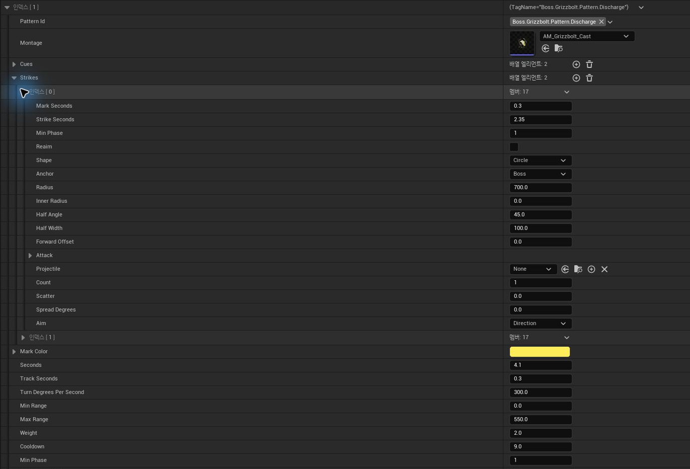

# 10. Boss Encounter Runtime

**기존 몬스터의 전투·피해·포획 기능 위에 보스 전용 FSM과 데이터 기반 패턴 실행기를 구성**했습니다. `UBossFSM`은 거리·쿨타임·가중치로 패턴을 선택하고, 하나의 `PatternClock`에서 타겟 추적, 텔레그래프, 타격, Montage Section 전환을 제어합니다. HP와 Break는 Phase 전환·Down·Resting을 결정합니다.

## 전투 시연

### 패턴 실행 — Discharge

https://github.com/user-attachments/assets/fbee5e3c-767d-4b20-b18a-8dffa4c8cc4c

`Discharge` 패턴의 **타겟 추적 → 텔레그래프 → 타격 → 회복 구간**을 확인할 수 있습니다.

### 경고 범위와 타격

https://github.com/user-attachments/assets/cd81b345-d192-4374-9573-904b561f40bd

공격 형태에 맞는 경고 영역이 먼저 나타나고, `FBossStrike`의 형상·기준 위치에 따라 타격이 실행됩니다.

## 핵심 구현

| 구현 | 역할 |
|---|---|
| **`ABossMonster : ABaseMonster`** | 보스 Actor, 상태 복제, 몽타주·텔레그래프·타격 |
| **`UBossFSM : UBaseAiFSM`** | Wake·Fighting·Roaring·Down·Resting, 패턴 선택·실행 |
| **`UBossPatternDataAsset : UDataAsset`** | 선택 조건, 타이밍, 공격 형상, Phase·Break·Exhaust 설정 |
| **`FBossPattern / FBossStrike`** | 패턴 단위 시간축, 경고와 실제 타격 정보 |
| **`ABossTelegraph`** | 경고 범위·색상·진행도 표시 및 보스 추종 |
| **`FBossStatus`** | Stage·Phase·Action 시간·Break의 복제 상태 |

## 목차

- [패턴 데이터와 선택 조건](#패턴-데이터와-선택-조건)
- [Encounter FSM과 전투 진입](#encounter-fsm과-전투-진입)
- [Pattern Clock 기반 실행](#pattern-clock-기반-실행)
- [텔레그래프와 실제 타격](#텔레그래프와-실제-타격)
- [타겟 추적·재조준·이동](#타겟-추적재조준이동)
- [Phase 2와 연출](#phase-2와-연출)
- [Break·Down·Resting·포획](#breakdownresting포획)
- [상태 복제와 클라이언트 표현](#상태-복제와-클라이언트-표현)
- [구현 선택과 비용](#구현-선택과-비용)
- [관련 코드 및 문서](#관련-코드-및-문서)

---

## 패턴 데이터와 선택 조건

### FBossPattern — 한 번의 공격 실행 단위

`UBossPatternDataAsset`은 다수의 `FBossPattern`을 보유합니다. 각 패턴은 **선택 조건**과 **실행 구간**을 함께 정의합니다.

~~~cpp
// BossPatternDataAsset.h — 주요 필드 발췌
struct FBossPattern
{
    FGameplayTag PatternId;
    TObjectPtr<UAnimMontage> Montage;
    TArray<FBossSectionCue> Cues;
    TArray<FBossStrike> Strikes;

    float Seconds = 3.f;
    float TrackSeconds = 0.5f;
    float TurnDegreesPerSecond = 300.f;

    float MinRange = 0.f;
    float MaxRange = 1500.f;
    float Weight = 1.f;
    float Cooldown = 0.f;
    int32 MinPhase = 1;

    float RootMotionScale = 1.f;
};
~~~

| 선택 조건 | 실행 설정 |
|---|---|
| `MinRange / MaxRange` | `Montage`, `Cues`, `Strikes` |
| `MinPhase` | `Seconds`, `TrackSeconds` |
| `Weight` | `RootMotionScale`, `LeapStartSeconds / LeapEndSeconds` |
| `Cooldown` | `ChargeEffect / ChargeEndSeconds` |

### ChoosePattern — 조건 필터링 후 가중 랜덤

`UBossFSM::ChoosePattern`은 현재 Phase와 타겟 거리, 패턴별 재사용 가능 시간을 조회합니다.

~~~cpp
// BossFSM.cpp — 후보 선택 조건 발췌
if (Pattern.MinPhase > Phase ||
    Pattern.Weight <= 0.f || !Pattern.Montage)
    continue;

if (Distance < Pattern.MinRange ||
    Distance > Pattern.MaxRange)
    continue;

if (const double* Ready = ReadyAt.Find(Pattern.PatternId);
    Ready && *Ready > Time)
    continue;
~~~

후보가 있으면 **직전 패턴을 제외한 후보를 먼저 구성**합니다. 선택 가능한 대안이 없다면 직전 패턴도 허용하고, 최종 후보를 `Weight`에 비례한 랜덤 선택으로 결정합니다.

~~~mermaid
flowchart TB
    TARGET["PickTarget Arena 안의 가장 가까운 공격 가능 플레이어"] --> FILTER["Phase · Range · Cooldown · Weight 검사"]
    FILTER --> ALTERNATE{"직전 패턴을 제외해도 후보가 있는가?"}
    ALTERNATE -->|"예"| DISTINCT["직전 패턴 제외"]
    ALTERNATE -->|"아니오"| REPEAT["반복 허용"]
    DISTINCT --> ROLL["Weighted Random"]
    REPEAT --> ROLL
    ROLL --> BEGIN["Begin(Pattern) Montage · PatternClock 시작"]
~~~

패턴이 끝나면 `EndPattern`에서 `ReadyAt[PatternId]`를 갱신하고 다음 패턴 선택까지 `GapSecondsMin / GapSecondsMax` 간격을 둡니다. **패턴 후보가 없다면 가까이 이동**합니다.

---

## Encounter FSM과 전투 진입

`ABossMonster`는 `ABaseMonster`를 상속하고 `m_AiFSM`에 `UBossFSM`을 구성합니다. 기존 Health·Damage·포획 소유권 처리를 사용하면서, 보스의 행동 단계만 `EBossStage`로 관리합니다.

~~~mermaid
stateDiagram-v2
    [*] --> Sleeping
    Sleeping --> Waking: WakeRadius 진입 / 피격
    Waking --> Fighting: Wake 완료
    Fighting --> Roaring: Phase 2 조건
    Roaring --> Fighting: Roar 완료
    Fighting --> Down: Break >= 1
    Down --> Fighting: GetUp 종료
    Fighting --> Resting: Exhaust HP 임계값
    Resting --> Fighting: 휴식 시간 종료
    Fighting --> Defeated: 사망
~~~

| 상태 | 실제 처리 |
|---|---|
| `Sleeping` | 플레이어 접근 또는 피격 대기 |
| `Waking` | `WakeMontage`의 Wake Section 재생 |
| `Fighting` | 타겟 선정, 패턴·이동·경고·타격 실행 |
| `Roaring` | Phase 2 진입을 알리는 몽타주·사운드 |
| `Down` | Break 충족으로 쓰러지고 `GetUp` Section으로 복귀 |
| `Resting` | Exhaust 조건 충족·제한 시간 동안 포획 가능 |
| `Defeated` | 전투 종료·패턴 정리 |

`UBossFSM::UpdateState`는 **서버에서 실행**합니다. `WakeRadius` 이내의 플레이어를 발견하면 `Wake`를 실행하고, `Fighting`에서는 `Fight`가 현재 패턴 실행 또는 다음 패턴 선택을 담당합니다.

패턴 사이에는 타겟과 거리 차이를 보고 추적하거나 Hop으로 거리를 조절합니다. 플레이어가 `ArenaRadius` 밖에 있다면 추적 대상에서 제외하고 보스의 생성 위치로 복귀합니다.

---

## Pattern Clock 기반 실행

### Pattern의 시간축을 게임플레이 기준으로 사용

`Begin`은 `PatternClock`, Cue 실행 여부, Strike별 Runtime 상태를 초기화하고 Montage와 상태를 갱신합니다.

~~~cpp
// BossFSM.cpp — 실행부 발췌
PatternClock += DeltaSeconds * Tempo();

if (!Run.bMarked && PatternClock >= Strike.MarkSeconds)
    Mark(Strike, Run, Victim);

if (Run.bMarked && PatternClock >= Strike.StrikeSeconds)
{
    Run.bLanded = true;
    Owner->LandStrike(Strike, Where, Run.Spots, Victim,
                      StrikeCount(Strike));
}
~~~

~~~text
FBossPattern.Seconds
  0 ────── Track ────── Mark ── Cue ── Strike ── Recovery ── End
           │             │       │      │
           회전 추적      경고     Montage  실제 피해/투사체
                         등장    Section
~~~

- `PatternClock`는 `DeltaSeconds × Tempo()`로 증가합니다.
- `FBossSectionCue::Seconds`에서 `JumpToSection`을 실행합니다.
- `FBossStrike::MarkSeconds`에 텔레그래프를 생성하고 `StrikeSeconds`에 타격합니다.
- `LeapStartSeconds / LeapEndSeconds`가 설정되면 해당 구간의 이동을 실행합니다.
- `Pattern.Seconds`에 도달하면 패턴을 종료하고 다음 패턴 대기 구간으로 들어갑니다.

패턴별 Root Motion 강도는 `RootMotionScale`로 조절하고 패턴 종료 시 원래 값으로 복구합니다. **Animation의 Section 배치와 실제 타격 시간을 하나의 데이터 정의에서 조율**하는 구조입니다.

### 몽타주 Section Cue

~~~cpp
// BossPatternDataAsset.h
struct FBossSectionCue
{
    float Seconds = 0.f;
    FName Section;
};
~~~

예를 들어 차징 Montage의 반복 구간에서 정해진 시점에 Release Section으로 이동할 수 있습니다. 공통 Wake/Down Montage는 `Sleep·Wake·Roar`, `Fall·Down·GetUp` Section을 사용하며, 점프·Hop은 `Land` Section을 사용합니다.

---

## 텔레그래프와 실제 타격

### 하나의 Strike가 경고 형상과 타격을 정의

`FBossStrike`는 공격의 경고 시점과 피해 시점, 영역·기준점·투사체를 정의합니다.

~~~cpp
// BossPatternDataAsset.h — 주요 필드 발췌
struct FBossStrike
{
    float MarkSeconds = 0.f;
    float StrikeSeconds = 1.f;
    int32 MinPhase = 1;
    bool bReaim = false;

    EBossAreaShape Shape = EBossAreaShape::Circle;
    EBossAreaAnchor Anchor = EBossAreaAnchor::Boss;
    float Radius = 400.f;
    float InnerRadius = 0.f;
    float HalfAngle = 45.f;
    float HalfWidth = 100.f;

    FAttackData Attack;
    TSubclassOf<ABaseElement> Projectile;
    int32 Count = 1;
    EBossProjectileAim Aim = EBossProjectileAim::Direction;
};
~~~

| `EBossAreaShape` | 경고·영역 피해 |
|---|---|
| `Circle` | 중심에서 `Radius` 안쪽 |
| `Ring` | `InnerRadius ~ Radius`의 띠 |
| `Cone` | 중심에서 `Radius`까지, 전방 `HalfAngle` |
| `Line` | 전방 `Radius` 길이·좌우 `HalfWidth` |
| `None` | 영역 경고/피해 없이 투사체를 발사할 때 사용 |

### Boss 기준과 Target 기준

~~~mermaid
flowchart LR
    STRIKE["FBossStrike Shape · Anchor · MarkSeconds"] --> CHOOSE{"Anchor"}
    CHOOSE -->|"Boss"| FOLLOW["보스 발밑 기준 표시가 Boss Transform 추종"]
    CHOOSE -->|"Target"| FIXED["Mark 시점 타겟 위치 저장 고정된 경고 영역"]
    FOLLOW --> HIT["StrikeSeconds LandStrike"]
    FIXED --> HIT
~~~

- **Boss Anchor:** `ABossTelegraph::FeetTransform`으로 보스 발밑 기준 위치를 만들고 `Follow`를 설정합니다. 표시와 타격은 Strike 실행 시점의 보스 위치를 따릅니다.
- **Target Anchor:** `Mark` 시점의 타겟 발밑 위치와 방향을 `FStrikeRun::Where`에 보관합니다. 이후 플레이어가 이동해도 경고·영역 타격의 기준은 유지됩니다.

타겟 지점 여러 곳에 공격할 때는 `Count`·`Scatter`·`SpreadDegrees`로 지점을 생성해 `FStrikeRun::Spots`에 보관합니다. **경고를 표시한 위치와 실제 공격할 위치를 같은 실행 상태에 기록**합니다.

### 영역 판정과 투사체 실행

`ABossMonster::LandStrike`는 서버에서 두 경로를 실행합니다.

| 형태 | 처리 |
|---|---|
| **영역 타격** | `Spots`가 있으면 각 지점에 영역 구성 → `IsInside`로 대상 발 위치 검사 → `CalcDamage` |
| **투사체** | `Projectile` 생성 → `Aim`에 따라 방향 또는 목표 지점 전달 → `InitElement` |
| **효과** | `FAttackData`의 FireVFX/FireSFX를 영역·발사 지점에서 재생 |

영역 타격에서는 모든 공격 영역을 대상으로 **한 번이라도 범위 안에 들어온 Actor에 한 번만 피해를 계산**합니다. 원형·링·부채꼴·직선에 대한 범위 판정은 `IsInside`가 처리합니다.

투사체 패턴은 `LandStrike`가 직접 영역 피해를 적용하는 대신 `ABaseElement`를 생성합니다. 투사체의 비행과 충돌·피해는 각 Element 클래스가 처리합니다.

### 텔레그래프의 네트워크 표현

`ABossTelegraph`는 `FBossMark`를 **`COND_InitialOnly`로 복제**합니다. Mark에는 형상·시간·색상과 Boss 추종 참조가 들어 있습니다.

~~~text
서버 PlaceMark → FBossMark 초기 데이터 복제
    ↓
클라이언트 OnRep_Mark → 평면 Mesh·Material 구성
    ↓
Tick → Fill 진행도 표시
       → Follow가 있으면 보스 발밑 Transform으로 이동
~~~

`ABossTelegraph`는 `bReplicates=true`지만 `SetReplicatingMovement(false)`를 사용합니다. **매 프레임 텔레그래프 위치를 복제하지 않고**, Boss를 추종하는 표시를 각 머신이 계산합니다.

---

## 타겟 추적·재조준·이동

### 경고 전 추적과 재조준

https://github.com/user-attachments/assets/91dbe45d-4a18-4934-ba9e-d732858faa88

`TrackSeconds`는 패턴 시작 후 보스가 타겟 쪽으로 회전하는 시간입니다. `bReaim`이 켜진 후속 Strike는 앞 Strike가 착지한 뒤, **다음 경고가 생성되기 전까지** 다시 타겟을 향해 회전할 수 있습니다.

~~~text
처음 TrackSeconds 동안 방향 추적
    ↓
첫 Mark → 경고 범위 제시
    ↓
첫 Strike
    ↓ bReaim (후속 Strike 설정)
다시 회전 추적
    ↓
다음 Mark → 방향/위치 확정
    ↓
다음 Strike
~~~

경고가 표시된 이후 타겟을 계속 추적할지, 회피할 수 있도록 공격 방향·위치를 유지할지를 **Pattern과 Strike 설정으로 조정**합니다.

### 전투 사이 이동과 도약

`Fight`는 공격을 실행하지 않는 `GapSecondsMin / GapSecondsMax` 구간에 타겟 거리와 위치를 확인합니다. 너무 가까운 타겟에게서는 뒤로 Hop하고, 중거리에서는 측면 Hop 또는 접근 이동을 선택합니다.

`Leap`가 설정된 패턴은 표시한 타겟 지점 또는 현재 타겟 위치를 착지 지점으로 사용하고, `Launch`에서 비행 시간을 기준으로 이동을 시작합니다. 착지하면 `Land` Section으로 전환합니다.

---

## Phase 2와 연출

https://github.com/user-attachments/assets/00111f16-35b0-451a-af2c-4cdb72f506f5

`UBossFSM::Fight`는 실행 중인 패턴이 없는 시점에 HP가 `PhaseTwoHealth` 이하인지 검사합니다. 조건을 만족하면 `Phase=2`로 갱신하고 `Roaring` 상태·몽타주를 거친 뒤 다음 패턴을 선택합니다.

| Phase 2 변경 | 적용 |
|---|---|
| **Tempo** | `PhaseTwoTempo`로 Montage·PatternClock 속도 증가 |
| **타격 수** | `Projectile` 또는 다중 영역 Strike에 `PhaseTwoExtraCount` 추가 |
| **패턴 선택** | `MinPhase=2` 패턴·Strike가 실행 후보에 포함 |
| **외형** | `RageEffect`·`RageOverlay` 적용 |
| **차징** | `ChargeEffect`의 Color·Size를 시간에 따라 조절 |

`ABossMonster::RefreshLook`은 `FBossStatus`의 Phase와 현재 `ActionId`·`ActionStartServerTime`을 기준으로 Rage Aura와 Charge VFX를 구성합니다. `Tick`에서는 HP 비율과 서버 시간을 사용해 밝기·크기를 갱신합니다.

이렇게 **Phase가 전환되는 시점, 이후 패턴의 실행 속도, 차징/분노 외형**을 같은 상태에 연결합니다.

---

## Break·Down·Resting·포획

### Break 누적과 Down

https://github.com/user-attachments/assets/7553e42f-54d6-4265-a445-17cba43a15d3

`UBossFSM::OnDamaged`는 `Fighting` 중 받은 피해를 기준으로 Break를 누적합니다.

~~~cpp
// BossFSM.cpp — Break 누적
Next.Break = FMath::Min(
    1.f,
    Status.Break + Damage / (MaxHP * Patterns->DownAfterDamage));

if (Next.Break >= 1.f)
    KnockDown();
~~~

`Down`에 진입하면 실행 중인 패턴을 중단하고 `Fall` Section을 재생합니다. `DownSeconds` 종료 직전에는 `GetUp` Section으로 이동하며, 복귀 후 전투를 다시 시작합니다. Break는 Down 진입 시 0으로 초기화합니다.

### Exhaust로 Resting 진입

`ExhaustHealth`는 HP 비율 임계값 배열입니다. `TryExhaust`는 HP가 다음 임계값 이하로 떨어지면 **현재 패턴을 중단하고 Resting으로 전환**합니다.

~~~text
ExhaustHealth = [0.3, 0.1] (DataAsset 기본값)
    ↓
HP가 다음 임계값 이하가 됨
    ↓
TryExhaust → EndPattern(true)
    ↓
Resting · ExhaustMontage
    ↓
ExhaustSeconds 경과 → Fighting
~~~

한 번의 큰 피해로 여러 임계값을 통과했더라도 `ExhaustsTaken`을 진행시켜 **한 번의 Resting만 발생**시킵니다. `Down`과 `Resting`은 각각 다른 조건으로 진입하며, `Resting` 도중에는 Break를 누적하지 않습니다.

| 상태 | 발동 조건 | 게임플레이 결과 |
|---|---|---|
| **Down** | Break가 1에 도달 | 일시적인 공격 기회, 포획 불가 |
| **Resting** | 다음 Exhaust HP 임계값 통과 | 정해진 시간 동안 포획 가능 |

### Resting에서 기존 포획 시스템으로 연결

https://github.com/user-attachments/assets/46026e10-a197-4c98-b244-260dd2fe42d3

~~~cpp
// BossMonster.cpp
bool ABossMonster::CanCapture() const
{
    return Super::CanCapture() && Status.IsVulnerable();
}

// BossMonster.h
bool IsVulnerable() const
{
    return Stage == EBossStage::Resting;
}
~~~

보스는 **포획할 수 있는 상태만 FSM에서 결정**합니다. PalSphere 충돌 이후 포획 확률 판정·Reveal·보유 목록 등록은 공통 Pal 시스템을 사용합니다. 상세 과정은 [[08. Pal Capture & Partner Lifecycle|08_Pal_Capture_Partner_Lifecycle]]에서 설명합니다.

포획 Reveal 동안 보스의 `DeactivateMonster`는 `UBossFSM::Pause`도 호출합니다. 실패 후 다시 활성화할 때는 `Resume`으로 휴식/Down 시간에 포획 연출 동안의 시간을 보정합니다.

---

## 상태 복제와 클라이언트 표현

`UBossFSM`이 결정한 현재 상태는 `ABossMonster::FBossStatus`에 저장됩니다.

~~~cpp
// BossMonster.h — 실제 복제 상태
struct FBossStatus
{
    EBossStage Stage = EBossStage::Sleeping;
    int32 Phase = 1;
    FGameplayTag ActionId;
    double ActionStartServerTime = 0;
    double ActionEndServerTime = 0;
    float Break = 0.f;
};
~~~

`ABossMonster::SetStatus`는 상태 변경 시 `ForceNetUpdate`와 `OnBossStatusChanged`를 실행합니다. 클라이언트 `OnRep_Status`도 같은 Delegate와 `RefreshLook`을 호출합니다.

~~~mermaid
flowchart LR
    FSM["서버 UBossFSM"] --> STATUS["ABossMonster::Status DOREPLIFETIME"]
    STATUS --> VFX["OnRep_Status Charge · Rage 외형"]
    STATUS --> DUNGEON["UDungeonStageRuntimeSubsystem Boss Status Delegate"]
    DUNGEON --> SNAPSHOT["GameState DungeonStageState"]
    SNAPSHOT --> HUD["Boss HUD Phase · Break · Action"]
    FSM --> ANIM["Montage / Section NetMulticast"]
~~~

`UDungeonStageRuntimeSubsystem::HandleBossStatus`는 `Phase`·`ActionId`·Action 시간·Break·`IsVulnerable()` 값을 던전 Snapshot에 반영합니다. HUD는 이 Snapshot을 표시 데이터로 변환합니다.

**현재 상태와 순간 연출을 별도 경로로 전송**합니다. Stage·Phase·Action 시간은 복제된 `FBossStatus`를 사용하고, Montage 시작·Section 이동·중단은 `NetMulticast`로 재생합니다. 보스가 늦게 relevant해진 클라이언트의 애니메이션 동기화와 관련성 문제는 [[12. Multiplayer Synchronization|12_Multiplayer_Synchronization]]에서 다룹니다.

---

## 구현 선택과 비용

| 설계 | 구현에서 얻은 효과 | 관리 요소 |
|---|---|---|
| **Monster 상속 + 전용 Boss FSM** | 기존 피격·포획과 별개로 Encounter 단계 구성 | FSM 상태와 Monster 수명 연결 |
| **Pattern DataAsset** | 패턴 후보·타이밍·형상을 콘텐츠 설정으로 조정 | 선택 조건·타임라인·Montage Section 정합성 |
| **PatternClock / Section Cue** | 추적·경고·타격을 정해진 시점에 실행 | Animation과 게임플레이 시간축 조율 |
| **Strike/Telegraph 형상 공유** | 경고 영역과 서버 영역 타격의 형상 기준 공유 | Anchor·다중 지점·투사체 Aim 설정 |
| **InitialOnly Mark 복제** | 텔레그래프 표시를 각 머신에서 갱신 | Actor Follow 참조·클라이언트 표시 타이밍 |
| **Down / Resting 분리** | 공격 기회와 포획 가능 상태 구분 | 피해·HP 임계값·복귀 타이머 |
| **FBossStatus + 던전 Snapshot** | 보스의 현재 행동·Break를 여러 화면에 전달 | 상태 복제와 몽타주 연출의 시점 관리 |

## 관련 코드 및 문서

- [BossPatternDataAsset.h](https://github.com/chungheonLee0325/Sonheim/blob/feat-ui-dex/Sonheim/Source/Sonheim/AreaObject/Monster/Boss/BossPatternDataAsset.h) — 패턴·Strike·Phase·Exhaust 설정
- [BossPatternDataAsset.cpp](https://github.com/chungheonLee0325/Sonheim/blob/feat-ui-dex/Sonheim/Source/Sonheim/AreaObject/Monster/Boss/BossPatternDataAsset.cpp) — Pattern 설정 검증
- [BossFSM.cpp](https://github.com/chungheonLee0325/Sonheim/blob/feat-ui-dex/Sonheim/Source/Sonheim/AreaObject/Monster/Boss/BossFSM.cpp) — 패턴 선택·시간축·상태 전환
- [BossMonster.cpp](https://github.com/chungheonLee0325/Sonheim/blob/feat-ui-dex/Sonheim/Source/Sonheim/AreaObject/Monster/Boss/BossMonster.cpp) — 몽타주·타격·상태·효과
- [BossTelegraph.cpp](https://github.com/chungheonLee0325/Sonheim/blob/feat-ui-dex/Sonheim/Source/Sonheim/AreaObject/Monster/Boss/BossTelegraph.cpp) — 텔레그래프 구성·복제·Follow
- [[05. Combat, Skill & Animation|05_Combat_Skill_Animation]] — `FAttackData` 기반 피해 경로
- [[08. Pal Capture & Partner Lifecycle|08_Pal_Capture_Partner_Lifecycle]] — 보스 포획의 공통 Pal 시스템
- [[09. Branching Dungeon Runtime|09_Branching_Dungeon_Runtime]] — Boss 그룹·던전 진행
- [[11. UI Architecture & Client Presentation|11_Client_State_Presentation_Pipeline]] — Boss HUD 데이터 구성
- [[12. Multiplayer Synchronization|12_Multiplayer_Synchronization]] — 상태 복제와 연출 RPC
- [[13. Content Authoring & Validation|13_Content_Authoring_Validation]] — 패턴·타격 타이밍 검증
