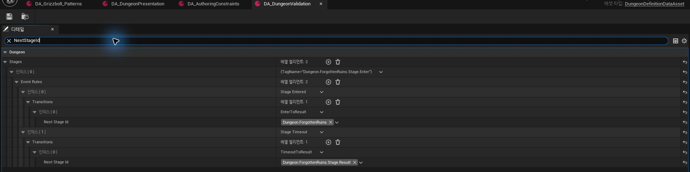
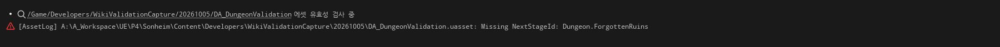
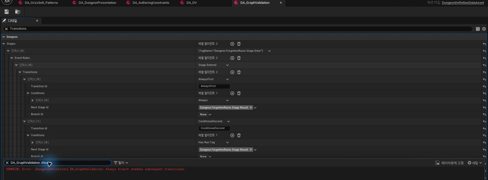
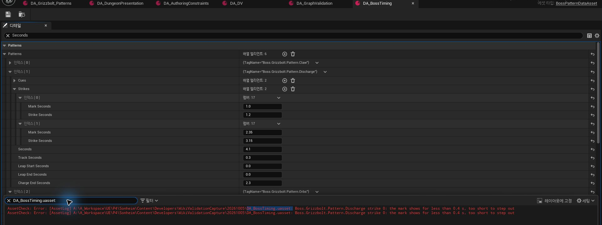
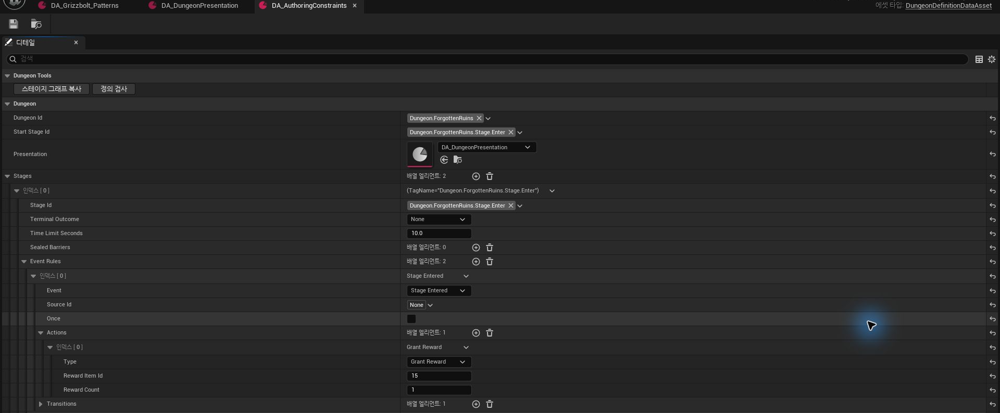
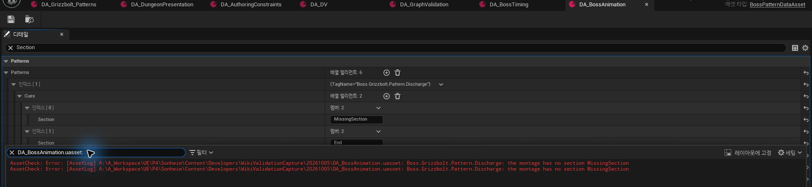

# 13. Content Authoring & Validation

**던전 분기와 보스 패턴을 DataAsset에서 작성하고, 실행할 수 없는 설정을 에디터 단계에서 검출**하도록 구성했습니다. 필드별 입력 제약에 더해 **Stage Graph의 도달 가능성·전환 순서·이벤트 생산 경로**, **보스의 경고 시간·타격 형상·Montage Section**을 검사합니다.

## 에디터 검증 사례

### 잘못된 Stage 참조

`NextStageId`를 동일 Dungeon의 루트 Tag인 `Dungeon.ForgottenRuins`로 설정한 사례입니다. **Tag 선택 자체는 가능하지만 실제 `Stages` 목록에 없는 대상**이므로 `ValidateDefinition()`에서 `Missing NextStageId` 오류가 발생합니다.

### 전환 순서 오류

먼저 평가하는 Transition이 `Always`면 뒤에 있는 `HasRunTag` 분기는 선택될 수 없습니다. 데이터 검사에서 **`Always branch shadows subsequent transitions.`**를 반환합니다.

### 보스 경고 시간 오류

영역 경고를 사용하는 Strike에 `MarkSeconds=1.0`, `StrikeSeconds=1.2`를 넣으면 경고 시간이 0.2초입니다. `UBossPatternDataAsset::Validate()`는 최소 0.4초 조건을 검사해 오류로 반환합니다.

| 검증 단계 | 구현 위치 | 핵심 검사 |
|---|---|---|
| **필드 입력** | `UPROPERTY` metadata | Type별 필드 표시·숫자 범위·GameplayTag 선택 범위 |
| **던전 구조** | `UDungeonDefinitionDataAsset::ValidateDefinition` | Stage 참조·분기 순서·순환·도달 가능성·Group 생산 경로 |
| **에디터 데이터 검증** | `IsDataValid` | 구조 검사 결과 전달 + SpawnRule 의존성 검사 |
| **던전 실행 전 로드** | `UDungeonAssetSubsystem` | Definition 구조와 실제 Presentation·SpawnRule·MonsterClass 로드 확인 |
| **보스 패턴** | `UBossPatternDataAsset::Validate` | Strike 타이밍·공격 형상·Montage Section·특수 행동 조건 |

## 목차

- [필드 작성 단계의 입력 제약](#필드-작성-단계의-입력-제약)
- [던전 구조 검증을 공유하는 경로](#던전-구조-검증을-공유하는-경로)
- [Stage Graph 검증](#stage-graph-검증)
- [이벤트 생산·사용 관계 검사](#이벤트-생산사용-관계-검사)
- [시간 제한·보상 등급 검증](#시간-제한보상-등급-검증)
- [Definition에서 Stage Graph 생성](#definition에서-stage-graph-생성)
- [보스 패턴 데이터 검증](#보스-패턴-데이터-검증)
- [구현 선택과 비용](#구현-선택과-비용)
- [관련 코드 및 문서](#관련-코드-및-문서)

---

## 필드 작성 단계의 입력 제약

### Action 유형에 따라 편집 필드 노출

`FDungeonStageAction`은 `EDungeonStageAction` 값에 따라 필요한 설정을 다르게 노출합니다.

~~~cpp
// DungeonStageDefinition.h — 필드 발췌
UPROPERTY(EditAnywhere, BlueprintReadOnly,
    meta=(EditCondition="Type == EDungeonStageAction::SpawnGroup",
          EditConditionHides, Categories="Dungeon"))
FGameplayTag GroupId;

UPROPERTY(EditAnywhere, BlueprintReadOnly,
    meta=(EditCondition="Type == EDungeonStageAction::SpawnGroup",
          EditConditionHides))
TSoftObjectPtr<UDungeonSpawnRuleDataAsset> SpawnRule;

UPROPERTY(EditAnywhere, BlueprintReadOnly,
    meta=(EditCondition="Type == EDungeonStageAction::GrantReward",
          EditConditionHides, ClampMin="1"))
int32 RewardItemId = 0;
~~~

| Metadata | 적용 예 |
|---|---|
| `EditCondition / EditConditionHides` | `SpawnGroup`에는 Group/SpawnRule, `GrantReward`에는 Reward 입력 |
| `TitleProperty` | Stage·Rule·Action 배열에서 식별 필드 표시 |
| `ClampMin / ClampMax` | Reward 수량·시간·보스 Phase 등의 입력 범위 |
| `Categories="Dungeon"` | Dungeon 관련 GameplayTag 선택 범위 제한 |

이 제약으로 **필드 입력을 편리하게 만들고**, 여러 필드 간의 실행 조건은 `ValidateDefinition`에서 검사합니다.

### Dungeon별 Tag 범위 검사

~~~text
Dungeon.ForgottenRuins
 ├─ Stage.*
 ├─ Group.*
 ├─ Branch.*
 ├─ Zone.*
 ├─ Switch.*
 └─ Barrier.*
~~~

각 Stage·Event Source·Branch·RunTag·Group·Barrier가 **해당 DungeonId와 같거나 그 하위 Tag**인지 `MatchesTag(DungeonId)`로 확인합니다.

Tag가 같은 Dungeon 아래에 있더라도 **참조 대상으로 유효한지는 별도로 검사**합니다. 예를 들어 `NextStageId`는 실제 `Stages` 배열에 존재해야 하고, `SpawnGroupCompleted(GroupId)`에는 해당 그룹을 생성하는 Action이 필요합니다.

---

## 던전 구조 검증을 공유하는 경로

`UDungeonDefinitionDataAsset`은 핵심 구조 검사를 `ValidateDefinition()`에 모았습니다.

~~~cpp
// DungeonDefinitionDataAsset.h — 검증 진입점
bool ValidateDefinition(
    TArray<FString>& Errors,
    TArray<FString>& Warnings) const;

#if WITH_EDITOR
virtual EDataValidationResult IsDataValid(
    FDataValidationContext& Context) const override;

UFUNCTION(BlueprintCallable, CallInEditor,
    Category="Dungeon Tools",
    meta=(DisplayName="정의 검사"))
void ValidateNow();
#endif
~~~

~~~mermaid
flowchart TB
    DATA["UDungeonDefinitionDataAsset"] --> CORE["ValidateDefinition 구조·그래프 검사"]
    CORE --> BUTTON["에디터 정의 검사 ValidateNow"]
    CORE --> EDITOR["Unreal Data Validation IsDataValid"]
    CORE --> RUNTIME["실행 전 에셋 로드 DungeonAssetSubsystem"]
    EDITOR --> SOFT["SpawnRule 로드·Count·MonsterClass 참조 확인"]
    RUNTIME --> LOADED["Presentation·SpawnRule·MonsterClass 실제 로드 결과 확인"]
    CORE --> GRAPH["BuildStageGraph Mermaid 생성"]
~~~

### 1. 에디터 버튼 — 즉시 구조 검사

`ValidateNow()`는 `ValidateDefinition`의 Error·Warning 목록을 Output Log에 기록하고, **오류·경고 개수를 에디터 알림으로 표시**합니다.

### 2. Unreal Data Validation — 구조 + 에셋 의존성

`IsDataValid()`은 동일한 구조 검사를 수행하고, SpawnGroup Action의 Soft Reference로 연결된 `SpawnRule`을 로드합니다. **SpawnRule 존재·Count 1~16·MonsterClass 참조 설정 여부**를 확인해 `FDataValidationContext`에 오류를 추가합니다.

### 3. 실행 전 로드 — 실제 사용 가능한 참조 확인

`UDungeonAssetSubsystem::OnReferencesLoaded`는 `ValidateDefinition`과 Presentation 참조를 확인한 뒤, 게임플레이 로드 요청에서는 `SpawnRule`·`MonsterClass`의 실제 로드 성공까지 검사합니다.

**에디터의 구조 검사와 실행 시 에셋 로드 검사가 동일한 기본 규칙을 사용**하고, 실행 경로에서는 필요한 객체가 실제로 준비됐는지도 확인합니다.

---

## Stage Graph 검증

### Stage·Transition 참조와 실행 순서

`ValidateDefinition`은 다음을 검사합니다.

| 대상 | 검증 규칙 |
|---|---|
| **Definition** | `DungeonId`, `StartStageId`, Presentation 필수 |
| **Stage** | `StageId` 누락·중복, 종료 Stage의 EventRule 금지 |
| **Action** | SpawnGroup 필수 필드, Reward ID·수량, EmitEvent 종류 |
| **EventRule** | Stage별 동일 Event/SourceId 중복, 이벤트 유형에 맞는 SourceId |
| **Transition** | `TransitionId` 누락·중복, `NextStageId` 존재, Condition 필수 |
| **분기 순서** | 조건 없이 항상 참인 `Always` Transition 뒤에 다른 Transition 금지 |

`TransitionId`는 Definition 전체에서 중복을 검사합니다. `ProcessQueue`는 Event/SourceId와 일치하는 Rule의 Transition 배열을 **앞에서부터 평가해 첫 번째로 만족한 경로로 전환**하므로, 순서가 곧 게임플레이 동작입니다.

~~~text
WaveCompleted(Group.WaveA)
  ├─ HasRunTag(ShortcutUnlocked) → Stage.Shortcut
  └─ Always                    → Stage.ExtraWave

Always를 첫 번째로 배치하면
  → 뒤의 HasRunTag는 평가 기회를 얻지 못함
  → Validation Error
~~~

### 순환과 도달 가능성

Transition의 `NextStageId`를 그래프 Edge로 구성해 재귀 탐색합니다.

~~~mermaid
flowchart LR
    START["StartStageId"] --> DFS["DFS Visiting / Visited"]
    DFS --> CYCLE["현재 탐색 경로 재진입 Cycle Error"]
    DFS --> REACH["Start에서 도달할 수 없는 Stage Warning"]
    REACH --> OTHER["분리된 Stage에서도 Cycle 검사"]
~~~

- **순환:** 자기 자신 또는 탐색 중인 Stage로 다시 돌아오는 전환은 Error
- **도달 불가능:** StartStage에서 접근할 수 없는 Stage는 Warning
- **분리된 그래프:** Start에서 연결되지 않은 Stage의 순환도 추가 탐색으로 Error 처리

이 검사는 Stage 참조가 유효하더라도 **결과로 도달하지 못하거나 무한 순환할 수 있는 콘텐츠**를 작성 단계에서 찾아냅니다.

---

## 이벤트 생산·사용 관계 검사

### SpawnGroup이 먼저 존재할 수 있는지 확인

`SpawnGroup(GroupId)`은 목표 그룹을 만드는 **Producer**이고, `WaveCompleted / BossDefeated / MonsterCaptured` 또는 `SpawnGroupCompleted(GroupId)`는 해당 그룹 상태를 읽는 **Consumer**입니다.

~~~text
Stage.Enter
   → SpawnGroup(Group.WaveA)       Producer
   ↓
Stage.Combat
   → WaveCompleted(Group.WaveA)   Consumer

Producer가 없는 Group ID
   → No producer for condition group
   또는 no preceding spawn path
~~~

`ValidateDefinition`은 SpawnGroup Action으로 `ProducersByGroup`을 만들고, Stage 간 Edge를 탐색해 **Producer Stage에서 Consumer Stage로 도달 가능한 경로가 있는지** 검사합니다. `WaveCompleted`와 `BossDefeated`는 Boss Group 여부도 구별합니다.

이 검사는 **Stage Graph상 선행 Spawn 경로가 존재할 수 있는지** 확인하는 방식입니다. 같은 Stage 안에 여러 Action·Event가 있는 경우의 모든 실행 순서를 시뮬레이션하는 검사는 아닙니다.

### Event SourceId와 실행 주체

| Event | SourceId 검증 |
|---|---|
| `StageEntered / StageTimeout` | Stage 자체에서 발생하므로 SourceId가 있으면 오류 |
| `ActorInteracted / AreaEntered / MonsterCaptured` | Actor·Zone·Group의 SourceId가 없으면 오류 |
| `WaveCompleted / BossDefeated` | 그룹 Producer 경로 및 Boss Group 유형 검사 |
| `EmitEvent` | `StageEntered`만 허용, 동일 Event/Source로 즉시 자기 호출 시 오류 |

액션에서 임의의 `MonsterCaptured`나 `ActorInteracted` 이벤트를 생성하지 않고, **몬스터·월드 상호작용에서 발생한 이벤트를 던전 Runtime이 전달받도록** 구성했습니다.

---

## 시간 제한·보상 등급 검증

### Stage Timer와 이벤트 규칙

`FDungeonStageDefinition::TimeLimitSeconds`와 `StageTimeout` EventRule은 쌍으로 검사합니다.

| 설정 | 결과 |
|---|---|
| TimeLimit > 0 + StageTimeout 없음 | Error |
| TimeLimit = 0 + StageTimeout 있음 | Error |
| TimeLimit > 0 + StageTimeout 있음 | 유효한 조합 |
| TimeLimit = 0 + StageTimeout 없음 | 제한 시간이 없는 Stage |

Stage 진입 시 서버 Timer가 `StageTimeout` 이벤트를 발생시키므로, 이 이벤트를 처리할 Rule이 없으면 제한 시간 설정이 게임플레이에 반영되지 않습니다.

### 클리어 등급의 Fallback

`GradeFor(ClearSeconds, OptionalObjectivesDone)`는 `GradeRules`를 앞에서부터 검사해 첫 번째 일치하는 등급을 반환합니다. 마지막 Rule에는 다음 값을 요구합니다.

~~~text
MaxClearSeconds = 0
RequiredOptionalObjectives = 0
~~~

성공한 Run이 앞의 우수 등급 조건을 만족하지 않아도 **마지막 등급에 포함될 수 있도록** 하는 Fallback입니다. 마지막 Rule이 이 조건을 만족하지 않으면 검사에서 오류로 처리합니다.

---

## Definition에서 Stage Graph 생성

`UDungeonDefinitionDataAsset::BuildStageGraph()`는 작성한 데이터의 `StageId`, `EventRule`, `Action`, `Condition`, `Transition`을 읽어 **Mermaid 텍스트를 생성**합니다.

~~~cpp
// DungeonDefinitionDataAsset.h
UFUNCTION(BlueprintCallable, Category="Dungeon Tools")
FString BuildStageGraph() const;
~~~

생성 그래프에는 Stage 전환 경로와 Branch가 표시되고, 제한 시간·장벽·Action은 주석으로 기록됩니다. 마지막에는 `ValidateDefinition`의 오류·경고 개수도 붙습니다.

~~~text
Dungeon Definition
    → BuildStageGraph()
    → Mermaid 텍스트
    → Editor "스테이지 그래프 복사"
    → 검토 문서·PR·Wiki
~~~

[Forgotten Ruins — 실제 생성된 Stage Graph 원본](../Media/Wiki/09_Branching_Dungeon_Runtime/09_dungeon_stage_graph.mmd)

스테이지별 진행 흐름과 지름길/추가 웨이브 시연은 [[09. Branching Dungeon Runtime|09_Branching_Dungeon_Runtime]]에서 확인할 수 있습니다.

---

## 보스 패턴 데이터 검증

`UBossPatternDataAsset`은 `UDataAsset` 기반이며, `Validate()`로 패턴별 오류 목록을 만듭니다. `IsDataValid()`은 이를 Unreal Data Validation의 Error로 전달합니다.

### 1. Strike 경고 시간과 형상

~~~cpp
// BossPatternDataAsset.cpp — 영역 Telegraph 경고 시간 검사
if (Strike.StrikeSeconds - Strike.MarkSeconds <
    UBossPatternDataAsset::MinWarningSeconds)
    Problems.Add(FString::Printf(
        TEXT("%s: the mark shows for less than %.1f s, too short to step out"),
        *At, UBossPatternDataAsset::MinWarningSeconds));
~~~

`ValidateStrike`는 이 코드에 도달하기 전에 `Shape == EBossAreaShape::None`인 순수 투사체를 별도로 검사하고 반환합니다.

| 검사 대상 | 조건 |
|---|---|
| **시간 순서** | `0 ≤ MarkSeconds ≤ StrikeSeconds ≤ Pattern.Seconds` |
| **영역 경고** | `Shape != None`일 때 최소 `0.4초` |
| **범위** | `Radius > 0`, Ring 안쪽 반경, Cone 각도, Line 너비 |
| **다중 영역** | 투사체가 아닌 Area Count > 1이면 Target Anchor 필요 |
| **투사체** | `Shape=None`은 투사체에만 허용, Location Aim은 경고 형상 필요 |

`None` 형상인 순수 투사체는 Area Telegraph의 최소 경고 시간 조건을 적용받지 않습니다. Strike의 기본 시간 순서 검사는 그대로 수행합니다.

### 2. Montage Section과 특수 행동

| 검증 대상 | 조건 |
|---|---|
| **Pattern** | 고유 PatternId, Montage 존재, Range Min < Max, Strike 하나 이상 |
| **Cue** | 지정한 Montage에 Section 존재, Pattern 실행 시간 안의 Cue |
| **Wake/Down** | `Sleep/Wake/Roar`, `Fall/Down/GetUp` Section 존재 |
| **Leap / Hop** | Leap 시간·높이와 `Land` Section, Hop 거리 |
| **Charge** | Effect·Socket·Release 시간이 함께 설정됐는지 |
| **Exhaust / GetUp** | HP 임계값 내림차순, Exhaust 시간, GetUp 시간이 Down보다 짧은지 |
| **bReaim** | 이전 Strike가 없는 첫 Strike에서는 사용 금지 |

`FBossPattern::Cues`의 Section은 실제 Montage의 `GetSectionIndex`로 확인합니다. 위 캡처는 존재하지 않는 `MissingSection`을 입력한 뒤 오류로 검출한 사례입니다.

**패턴 선택이나 타격 자체를 여기서 실행하는 것은 아닙니다.** 잘못된 데이터 조합을 에디터에서 먼저 찾고, 실제 패턴 실행은 [[10. Boss Encounter Runtime|10_Boss_Encounter_Runtime]]에서 담당합니다.

---

## 구현 선택과 비용

| 선택 | 효과 | 함께 관리할 사항 |
|---|---|---|
| **EditCondition·Tag Filter·Clamp** | 필드 수준의 입력 실수를 줄임 | 필드 사이의 관계는 별도 검증 필요 |
| **공유 Dungeon 구조 검사** | 에디터와 실행 전 로드의 규칙 일치 | DataAsset 필드 추가 시 검사 동기화 |
| **그래프 검증** | 도달 불가능·순환·Shadowed Transition 발견 | Graph 경로 검사와 실제 Event 순서는 별개 |
| **Producer/Consumer 검사** | Spawn 없는 Group 참조와 유형 불일치 발견 | 복잡한 모든 분기 조합의 실행 증명은 아님 |
| **Stage Graph 자동 생성** | Definition 변경 내용을 Mermaid 문서에 반영 | Data 변경 후 그래프 재생성 필요 |
| **Boss 타이밍·Montage 검사** | 표시 경고·실행 타이밍·Animation Section 오류 검출 | 패턴 타입 추가 시 유효성 규칙 확장 |

## 관련 코드 및 문서

- [DungeonStageDefinition.h](https://github.com/chungheonLee0325/Sonheim/blob/feat-ui-dex/Sonheim/Source/Sonheim/GameObject/Dungeon/DungeonStageDefinition.h) — `EditCondition`·Event·Action·Transition 필드
- [DungeonDefinitionDataAsset.cpp](https://github.com/chungheonLee0325/Sonheim/blob/feat-ui-dex/Sonheim/Source/Sonheim/GameObject/Dungeon/DungeonDefinitionDataAsset.cpp) — 구조·그래프 검증, `BuildStageGraph`, Editor 진입점
- [DungeonAssetSubsystem.cpp](https://github.com/chungheonLee0325/Sonheim/blob/feat-ui-dex/Sonheim/Source/Sonheim/GameManager/Dungeon/DungeonAssetSubsystem.cpp) — 실제 Definition/SpawnRule/MonsterClass 로드 검증
- [BossPatternDataAsset.cpp](https://github.com/chungheonLee0325/Sonheim/blob/feat-ui-dex/Sonheim/Source/Sonheim/AreaObject/Monster/Boss/BossPatternDataAsset.cpp) — Strike·Montage·특수 행동 검증
- [BossPatternDataAsset.h](https://github.com/chungheonLee0325/Sonheim/blob/feat-ui-dex/Sonheim/Source/Sonheim/AreaObject/Monster/Boss/BossPatternDataAsset.h) — Pattern·Strike 데이터 선언
- [[03. Data & Content Architecture|03_Data_Content_Architecture]] — DT/DA/PDA·GameplayTag 구성
- [[09. Branching Dungeon Runtime|09_Branching_Dungeon_Runtime]] — 분기 Event Queue·Runtime 실행
- [[10. Boss Encounter Runtime|10_Boss_Encounter_Runtime]] — 보스 패턴 Clock·타격 실행
- [[14. Unreal Editor Automation & Verification|14_Unreal_Editor_Automation_Verification]] — 에디터 작업·실행 검증
