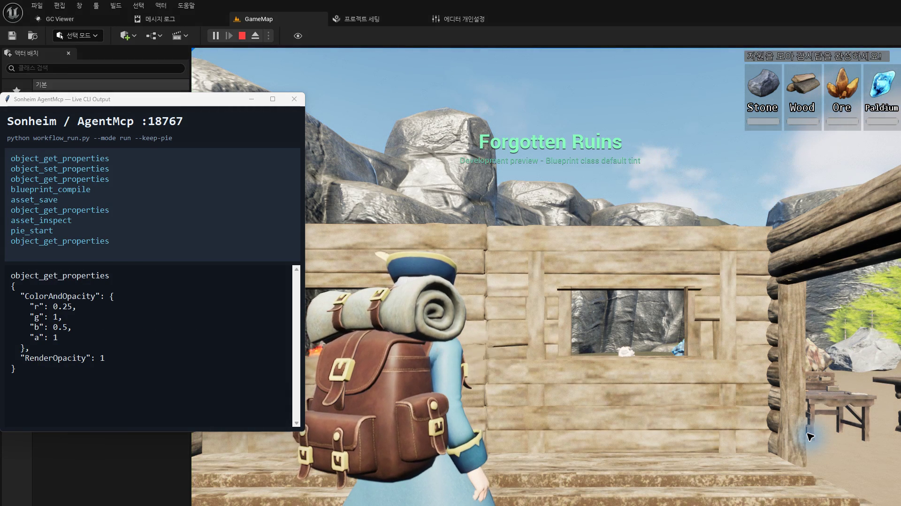

# 14. Unreal Editor Automation — AgentMcp

[AgentMcp](https://github.com/chungheonLee0325/AgentMcp)는 Unreal Editor의 Widget Blueprint·DataAsset·Animation 에셋을 **조회·편집·검증**하기 위해 UE 5.5·5.7에서 사용 중인 별도 MCP 플러그인입니다. Sonheim의 UI 개편과 에셋 작업에서는 C++ 소스 수정만으로 알 수 없는 **실제 Widget Tree·Class Default·실행 화면**을 확인하는 데 사용했습니다.

## 에디터 작업 영상

https://github.com/user-attachments/assets/e61d53e3-c94b-4062-99dc-be11dd261ea5

변경 명령이 성공했다고 에셋이 올바르게 동작하는 것은 아닙니다. 에디터 값의 **재조회**, Blueprint 컴파일, PIE에서의 실제 동작을 서로 구분해 확인하도록 했습니다.

## Sonheim의 Widget Blueprint 작업

UI를 개편할 때 가장 먼저 확인한 것은 C++ Widget의 `BindWidget` 선언과 Widget Blueprint의 **이름·타입 일치 여부**입니다.

~~~text
C++ UUserWidget의 BindWidget
     ↓ 이름 · Widget 클래스
AgentMcp umg_inspect
     ↓ Widget Tree / Named Slot 조회
umg_add_widgets · umg_set_widget_properties
     ↓ 실제 Widget과 Slot 수정
umg_inspect → blueprint_compile → asset_save
     ↓
PIE · viewport_capture
~~~

예를 들어 `WBP_MonsterDex`의 `PageGrid`, `WBP_MonsterDexTier`의 `RewardBox`·`ClaimButton`은 C++에서 참조하므로, 레이아웃을 바꾸면서 이 이름과 타입은 유지했습니다. 목록·상세·보상 UI의 실제 배치와 갱신 처리는 [18. UMG v2](18_UMG_v2_Migration.md)에서 확인할 수 있습니다.

AgentMcp는 에디터 조작 수단을 제공하고, 보상 계산이나 퀘스트 목표 판정 등 게임플레이 로직은 Sonheim의 기존 C++가 담당합니다.

## Inspect → Edit → Read-back → PIE

에디터에서 변경 가능한 값에는 **Class Default**, Widget Tree·Slot, DataTable Row, StringTable 항목 등이 있습니다. 적용 대상에 따라 Tool은 달라도 변경 후 값을 다시 읽는 순서는 같습니다.

| 단계 | 대표 Tool | 확인하는 내용 |
|---|---|---|
| 1. 대상 파악 | `editor_get_state` · `blueprint_inspect` · `umg_inspect` | 현재 에셋·부모 클래스·Widget Tree |
| 2. 기존 값 확인 | `object_get_properties` | 변경 대상의 현재 값 |
| 3. 편집 | `object_set_properties` · `umg_set_widget_properties` | 대상 프로퍼티 또는 Widget Slot 변경 |
| 4. 재조회 | `object_get_properties` · `umg_inspect` | 실제 반영된 값과 트리 |
| 5. Compile / Save | `blueprint_compile` · `asset_save` | 컴파일·저장 결과 |
| 6. PIE | `pie_start` · `log_get_recent` · `viewport_capture` | 실행 인스턴스·오류·화면 |

~~~mermaid
flowchart LR
    A["Inspect"] --> B["Edit"]
    B --> C["Read-back"]
    C --> D["Compile · Save"]
    D --> E["PIE · Log · Capture"]
    E -->|"수정 필요"| A
~~~

Class Default의 변경은 에디터에 저장된 값과 런타임 인스턴스의 값이 같아야 하고, UMG의 변경은 컴파일에 성공해도 **화면 배치와 이벤트 연결을 PIE에서 추가 확인**해야 합니다. 모든 에셋 수정은 실행 전에 완료하고, PIE 중에는 실행 상태를 조회하는 쪽으로 작업을 구분했습니다.

## 에셋 종류별 작업

| 에셋 | 사용한 기능 | 재확인 대상 |
|---|---|---|
| Widget Blueprint | `umg_inspect`, 위젯·Slot 수정 | Widget Tree·`BindWidget`·레이아웃 |
| Blueprint / DataAsset | `object_get_properties`, `object_set_properties` | Class Default·DataAsset 설정 |
| DataTable | `datatable_get_schema`, `datatable_get_rows / set_rows` | Row 필드와 값 |
| StringTable | `stringtable_get_entries / set_entries` | UI 텍스트 Key·원문 |
| Animation | `anim_build_blend_space`, `anim_build_montage` 등 | Montage Section·Blend 설정 |

Tool이 **에셋을 설정할 수 있다는 것**과 해당 콘텐츠가 유효하다는 것은 다릅니다. 던전 Stage 연결과 보스 패턴의 타이밍·Montage 검사는 Sonheim의 `ValidateDefinition()`·`UBossPatternDataAsset::Validate()`가 담당합니다. 에디터 자동화와 콘텐츠 검증을 동일한 것으로 표현하지 않았습니다.

## AgentMcp 별도 테스트베드 — Dungeon UI

AgentMcp 저장소에서는 Sonheim과 **별개인 UE 5.5 테스트베드**로 Dungeon HUD와 Result 화면을 제작했습니다. 다음 작업을 비교·검토하는 용도였습니다.

- Widget Tree를 생성한 뒤 Blueprint 컴파일과 PIE 화면 확인
- 보상 슬롯·목표 행·통계 타일의 반복 구조를 공통 Widget으로 분리
- C++ `BindWidget` 계약 유지, DataTable·Theme DataAsset·`DynamicEntryBox` 적용
- 변경된 Theme 데이터를 다시 조회하고 캡처 화면에 반영됐는지 확인

처음에는 Tool의 UMG 조회 응답이 필요한 필드보다 커져, 요청한 속성을 중심으로 반환하도록 수정했습니다. 이 사례는 **AgentMcp 도구의 제작·검증 기록**이며 Sonheim 자체 게임플레이 테스트로 해석하지 않습니다.

[AgentMcp — Dungeon UI 제작·개선 사례](https://github.com/chungheonLee0325/AgentMcp/blob/main/Docs/Samples/DungeonUi.ko.md)

## Tool 정책과 프로젝트별 Skill

AgentMcp는 에디터 API와 작업 지침을 나눠 제공합니다. `umg_inspect`·`blueprint_compile` 같은 **Tool**은 실제 동작을 수행하고, `skills_list / skills_get`으로 제공되는 **Skill**은 재사용 Widget 제작, `BindWidget` 확인, 결과 캡처 등 작업 순서를 정합니다. 프로젝트의 `AgentMcp/Skills`에 같은 이름의 Skill이 있으면 해당 지침을 우선합니다.

실제 에셋을 변경하는 Tool에는 사용 범위를 제한하는 장치도 두었습니다.

| 구분 | 처리 |
|---|---|
| Write | 입력 검사 후 Transaction 안에서 변경, 실패 시 Rollback |
| Destructive | 영향 범위를 확인하고 `bConfirm=true`가 있어야 실행 |
| PIE 중 에디터 쓰기 | 기본적으로 차단 |
| 저장 | `asset_save`와 `level_save`를 명시적으로 호출 |
| 접근 범위 | `AllowedTools / BlockedTools / BlockedProperties` 설정 |

에셋의 변경값을 재조회하고 Blueprint 컴파일과 PIE 실행으로 확인했습니다. 에디터 수정 명령의 성공과 실제 게임 화면의 동작은 별개로 점검했습니다.

## 관련 자료

- [AgentMcp 저장소 및 Tool 설명](https://github.com/chungheonLee0325/AgentMcp)
- [AgentMcp Dungeon UI 테스트베드](https://github.com/chungheonLee0325/AgentMcp/blob/main/Docs/Samples/DungeonUi.ko.md)
- [13. Content Authoring & Validation](13_Content_Authoring_Validation.md) — 게임 데이터의 실행 조건 검사
- [18. UMG v2](18_UMG_v2_Migration.md) — Sonheim에서의 화면 개편
