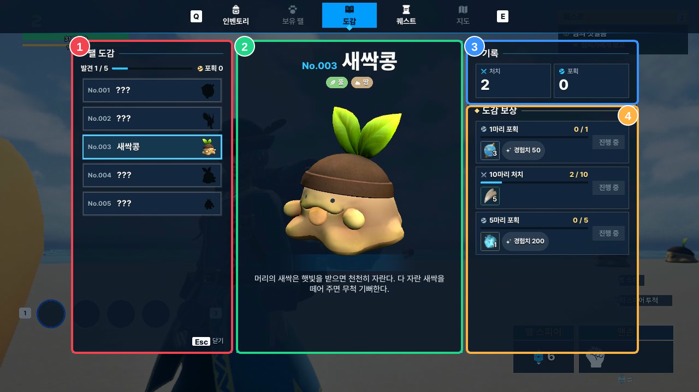

# 16. MonsterDex System

`DT_MonsterDex`의 종별 정의와 플레이어별 `FMonsterDexEntry`를 결합해, **미발견 종의 정보 마스킹·처치/포획 기록·단계별 보상 상태**를 구성합니다. 진행 기록과 보상 지급은 `UMonsterDexComponent`가 서버에서 관리하고, `MonsterDexView::Build`가 화면 표시용 데이터로 변환합니다.

## 실행 화면

*No.003 새싹콩 발견(전체 5종 중 1종), 처치 2회·포획 0회. 세 보상 단계는 모두 진행 중인 실제 화면입니다.*

**① 목록 (빨강)** — 전체 도감 번호를 유지하면서 미발견 종의 이름·초상을 마스킹합니다. 발견·포획 여부와 수령 가능 표시도 여기에서 반영합니다.

**② 상세 (초록)** — 선택한 종의 이름·설명·속성 및 회전 가능한 3D 모델을 보여줍니다.

**③ 기록 (파랑)** — 해당 종의 서버 기록인 처치·포획 횟수를 표시합니다.

**④ 보상 (주황)** — 단계별 목표 수치·진행률·아이템/경험치·수령 상태를 표시합니다.

화면 영역과 C++ 구현 연결 보기

| 영역 | 조회 데이터 | UI |
|---|---|---|
| ① | `UMonsterDexSubsystem::GetPages`, `FMonsterDexEntry` | `UMonsterDexCellWidget` |
| ② | `FMonsterDexPageView`, `AMonsterDexStage` | `UMonsterDexWidget::DrawPicked` |
| ③ | `FMonsterDexEntry::KillCount / CaptureCount` | `UMonsterDexWidget::DrawPicked` |
| ④ | `FMonsterDexRewardTier`, `FMonsterDexTierView` | `UMonsterDexTierWidget` |

## 목차

- [데이터 구성과 소유 관계](#데이터-구성과-소유-관계)
- [미발견 종의 마스킹과 공개](#미발견-종의-마스킹과-공개)
- [보상 단계와 수령 처리](#보상-단계와-수령-처리)
- [처치·포획 이벤트와 UI 갱신](#처치포획-이벤트와-ui-갱신)
- [3D 모델 표현](#3d-모델-표현)
- [관련 코드](#관련-코드)

---

## 데이터 구성과 소유 관계

도감 페이지는 모든 종에 대해 구성하지만, 플레이어가 실제로 기록한 종만 진행 데이터가 존재합니다. **전체 페이지 목록은 정적 Definition, 발견 여부와 누적 수치는 플레이어의 Runtime Record**에서 가져옵니다.

~~~mermaid
flowchart TB
    subgraph DEF["Definition / Local Lookup"]
        DT["DT_MonsterDex FMonsterDexData"]
        AREA["dt_AreaObject FAreaObjectData"]
        BOOK["UMonsterDexSubsystem Pages / FindPage"]
        DT --> BOOK
    end
    subgraph RUN["Server / Player Runtime"]
        PS["ASonheimPlayerState"]
        RECORD["UMonsterDexComponent FMonsterDexList"]
        SAVE["MonsterDexSubsystem Host SaveGame"]
        PS --> RECORD
        RECORD --> SAVE
    end
    subgraph VIEW["Owner Client / Presentation"]
        CLIENT["Replicated FMonsterDexEntry"]
        BUILD["MonsterDexView::Build"]
        PAGE["FMonsterDexBookView Pages / Discovered / Captured"]
        UI["UMonsterDexWidget Cell / Tier / 3D Stage"]
        CLIENT --> BUILD --> PAGE --> UI
    end
    BOOK --> BUILD
    AREA --> BUILD
    RECORD -->|"FastArray · COND_OwnerOnly"| CLIENT
~~~

### Definition: `DT_MonsterDex`

`UMonsterDexSubsystem`은 `DT_MonsterDex`를 로드한 뒤 `FMonsterDexData::Number` 순으로 페이지를 정렬합니다. 한 페이지는 `AreaObjectID`로 몬스터 종과 연결됩니다.

| 필드 | 용도 |
|---|---|
| `AreaObjectID`, `Number` | 종 조회 키, No.001 같은 도감 정렬·표시 번호 |
| `DisplayName`, `Description` | 발견 후 공개할 이름과 설명 |
| `RewardTiers` | 단계별 요구 처치/포획 수, 아이템 및 경험치 |
| `DisplayClass` | 상세 3D 모델·목록 초상 캡처에 사용할 Character Class |

초상 아이콘과 속성은 `FMonsterDexData`에 중복 저장하지 않습니다. `MonsterDexView::Build`가 같은 `AreaObjectID`로 `USonheimGameInstance::GetDataAreaObject`를 조회하여 `FAreaObjectData::AreaObjectIcon`과 `DefenceElementalAttributes`를 읽습니다.

`FMonsterDexData` / `FMonsterDexRewardTier` 코드 보기

~~~cpp
// MonsterDexTypes.h — USTRUCT / UPROPERTY 메타데이터 생략
struct FMonsterDexRewardTier
{
    int32 RequiredKills = 0;
    int32 RequiredCaptures = 0;
    int32 Exp = 0;
    TArray<FItemReward> Items;
};

struct FMonsterDexData : public FTableRowBase
{
    int32 AreaObjectID = 0;
    int32 Number = 0;
    FText DisplayName;
    FText Description;
    TArray<FMonsterDexRewardTier> RewardTiers;
    TSoftClassPtr<ACharacter> DisplayClass;
};
~~~

DataTable 에셋: [`DT_MonsterDex.uasset`](https://github.com/chungheonLee0325/Sonheim/blob/feat-ui-dex/Sonheim/Content/_BluePrint/_DataTable/DT_MonsterDex.uasset)

### Runtime: `FMonsterDexEntry`

`ASonheimPlayerState`는 `UMonsterDexComponent`를 기본 서브오브젝트로 소유합니다. 해당 컴포넌트의 `FMonsterDexList`에는 **발견된 종만** `FMonsterDexEntry`로 기록됩니다.

`FMonsterDexEntry` / `FMonsterDexList` 핵심 필드 보기

~~~cpp
// MonsterDexTypes.h — USTRUCT / UPROPERTY 메타데이터 생략
struct FMonsterDexEntry : public FFastArraySerializerItem
{
    int32 AreaObjectID = 0;
    int32 KillCount = 0;
    int32 CaptureCount = 0;
    int32 ClaimedTiers = 0;
};

struct FMonsterDexList : public FFastArraySerializer
{
    TArray<FMonsterDexEntry> Items;
    TObjectPtr<UMonsterDexComponent> Owner;
};
~~~

`ClaimedTiers`는 단계별 수령 여부를 비트로 기록합니다. `FMonsterDexEntry::Meets`는 보상 정의의 `RequiredKills`와 `RequiredCaptures` 두 조건을 모두 확인합니다.

## 미발견 종의 마스킹과 공개

### 발견 판정은 `Entry` 존재 여부

`MonsterDexView::Build`는 `GetPages()`로 **전체 정의 페이지**를 순회한 뒤 `Dex.FindEntry(Page.AreaObjectID)`를 호출합니다.

| 상태 | 판정 | 목록·상세 처리 |
|---|---|---|
| 미발견 | `Entry == nullptr` | 번호 유지, 이름 `???`, 미발견용 설명, 속성 배지 없음, 목록/3D 모델은 실루엣 |
| 발견 | `Entry != nullptr` | 종 이름·설명·속성 공개, 목록/3D 모델 원래 색상 |
| 포획 기록 있음 | `Entry && CaptureCount > 0` | 발견 화면에 추가로 포획 마크 표시 |

**현재 발견의 기준은 근접 조우가 아니라 첫 처치 또는 첫 포획입니다.** `UMonsterDexComponent::Record`는 해당 종의 첫 `Kill/Capture` 이벤트에서 Entry를 생성하고, 새 종 등록 Headline 알림을 전달합니다.

`MonsterDexView::Build`의 발견·마스킹 분기 보기

~~~cpp
const FMonsterDexEntry* Entry = Dex.FindEntry(Page.AreaObjectID);

View.bDiscovered = Entry != nullptr;
View.bCaptured = Entry && Entry->CaptureCount > 0;
View.Portrait = Species ? Species->AreaObjectIcon : nullptr;
View.DisplayClass = Page.DisplayClass;

if (View.bDiscovered)
{
    View.Name = Page.DisplayName;
    View.Description = Page.Description;
    if (Species) View.Elements = Species->DefenceElementalAttributes.Array();
}
else
{
    View.Name = INVTEXT("???");
    View.Description = LOCTABLE(SONHEIM_ST_DEX, "Page.Unknown.Description");
}
~~~

### 실루엣은 Widget 표현 규칙

모델과 초상을 Definition에서 지우는 방식이 아닙니다.

- 목록: `UMonsterDexCellWidget::Show`가 `PortraitImage`의 색을 `bDiscovered ? White : SilhouetteColor`로 바꿉니다.
- 상세: `UMonsterDexWidget::DrawPicked`도 `Stage`의 RenderTarget에 같은 실루엣 색을 적용합니다.
- 목록에서 **미발견 페이지도 선택 가능**하며 상세 3D 모델과 보상 조건은 표시됩니다. 이름·설명·속성만 공개 여부에 따라 달라집니다.

따라서 현재의 마스킹은 **게임 UI 표시 제한**이지 클라이언트에 모델/보상 Definition을 전달하지 않는 정보 접근 제어 방식은 아닙니다.

도감 상단의 발견 수는 `Book.Discovered`(Entry가 있는 종의 수), 포획 수는 `Book.Captured`(`CaptureCount > 0`인 종의 수)를 계산해 보여줍니다. 포획 수는 총 포획 횟수의 합계가 아닙니다.

## 보상 단계와 수령 처리

보상 상태는 서버에 별도 Enum으로 저장하지 않고, **Tier Definition + 종별 기록 + 수령 비트**로 `MonsterDexView::TierView`에서 계산합니다.

| 화면 상태 | `EMonsterDexTierState` | 조건 | 버튼·표시 |
|---|---|---|---|
| 진행 중 | `InProgress` | Entry 없음 또는 요구 처치/포획 수 미달 | 진행바 표시, 수령 버튼 비활성 |
| 수령 가능 | `Ready` | `Entry->Meets(Tier)` 이고 아직 미수령 | 진행바 강조, 수령 버튼 활성 |
| 수령 완료 | `Claimed` | 해당 Tier의 `ClaimedTiers` 비트 설정됨 | 완료 문구, 버튼 비활성, 불투명도 낮춤 |

Tier 상태 계산과 버튼 설정 코드 보기

~~~cpp
// MonsterDexView.cpp
View.State = Entry && Entry->IsClaimed(Index)
    ? EMonsterDexTierState::Claimed
    : Entry && Entry->Meets(Tier)
        ? EMonsterDexTierState::Ready
        : EMonsterDexTierState::InProgress;

// MonsterDexWidget.cpp
const bool bReady = Tier.State == EMonsterDexTierState::Ready;
ClaimButton->SetIsEnabled(bReady);
ClaimText->SetText(
    Tier.State == EMonsterDexTierState::Claimed ? LOCTABLE(SONHEIM_ST_DEX, "Tier.Claimed")
    : bReady ? LOCTABLE(SONHEIM_ST_DEX, "Tier.Claim")
    : LOCTABLE(SONHEIM_ST_DEX, "Tier.InProgress"));
~~~

`FMonsterDexTierView`는 현재 횟수와 요구 횟수도 제공합니다. 진행바는 해당 Tier가 요구하는 처치 또는 포획의 카운트를 사용하고, 보상은 `SonheimReward::Describe`가 아이템/경험치 표시 데이터로 변환합니다. 아이템은 공용 `USlotWidget::AddReadOnly`로 출력합니다.

현재 저작된 Tier는 **처치 또는 포획 중 한 종류의 요구치**를 사용합니다. `Meets` 자체는 두 요구치를 모두 비교하지만, UI 진행바는 한 축만 표시하므로 혼합 조건 Tier가 추가되면 표현 확장이 필요합니다.

### 보상 수령 요청

~~~mermaid
flowchart LR
    A["Tier Ready"] --> B["UMonsterDexWidget::Claim"]
    B --> C["ServerClaimReward"]
    C --> D{"CanClaimReward?"}
    D -->|No| X["요청 종료"]
    D -->|Yes| E["ClaimedTiers 비트 설정"]
    E --> F["Commit MarkItemDirty / Save"]
    F --> G["SonheimReward::Grant"]
~~~

`ServerClaimReward`는 서버에서 페이지/Entry 존재, Tier 범위(비트 마스크 기준 32개 미만), 요구치 충족, 기존 수령 여부를 확인합니다. `ClaimedTiers`를 **보상 지급 전에** 변경하여 동일 Tier의 반복 수령 요청을 차단합니다.

## 처치·포획 이벤트와 UI 갱신

~~~mermaid
sequenceDiagram
    participant G as Combat / Capture
    participant P as ASonheimPlayerState
    participant D as UMonsterDexComponent (Server)
    participant S as MonsterDexSubsystem (Host)
    participant C as UMonsterDexComponent (Owner Client)
    participant W as UMonsterDexWidget

    G->>P: ReportDeed(Kill / Capture, AreaObjectID)
    P->>D: OnDeed delegate
    D->>D: HandleDeed → Record → Commit
    D->>S: StorePlayer(Entries)
    D-->>C: FMonsterDexList (OwnerOnly FastArray)
    C->>W: OnDexChanged delegate
    W->>W: Redraw → MonsterDexView::Build → DrawPicked
~~~

- 서버의 `UMonsterDexComponent::BeginPlay`에서 `PS->OnDeed.AddUObject(this, &UMonsterDexComponent::HandleDeed)`로 C++ 델리게이트를 구독합니다.
- `ASonheimPlayerState::ReportDeed`는 `HasAuthority()`일 때 `OnDeed.Broadcast`를 호출합니다. 도감은 `Kill` 또는 `Capture`를 받으면 해당 종을 `Record`합니다. **현재 도감 카운트는 이벤트 1회당 1 증가**하며 이벤트의 `Count` 인수는 사용하지 않습니다.
- `Commit`에서 `Dex.MarkItemDirty`를 호출합니다. 기록은 `DOREPLIFETIME_CONDITION(UMonsterDexComponent, Dex, COND_OwnerOnly)`로 소유 클라이언트에 복제됩니다.
- 클라이언트의 `FMonsterDexEntry::PostReplicatedAdd / PostReplicatedChange`가 `OnDexChanged`를 브로드캐스트합니다. `UMonsterDexWidget::NativeConstruct`는 이를 `Redraw`에 바인딩합니다.

**FastArray의 전송 단위와 Widget 갱신 단위는 다릅니다.** 네트워크는 Entry 변경분을 델타 복제하지만, 현재 `Redraw`는 `MonsterDexView::Build`로 전체 페이지 View를 다시 만들고 `PageGrid`를 재구성합니다.

### 호스트 저장

`UMonsterDexSubsystem`은 `MonsterDex` SaveGame 슬롯에 플레이어별 Entry 배열을 기록합니다. 서버에서 플레이어의 UniqueNetId가 설정되면 `ASonheimPlayerState::OnSetUniqueId`를 통해 `LoadSaved`를 실행합니다.

현재 `StorePlayer`는 변경 시마다 `SaveGameToSlot`으로 호스트 로컬 저장 파일을 갱신합니다. 별도 계정 DB나 전용 온라인 영속 서버를 사용하는 구조는 아닙니다.

## 3D 모델 표현

`UMonsterDexWidget::NativeConstruct`는 로컬 전용 `AMonsterDexStage` 두 개를 생성합니다. 하나는 선택한 종의 **실시간 상세 프리뷰**, 다른 하나는 목록에 사용할 **정지 초상 캡처**용입니다. Widget 해제 시 Stage Actor도 제거합니다.

- `FMonsterDexData::DisplayClass`의 Character Class Default에서 Skeletal Mesh, Transform, Animation Class, Override Material을 복사해 표시용 Mesh를 구성합니다.
- `SceneCaptureComponent2D`는 `ShowOnlyComponents`에 지정된 Mesh를 RenderTarget으로 캡처합니다. 실제 월드 몬스터의 AI·충돌·상태는 사용하지 않습니다.
- `Frame`에서 Mesh의 Imported Bounds와 FOV로 카메라 거리·중심을 계산합니다. 마우스로 회전한 뒤 일정 시간 정지하면 자동 회전합니다.
- 목록의 `SnapStage`는 각 종을 정지 RenderTarget으로 캡처하고, Cell Widget은 미발견 종의 결과 이미지에도 `SilhouetteColor`를 적용합니다.

도감 프리뷰의 렌더링 수명은 Widget에 묶여 있으며 `AMonsterDexStage`는 `bReplicates = false`입니다.

## 관련 코드

- [`MonsterDexTypes.h` — Definition / Record / FastArray](https://github.com/chungheonLee0325/Sonheim/blob/feat-ui-dex/Sonheim/Source/Sonheim/MonsterDex/MonsterDexTypes.h)
- [`MonsterDexSubsystem.cpp` — DataTable / SaveGame](https://github.com/chungheonLee0325/Sonheim/blob/feat-ui-dex/Sonheim/Source/Sonheim/MonsterDex/MonsterDexSubsystem.cpp)
- [`MonsterDexComponent.cpp` — 기록 / 보상 / 복제](https://github.com/chungheonLee0325/Sonheim/blob/feat-ui-dex/Sonheim/Source/Sonheim/AreaObject/Player/Utility/MonsterDexComponent.cpp)
- [`MonsterDexView.cpp` — 마스킹 / Tier 상태 구성](https://github.com/chungheonLee0325/Sonheim/blob/feat-ui-dex/Sonheim/Source/Sonheim/UI/MonsterDex/MonsterDexView.cpp)
- [`MonsterDexWidget.cpp` — 목록·상세·알림 델리게이트](https://github.com/chungheonLee0325/Sonheim/blob/feat-ui-dex/Sonheim/Source/Sonheim/UI/MonsterDex/MonsterDexWidget.cpp)
- [`MonsterDexStage.cpp` — 3D 렌더링·초상 캡처](https://github.com/chungheonLee0325/Sonheim/blob/feat-ui-dex/Sonheim/Source/Sonheim/UI/MonsterDex/MonsterDexStage.cpp)
- [[17. Quest System|17_Quest_System]] — PlayerDeed를 활용한 퀘스트 진행
- [[18. UMG v2 Migration|18_UMG_v2_Migration]] — 화면 스타일·입력·알림 시스템 개편
