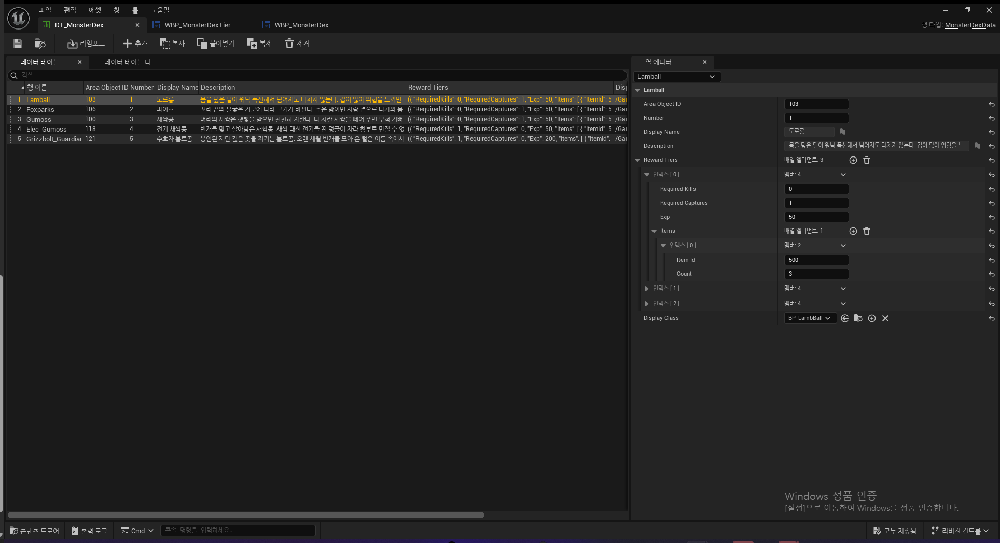
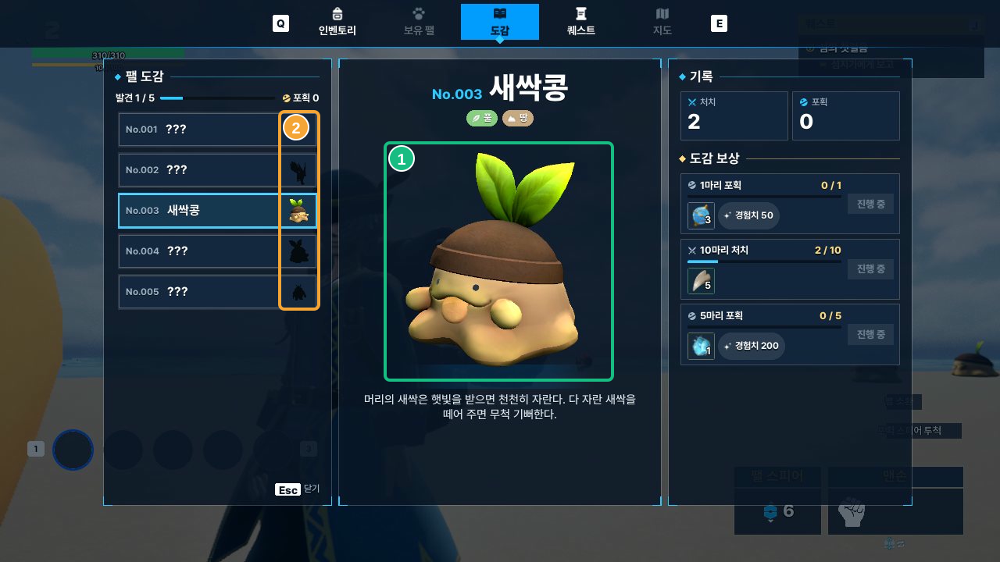

# 16. MonsterDex System

몬스터 도감은 `DT_MonsterDex`에 정의된 몬스터를 목록으로 보여주고, 플레이어별 처치·포획 기록에 따라 발견 상태와 보상 진행도를 갱신합니다. **도감 정의, 플레이어 기록, UI 표시 데이터를 분리**하고 보상 수령은 서버에서 검증합니다.

## 도감 화면

**① 몬스터 목록** — `UMonsterDexCellWidget`에서 도감 번호·몬스터 썸네일·발견/포획 여부를 표시합니다.

**② 몬스터 상세** — `UMonsterDexWidget::DrawPicked`에서 이름·설명·속성과 3D 모델을 갱신합니다.

**③ 처치·포획 기록** — `FMonsterDexPageView::Kills / Captures`를 표시합니다.

**④ 도감 보상** — `FMonsterDexTierView`의 진행도·보상 아이템·수령 상태를 `UMonsterDexTierWidget`에서 표시합니다.

모든 화면 영역은 `MonsterDexView::Build`에서 만든 `FMonsterDexBookView`를 사용합니다. 도감에 등록된 몬스터는 모두 목록에 표시하되, 기록이 없는 몬스터의 이름과 모습은 숨깁니다.

## 목차

- [도감 정의와 플레이어 기록](#도감-정의와-플레이어-기록)
- [UI 표시 데이터 구성](#ui-표시-데이터-구성)
- [처치·포획 기록과 동기화](#처치포획-기록과-동기화)
- [보상 진행과 수령](#보상-진행과-수령)
- [3D 프리뷰와 몬스터 썸네일](#3d-프리뷰와-몬스터-썸네일)
- [관련 코드](#관련-코드)

---

## 도감 정의와 플레이어 기록

### DT_MonsterDex — 도감에 등록할 몬스터 정의

`DT_MonsterDex`는 도감에 표시할 몬스터의 이름·설명·정렬 순서와 단계별 보상 조건을 정의합니다. `UMonsterDexSubsystem`이 테이블을 읽어 `Number` 순으로 정렬하며, 각 행의 `AreaObjectID`로 게임 내 몬스터 정보와 연결합니다.

*실제 DataTable의 몬스터 5개 행과 도로롱의 첫 번째 보상 설정. 오른쪽에 `RequiredKills`, `RequiredCaptures`, `Exp`, `Items`, `DisplayClass`를 펼쳐 표시했습니다.*

~~~cpp
// MonsterDexTypes.h — 선언 매크로 생략
struct FMonsterDexRewardTier
{
    int32 RequiredKills = 0;
    int32 RequiredCaptures = 0;
    int32 Exp = 0;
    TArray<FItemReward> Items;
};

struct FMonsterDexData : public FTableRowBase
{
    int32 AreaObjectID = 0;
    int32 Number = 0;
    FText DisplayName;
    FText Description;
    TArray<FMonsterDexRewardTier> RewardTiers;
    TSoftClassPtr<ACharacter> DisplayClass;
};
~~~

- `AreaObjectID`: 실제 몬스터 데이터 및 플레이어 기록과 연결하는 ID
- `Number`: 도감 표시 번호와 목록 정렬 순서
- `RewardTiers`: 단계별 처치·포획 목표와 지급 보상
- `DisplayClass`: 상세 화면의 3D 프리뷰에 사용할 Character 클래스

예를 들어 도로롱(`AreaObjectID=103`, `Number=1`)의 첫 보상은 포획 1회, 경험치 50, 아이템 ID 500의 3개 지급으로 정의되어 있습니다.

`dt_AreaObject`에서는 기본 몬스터 아이콘(`AreaObjectIcon`)과 속성(`DefenceElementalAttributes`)을 조회합니다. 실제 목록에는 `SnapStage`가 캡처한 **몬스터 썸네일**을 우선 사용하고, 캡처 결과가 없으면 `AreaObjectIcon`을 표시합니다. 도감 테이블에는 이 정보를 중복 등록하지 않습니다.

### FMonsterDexEntry — 플레이어별 도감 기록

몬스터 정의는 모든 플레이어가 공유하지만, 도감 진행 기록은 플레이어마다 다릅니다. `ASonheimPlayerState`의 `UMonsterDexComponent`가 이를 `FMonsterDexEntry` 배열로 관리합니다.

~~~cpp
// MonsterDexTypes.h — 선언 매크로 생략
struct FMonsterDexEntry : public FFastArraySerializerItem
{
    int32 AreaObjectID = 0;
    int32 KillCount = 0;
    int32 CaptureCount = 0;
    int32 ClaimedTiers = 0;
};
~~~

`KillCount`와 `CaptureCount`는 누적 처치·포획 횟수이고, `AreaObjectID`는 도감 정의와 플레이어 기록을 연결합니다. 이름·설명·보상 조건은 플레이어 기록에 복제하지 않습니다.

`ClaimedTiers`는 **정수의 각 비트에 보상 단계의 수령 여부를 기록**합니다. 0번째 비트는 첫 번째 보상, 1번째 비트는 두 번째 보상에 해당합니다. 예를 들어 세 단계 중 1·3번째 보상을 받았다면 `0b101`(10진수 5)입니다.

~~~cpp
// MonsterDexTypes.h / MonsterDexComponent.cpp
bool IsClaimed(const int32 Tier) const
{
    return Tier >= 0 && Tier < 32 && (ClaimedTiers & (1 << Tier)) != 0;
}

// 서버에서 보상 수령 처리 시
Entry->ClaimedTiers |= 1 << Tier;
~~~

보상 상태는 이 수령 기록과 처치·포획 조건을 비교해 계산합니다. 플레이어가 처음 도감에 등록되는 시점과 화면 공개 조건은 아래에서 설명합니다.

## UI 표시 데이터 구성

`MonsterDexView::Build`는 다음 세 데이터를 조합해 화면에 필요한 값을 구성합니다.

~~~mermaid
flowchart TB
    DT["DT_MonsterDex 도감 번호·이름·보상 조건"]
    AREA["dt_AreaObject 기본 몬스터 아이콘·속성"]
    RECORD["UMonsterDexComponent 처치·포획·수령 기록"]
    BUILD["MonsterDexView::Build"]
    BOOK["FMonsterDexBookView Pages / Discovered / Captured"]
    UI["UMonsterDexWidget 목록 · 상세 · 보상"]
    DT --> BUILD
    AREA --> BUILD
    RECORD --> BUILD
    BUILD --> BOOK --> UI
~~~

`FMonsterDexBookView`는 전체 도감 페이지(`Pages`), 발견한 몬스터 수(`Discovered`), 한 번 이상 포획한 몬스터 수(`Captured`)를 담습니다.

페이지마다 `FMonsterDexPageView`에 표시 이름·설명·속성·몬스터 썸네일·처치·포획 횟수를 채우고, 보상 단계는 `FMonsterDexTierView`로 구성합니다. 위젯은 이 값을 받아 화면을 갱신하므로 도감 정의와 플레이어 기록을 각 위젯에서 따로 조합할 필요가 없습니다.

### 첫 처치·포획에 따른 등록과 화면 표시

**도감 등록 플레이 영상**

https://github.com/user-attachments/assets/d1d96b5f-1076-4e29-872d-3399a540acac

서버의 `UMonsterDexComponent::Record`는 도감에 등록된 몬스터의 처치 또는 포획 이벤트를 처음 받으면 `FMonsterDexEntry`를 생성합니다. 이후 `MonsterDexView::Build`는 **기록의 존재 여부**로 발견 상태를 판단합니다. 접근하거나 화면에서 선택하는 것만으로는 발견 처리되지 않습니다.

~~~cpp
// MonsterDexView.cpp — Build 내부 발췌
const FMonsterDexEntry* Entry = Dex.FindEntry(Page.AreaObjectID);

View.bDiscovered = Entry != nullptr;
View.bCaptured = Entry && Entry->CaptureCount > 0;
View.Kills = Entry ? Entry->KillCount : 0;
View.Captures = Entry ? Entry->CaptureCount : 0;

if (View.bDiscovered)
{
    View.Name = Page.DisplayName;
    View.Description = Page.Description;
    if (Species) View.Elements = Species->DefenceElementalAttributes.Array();
}
else
{
    View.Name = INVTEXT("???");
    View.Description = LOCTABLE(SONHEIM_ST_DEX, "Page.Unknown.Description");
}
~~~

| 조건 | 화면에 반영되는 내용 |
|---|---|
| 기록 없음 | 도감 번호는 보이지만 이름은 `???`, 몬스터 썸네일·상세 3D 모델은 실루엣 |
| 기록 있음 | 이름·설명·속성과 원래 모델 색상 표시 |
| `CaptureCount > 0` | 목록에 포획 표시 |
| 수령 가능한 보상 존재 | 목록에 보상 알림 표시 |

미발견 몬스터도 선택해 보상 조건을 볼 수 있습니다. `Discovered`는 기록이 있는 몬스터 수이고, `Captured`는 포획 횟수가 1 이상인 몬스터 수입니다. `Captured`는 전체 포획 횟수의 합이 아닙니다.

## 처치·포획 기록과 동기화

몬스터 처치 또는 포획이 발생하면 서버의 `ASonheimPlayerState::ReportDeed`가 `OnDeed` 이벤트를 전달합니다. `UMonsterDexComponent`는 이 중 `Kill`과 `Capture`를 받아 기록합니다.

~~~cpp
// MonsterDexComponent.cpp — HandleDeed
void UMonsterDexComponent::HandleDeed(
    const EPlayerDeed Deed, const int32 Id, int32, FName)
{
    if (Deed == EPlayerDeed::Kill || Deed == EPlayerDeed::Capture)
        Record(Id, Deed == EPlayerDeed::Capture);
}
~~~

`Record`는 `UMonsterDexSubsystem::FindPage`로 도감에 등록된 몬스터인지 확인합니다. 처음 기록되는 몬스터라면 `FMonsterDexEntry`를 추가하고, 이후 해당 처치 또는 포획 횟수를 증가시킵니다.

최초 등록에는 `Headline` 알림, 보상 조건을 새로 충족했을 때는 `Feed` 알림을 표시합니다. 두 알림은 `UMonsterDexComponent::Record`에서 수치 갱신 전후의 보상 충족 여부를 비교해 발생합니다.

~~~mermaid
sequenceDiagram
    participant G as 전투 / 포획
    participant P as PlayerState
    participant S as MonsterDexComponent (서버)
    participant C as MonsterDexComponent (소유 클라이언트)
    participant U as MonsterDexWidget
    G->>P: ReportDeed(Kill / Capture)
    P->>S: OnDeed
    S->>S: Record → Commit
    S-->>C: FastArray 변경분 복제 (OwnerOnly)
    C->>U: OnDexChanged
    U->>U: Redraw → MonsterDexView::Build
~~~

`Commit`은 변경 항목을 `MarkItemDirty`로 표시하고 `OnDexChanged`를 호출합니다. 플레이어 기록은 `UMonsterDexSubsystem::StorePlayer`를 통해 호스트의 SaveGame 슬롯 `MonsterDex`에 저장합니다.

`FMonsterDexEntry::PostReplicatedAdd / PostReplicatedChange`도 클라이언트에서 `OnDexChanged`를 전달합니다. 도감 UI는 이 이벤트를 받아 `Redraw`를 호출합니다. **네트워크에는 FastArray의 변경분을 복제하고, 현재 UI 갱신 시에는 전체 도감 페이지의 표시 데이터를 다시 만듭니다.**

### 도감 등록·보상 알림

**① Headline (화면 중앙)** — 몬스터를 처음 처치하거나 포획하여 도감에 등록할 때 ‘새로운 팰 발견!’ 알림을 표시합니다.

**② Feed (화면 왼쪽)** — 위 화면에서 ‘퀘스트 수락’ 알림이 표시된 영역입니다. 도감 보상 조건이 충족됐을 때에도 **같은 Feed 슬롯**에 수령 가능 알림을 표시합니다.

~~~cpp
// MonsterDexComponent.cpp — Record 내부 발췌
if (bNew)
{
    Notify(ENoticeSlot::Headline, ENoticeTone::Information,
           bCaptured
               ? LOCTABLE(SONHEIM_ST_DEX, "Notice.FirstCapture.Title")
               : LOCTABLE(SONHEIM_ST_DEX, "Notice.FirstMeet.Title"),
           Page->DisplayName,
           FText::Format(LOCTABLE(SONHEIM_ST_DEX, "Notice.Registered.Detail"),
                         FText::AsNumber(Page->Number)),
           LOCTABLE(SONHEIM_ST_DEX, "Notice.Registered.Footer"));
}

for (int32 Tier = 0; Tier < Page->RewardTiers.Num(); ++Tier)
{
    if (!WasReady[Tier] && Entry->Meets(Page->RewardTiers[Tier])
        && !Entry->IsClaimed(Tier))
    {
        Notify(ENoticeSlot::Feed, ENoticeTone::Highlight,
               LOCTABLE(SONHEIM_ST_DEX, "Notice.RewardReady.Category"),
               Page->DisplayName,
               LOCTABLE(SONHEIM_ST_DEX, "Notice.RewardReady.Detail"));
    }
}
~~~

## 보상 진행과 수령

**보상 진행·수령 플레이 영상**

https://github.com/user-attachments/assets/f498002f-d15e-45ab-ac9b-1380ac0ad82b

`DT_MonsterDex`의 `RewardTiers`에는 단계마다 필요한 처치·포획 횟수와 경험치·아이템 보상이 설정됩니다. `FMonsterDexEntry::Meets`는 두 조건을 모두 비교합니다.

~~~cpp
// MonsterDexTypes.h
bool Meets(const FMonsterDexRewardTier& Tier) const
{
    return KillCount >= Tier.RequiredKills
        && CaptureCount >= Tier.RequiredCaptures;
}
~~~

현재 도감 설정은 단계별로 처치 또는 포획 중 하나의 조건을 사용합니다. `MonsterDexView::TierView`는 해당 목표의 현재 값과 요구 수치를 계산하고, 보상 수령 여부까지 반영해 다음 상태를 만듭니다.

| 보상 상태 | 판정 | UI 동작 |
|---|---|---|
| `InProgress` | 목표 미달성 | 진행도 표시, 수령 버튼 비활성 |
| `Ready` | 목표 달성·미수령 | 수령 버튼 활성 |
| `Claimed` | 해당 단계 수령 기록 있음 | 수령 완료 표시 |

수령 버튼을 누르면 `UMonsterDexWidget::Claim`에서 `ServerClaimReward(AreaObjectID, Tier)`를 호출합니다. 서버는 단계가 유효한지, 진행 조건을 달성했는지, 이미 수령하지 않았는지를 `CanClaimReward`에서 다시 확인합니다.

~~~cpp
// MonsterDexComponent.cpp — CanClaimReward 내부
return Page && Entry && Page->RewardTiers.IsValidIndex(Tier) && Tier < 32
    && !Entry->IsClaimed(Tier) && Entry->Meets(Page->RewardTiers[Tier]);
~~~

검사를 통과하면 `ClaimedTiers`에 해당 단계의 비트를 설정하고 `Commit`으로 기록한 뒤 `SonheimReward::Grant`로 보상을 지급합니다. 같은 단계로 반복 요청이 오면 수령 비트 검사에서 거부됩니다.

보상 UI는 `SonheimReward::Describe`로 아이템·경험치 정보를 구성하고, 아이템은 인벤토리에서도 사용하는 `USlotWidget::AddReadOnly`로 표시합니다.

## 3D 프리뷰와 몬스터 썸네일

도감 상세의 3D 모델은 `AMonsterDexStage`가 렌더링합니다. `FMonsterDexData::DisplayClass`에 지정된 Character의 기본 Skeletal Mesh·애니메이션·머티리얼을 가져와 `SceneCaptureComponent2D`로 캡처하고, RenderTarget을 위젯에 표시합니다.

도감을 열 때 두 개의 `AMonsterDexStage`를 로컬에 생성합니다.

**① 상세 3D 모델 (초록)** — `Stage`가 RenderTarget에 실시간 렌더링하고, 드래그 회전과 자동 회전을 처리합니다.

**② 몬스터 썸네일 (주황)** — `SnapStage`가 목록에 사용할 정지 이미지를 캡처합니다. 위 화면에서는 미발견 몬스터의 이미지가 실루엣으로 표시됩니다.

`Stage`와 `SnapStage`는 각각 실시간 프리뷰와 정지 이미지 캡처를 담당합니다. 썸네일은 도감 화면이 열려 있는 동안 재사용하고, `Stage`는 사용자 드래그와 자동 회전에 따라 모델을 갱신합니다.

`AMonsterDexStage::Frame`은 Skeletal Mesh의 Imported Bounds를 기준으로 모델이 화면에 들어오도록 카메라 위치와 거리를 조정합니다. 미발견 몬스터는 `UMonsterDexCellWidget::Show`와 `UMonsterDexWidget::DrawPicked`에서 `SilhouetteColor`를 적용해 실루엣으로 표시합니다.

Stage Actor는 도감 화면을 닫을 때 제거하며, 네트워크 복제 없이 로컬에서만 사용합니다.

## 관련 코드

- [MonsterDexTypes.h](https://github.com/chungheonLee0325/Sonheim/blob/feat-ui-dex/Sonheim/Source/Sonheim/MonsterDex/MonsterDexTypes.h) — 도감 정의, 플레이어 기록, FastArray
- [MonsterDexSubsystem.cpp](https://github.com/chungheonLee0325/Sonheim/blob/feat-ui-dex/Sonheim/Source/Sonheim/MonsterDex/MonsterDexSubsystem.cpp) — 도감 테이블 조회와 SaveGame
- [MonsterDexComponent.cpp](https://github.com/chungheonLee0325/Sonheim/blob/feat-ui-dex/Sonheim/Source/Sonheim/AreaObject/Player/Utility/MonsterDexComponent.cpp) — 처치·포획 집계, 보상 검증·지급, 복제
- [MonsterDexView.cpp](https://github.com/chungheonLee0325/Sonheim/blob/feat-ui-dex/Sonheim/Source/Sonheim/UI/MonsterDex/MonsterDexView.cpp) — 도감·보상 표시 데이터 구성
- [MonsterDexWidget.cpp](https://github.com/chungheonLee0325/Sonheim/blob/feat-ui-dex/Sonheim/Source/Sonheim/UI/MonsterDex/MonsterDexWidget.cpp) — 도감 목록·상세·보상 UI
- [MonsterDexStage.cpp](https://github.com/chungheonLee0325/Sonheim/blob/feat-ui-dex/Sonheim/Source/Sonheim/UI/MonsterDex/MonsterDexStage.cpp) — 3D 프리뷰와 몬스터 썸네일 캡처
- [[17. Quest System|17_Quest_System]] · [[18. UMG v2 Migration|18_UMG_v2_Migration]]
