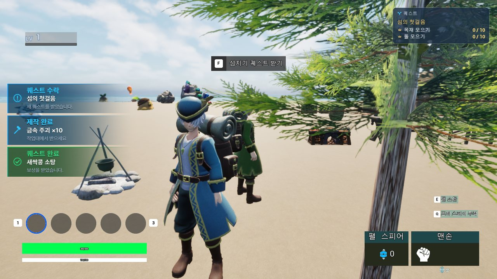
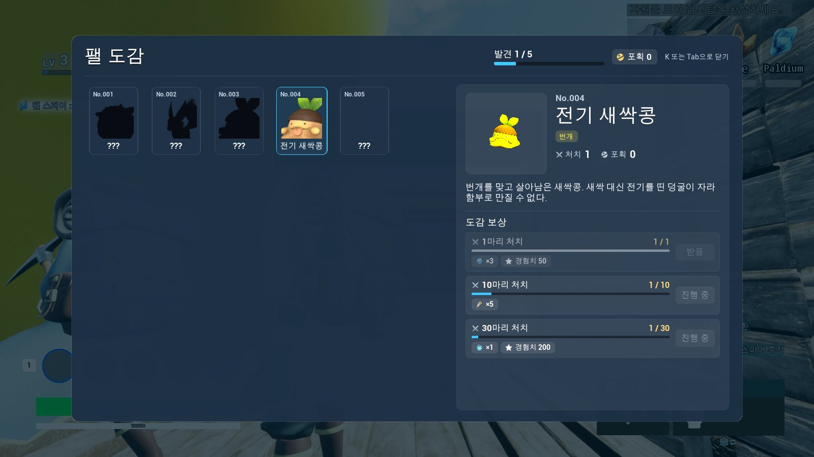
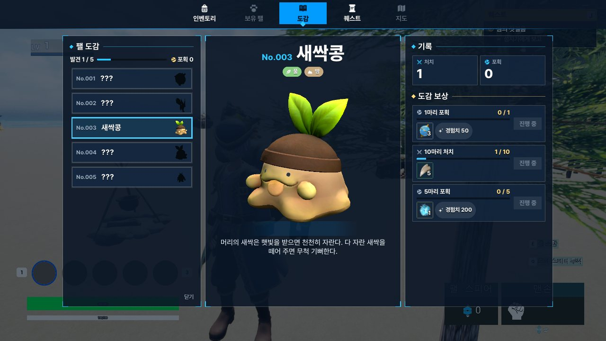
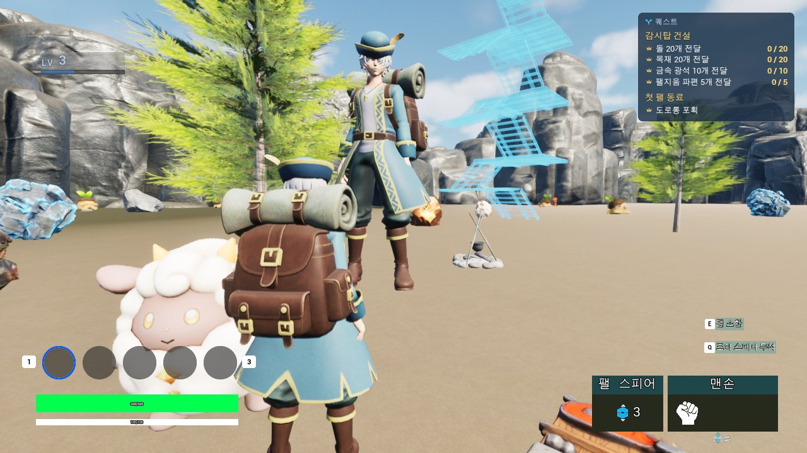
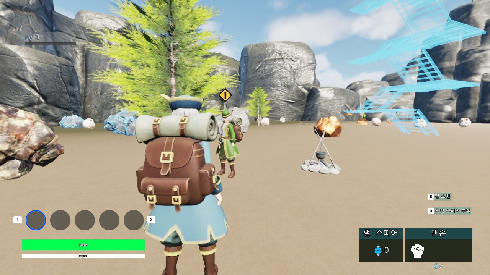

# 16. UMG Migration with Claude

Claude Code가 **Agent MCP로 Unreal Editor를 직접 조작해** Sonheim의 UMG 전체(알림·메뉴·도감·퀘스트·인벤토리·던전 HUD·필드 HUD)를 Palworld 스타일의 v2 UI로 옮긴 사례입니다. 사람은 레퍼런스와 방향을 정하고 결과를 승인했고, Claude는 스타일 문서·위젯 키트·저작 스크립트·C++·검증을 맡았습니다.

## 요약

- **범위:** 알림 3종(Feed·Headline·Title), 상단 탭 메뉴, 인벤토리·능력치, 몬스터 도감, 퀘스트 일지·대화창·추적기, 던전 HUD·결과 카드, 필드 HUD, 키 표시(키보드·패드), 아이콘 27종.
- **방식:** 화면을 손으로 그리지 않고 **Python 저작 스크립트 → Agent MCP → Widget Blueprint**로 만들었습니다. 같은 스크립트를 다시 돌리면 같은 위젯이 나옵니다.
- **원칙:**
  - C++ 쪽 `BindWidget` 계약은 그대로 두고 트리만 바꿨습니다.
  - 그래프나 애니메이션이 걸린 위젯은 트리를 다시 만들지 않고 속성만 바꿨습니다.
  - 아이템은 텍스트 대신 인벤토리 슬롯으로 보여줍니다.
  - 키는 하드코딩하지 않고 Enhanced Input 매핑에서 읽습니다.
- **검증:** 단계마다 PIE에서 실제 게임 경로(입력 주입, 실제 처치, 던전 1판)로 화면을 띄워 캡처했고, 기존 검증 스크립트 4개(체크 111개)를 매번 다시 돌렸습니다.

## 목차

- [출발점](#출발점)
- [Workflow](#workflow)
- [역할 분담](#역할-분담)
- [설계 결정](#설계-결정)
- [화면별 전/후](#화면별-전후)
- [검증](#검증)
- [막혔던 점](#막혔던-점)
- [숫자](#숫자)
- [남은 것](#남은-것)

---

## 출발점

개편 전 UI는 기능은 맞았지만 **"AI가 만든 티"** 가 났습니다.

| 문제 | 예 |
|---|---|
| 모든 알림이 한 카드 | 레벨업·퀘스트 수락·도감 등록·파티 가득이 같은 남색 카드 |
| 설명문 같은 문구 | "새 퀘스트를 받았습니다.", "K 또는 Tab으로 닫기" |
| 아이템을 글자로 표시 | 보상 "팰 스피어 ×3" 칩 |
| 키 글자 하드코딩 | Q/E/F/J 글자가 위젯에 박혀 있음, 패드 표시 불가 |
| 화면마다 다른 말투 | Roboto 폰트, 둥근 카드, 회색 테두리 |

## Workflow

~~~mermaid
flowchart LR
    REF["<b>Reference</b> Palworld 스타일 화면 10장"]
    STYLE["<b>Style 문서</b> Art/Style/ui_style.md"]
    KIT["<b>Widget Kit</b> Scripts/UI/ui_kit.py"]
    AUTHOR["<b>저작 스크립트</b> author_*.py · restyle_*.py"]
    MCP["<b>Agent MCP</b> umg_add_widgets · compile · save"]
    PIE["<b>PIE 캡처</b> 실제 입력·처치·던전"]
    VERIFY["<b>검증 스크립트</b> verify_*.py"]
    USER{"<b>사용자 승인</b>"}
    REF --> STYLE --> KIT --> AUTHOR --> MCP --> PIE --> USER
    USER -->|수정 요청| AUTHOR
    USER -->|승인| VERIFY --> COMMIT["커밋"]
~~~

1. **스타일 문서**를 먼저 정했습니다. 색 역할(시안=정보, 금=보상·보스, 초록=완료, 주황=갱신, 빨강=위험, 보라=수호자), 폰트(Pretendard + Black Han Sans), 형태(띠·다이아·프레임 브래킷), 알림 슬롯별 모션.
2. **위젯 키트**(`ui_kit.py`)가 그 값을 코드로 갖습니다: `frame`, `section`, `band`, `diamond`, `key_hint` 등.
3. **저작 스크립트**가 키트로 위젯 트리 JSON을 만들고 Agent MCP로 Widget Blueprint를 생성·컴파일·저장합니다. 바인딩이 모두 맞는지 매번 확인합니다.
4. **PIE 캡처:** 테스트용 우회 대신 게임 자체 경로로 화면을 띄웁니다. 결과를 사용자에게 보여주고 승인받은 뒤 다음으로 넘어갔습니다.

## 역할 분담

| 사용자 | Claude |
|---|---|
| 레퍼런스 이미지 10장 제공 | 레퍼런스 분석 → 스타일 문서 v2 |
| "토스트가 AI 티 난다", "아이템은 슬롯으로", "키는 모듈화" 같은 방향 | C++ 구조 변경(알림 슬롯, 키 표시 서브시스템, 슬롯 재사용) |
| 폰트·아이콘·탭 범위·패드 범위 결정 | 저작 스크립트, SVG 아이콘, 문구 51개 정리 |
| 시안 승인, 섬지기 T포즈 같은 지적 | PIE 캡처, 검증 스크립트 갱신, 커밋 |

## 설계 결정

| 결정 | 이유 |
|---|---|
| **알림을 역할별 슬롯 3개로** (`ENoticeSlot::Feed / Headline / Title`) | 메시지 종류가 모양을 정합니다. 큰 순간은 가운데, 진행은 왼쪽 스택, 장소는 상단. 같은 시스템, 다른 UI. |
| **`BindWidget` 계약 유지** | C++ 로직을 건드리지 않고 트리만 교체합니다. `umg_inspect`의 바인딩 확인이 매 저작의 통과 조건입니다. |
| **트리 재생성 vs 제자리 재스타일** | 그래프가 비어 있는 위젯(인벤토리·도감·퀘스트·던전)은 트리를 다시 만들었습니다. 애니메이션·BP 이벤트가 위젯 이름을 쓰는 필드 HUD와 인벤토리 슬롯은 `umg_set_widget_properties`로 속성·배치만 바꿨습니다. |
| **아이템 = 인벤토리 슬롯** (`USlotWidget::AddReadOnly`) | 기존 `BP_Slot`에 보기 전용 모드를 붙였습니다. 도감·퀘스트·던전 보상이 아이콘·개수·희귀도·툴팁까지 인벤토리와 같습니다. 경험치만 칩으로 남깁니다. |
| **키 표시 = 매핑 조회** (`UInputHintSubsystem`, `WBP_KeyHint`) | 액션에 매핑된 키를 Enhanced Input에 묻고, 마지막 입력 장치(키보드/패드)의 키를 글리프 데이터로 그립니다. 메뉴 전용 입력(`IMC_Menu`)은 화면이 게임 입력을 막는 동안만 켭니다. |
| **문구는 String Table에서** | 모든 문구가 테이블에 있어서, 저작 스크립트의 원문과 테이블을 함께 고치는 일괄 패스 한 번으로 51개를 정리했습니다. |
| **아이콘은 SVG** | 이미지 생성 경로가 Cloudflare 확인에 막혀 직접 그렸습니다. 단색 글리프라 선 굵기·크기를 27개 모두 맞추기 쉬웠습니다. |
| **검증은 실제 게임 경로로** | 에디터 Python 안에서 부른 RPC는 제자리에서 실행됩니다. 그래서 화면 확인은 입력 주입과 실제 처치·던전 진행으로 했습니다. |

## 화면별 전/후

### 알림

| 전 | 후 |
|---|---|
|  |  |
|  |  |
|  |  |

*레벨업 헤드라인: 띠, 엠블럼, 스탯 줄, 푸터. 등장할 때 0.92배에서 커지며 빛줄기가 지나갑니다.*

### 몬스터 도감 · 퀘스트 · 인벤토리

| 전 | 후 |
|---|---|
|  |  |
|  |  |
|  |  |

*대화창: 하단 대사창과 오른쪽 선택지. 보상은 인벤토리 슬롯으로 나옵니다.*

### 던전 HUD · 결과 · 필드 HUD

| 전 | 후 |
|---|---|
|  |  |
|  |  |
|  |  |

### 키 표시 · 아이콘 · NPC

| 키보드 | 패드 |
|---|---|
|  |  |

*같은 위젯이 마지막 입력 장치에 따라 Q/E·Esc ↔ LB/RB·B로 바뀝니다.*

| 섬지기 전 | 섬지기 후 |
|---|---|
|  |  |

*메시 스케일이 0.01(플레이어 0.004)이라 3.7m 거인이 공중에 떠 있었습니다. 크기를 맞추고, 초록 옷과 머리 위 퀘스트 마커(!/?)를 더했습니다.*

## 검증

모든 단계 뒤에 기존 검증 스크립트를 다시 돌렸습니다. 새 기능마다 계약 체크는 1~2개만 더했습니다.

| 스크립트 | 체크 | 이번에 더한 것 |
|---|---|---|
| `verify_ui_stack.py` | 6 | Q/E가 흐린 탭을 건너뛰고 끝에서 돌아감. 키 표시가 장치를 따라가고(Q → LB), 화면이 없으면 메뉴 입력이 꺼짐 |
| `verify_dex.py` | 3 | 도감 등록 알림을 헤드라인 푸터에서 읽도록 갱신 |
| `verify_quest.py` | 8 | 대화창 확인이 메뉴 확인 입력으로 바뀜. 추적기 카드를 위젯 종류와 상관없이 찾음 |
| `verify_dungeon_hud.py` | 94 | 섬 HUD를 퀘스트 추적기로, 바뀐 문구로 기대값 갱신 |

검증이 실패했을 때는 먼저 게임 버그인지 오래된 기대값인지 가렸습니다. 이번에 나온 실패는 모두 기대값 쪽이었습니다(문구 변경, 위젯 종류 변경, 느린 PIE 대기).

## 막혔던 점

| 증상 | 원인 | 해결 |
|---|---|---|
| 레벨업 알림이 클라이언트 화면에 안 뜸 | 에디터 Python 안에서 부른 Client RPC가 서버에서 제자리 실행 | 실제 처치로 경험치를 얻게 해서 확인 |
| 키 표시가 전부 숨겨짐 | 위젯이 만들어질 때 Enhanced Input 매핑이 아직 반영 전 | `ControlMappingsRebuiltDelegate`를 받아 다시 그림 |
| 도감 목록 행 폭이 제각각 | Button 슬롯이 내용을 가운데 정렬 | 안쪽 테두리에 `HAlign_Fill` |
| 대화창이 하단 HUD에 가려짐 | HUD가 더 위 레이어 | 대사창을 HUD 위로 올림 |
| 지역명과 헤드라인이 겹침 | 둘 다 화면 위쪽 | 지역명 12%, 헤드라인 42% 위치로 분리 |
| 아이콘 생성 불가 | 이미지 생성 브라우저 프로필이 Cloudflare 확인에서 멈춤 | SVG로 직접 그리고 헤드리스 Edge로 렌더 |
| 섬지기 T포즈·거인 | 메시 스케일 0.01, 플레이어와 같은 옷 | 스케일 0.004, 옷 색 변형, 퀘스트 마커 |

## 숫자

- 커밋: UMG v2 작업 5개(`593f7e33`, `6ac7002e`, `7c56527e`, `f3ecf911`, `8c223a20`)
- 위젯: 새로 만든 Widget Blueprint 9개(알림 5, 탭 2, 키 표시 1, 퀘스트 마커 1), 트리를 다시 짠 위젯 21개(인벤토리 2, 도감 4, 퀘스트 6, 던전 9), 제자리 재스타일 2개(`BP_Slot`, `WB_PlayerStatusWidget`)
- 저작 스크립트: `Scripts/UI` 10개(키트, 알림, 탭, 입력, 인벤토리, 슬롯·HUD 재스타일, 아이콘, 폰트) + 도감·퀘스트·던전 스크립트 갱신
- 아이콘 27종(SVG), 폰트 2종(OFL), 문구 51개 정리
- 검증 체크 111개 전부 통과

## 남은 것

- 메뉴 안 패드 포커스 이동(버튼·슬롯 사이 이동). 키 표시와 패드 매핑은 들어갔고, 포커스 설계는 별도 단계로 남겼습니다.
- 보유 팰·지도 탭의 화면
- 도감 헤드라인의 팰 초상(초상 텍스처 미리 굽기)
