# 18. UMG v2 — 화면 개편과 공통 UI 처리

인벤토리·도감·퀘스트·던전·HUD의 화면을 개편하면서 메뉴 입력, 알림, 키 안내를 공통화했습니다. 게임플레이 데이터는 각 C++ 시스템에서 처리하고, Widget은 화면에 필요한 데이터를 받아 목록·상세·진행도·입력을 구성하도록 작업했습니다.

## 변경된 화면

| Dungeon HUD — 이전 | Dungeon HUD — v2 |
|---|---|
| 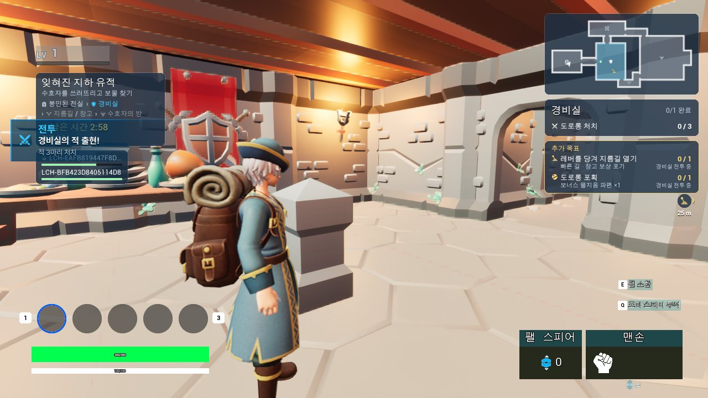 |  |

| Inventory — 이전 | Inventory — v2 |
|---|---|
| 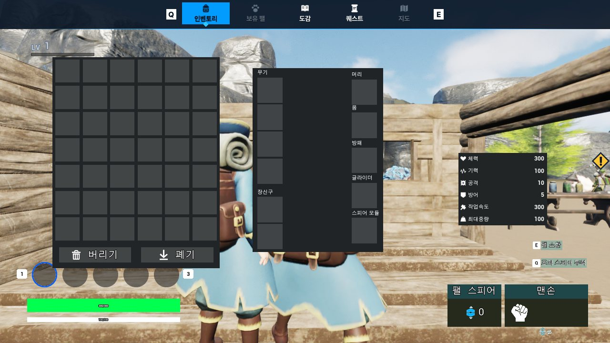 | 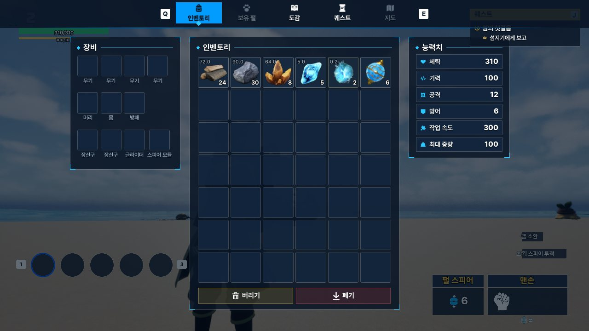 |

| Quest Journal — 이전 | Quest Journal — v2 |
|---|---|
| 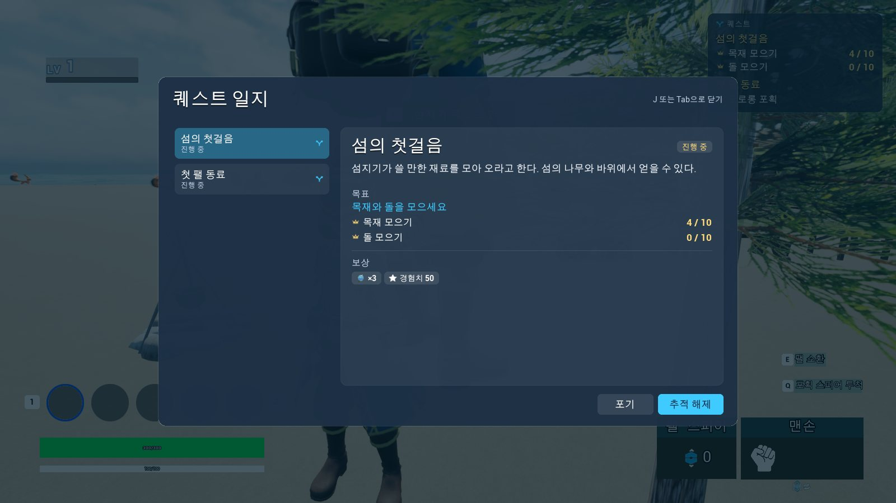 | 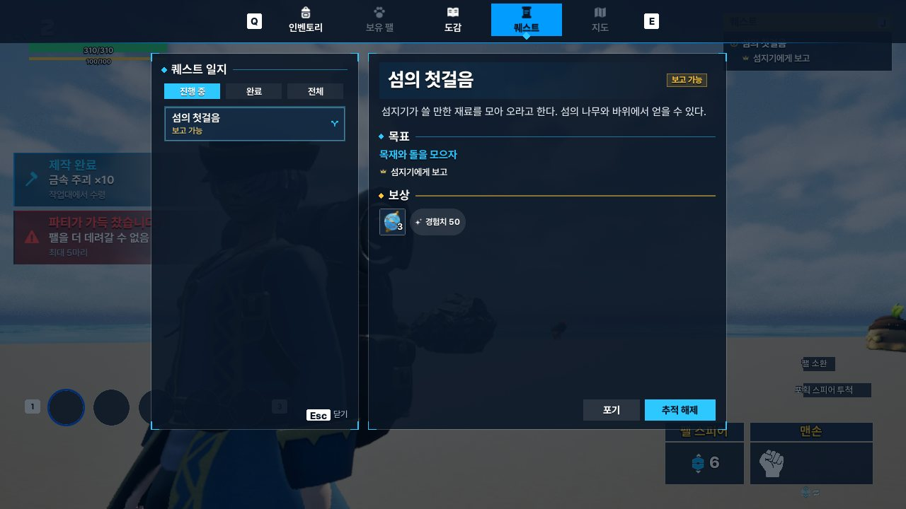 |

기존 화면을 교체하면서도 인벤토리의 슬롯·드래그, 퀘스트의 목록·상세 갱신, 던전 HUD의 진행 상태 표시 등 **C++ Widget과 게임 시스템의 연결은 유지**했습니다. 이 장에서는 화면별 기능을 다시 나열하기보다, 여러 화면에 공통으로 적용한 처리를 설명합니다.

## 중첩 메뉴에서 입력·커서 상태 복원

화면이 여러 개 열려 있으면 개별 Widget이 닫힐 때 무조건 `GameOnly`로 되돌릴 수 없습니다. 여전히 위에 남아 있는 메뉴가 입력과 커서를 사용하기 때문입니다.

`UUIStackSubsystem`은 `ULocalPlayerSubsystem`으로, `Screen ID`와 연결된 Widget들을 `FUIStackEntry`로 관리합니다. 메뉴 하나가 인벤토리·능력치처럼 여러 Widget을 포함하더라도 함께 열고 닫습니다. `FUIScreenRule`에는 화면별 `ZOrder`, `InputMode`, 커서 표시, 게임플레이 입력 차단 여부를 설정합니다.

~~~cpp
// UIStackSubsystem.cpp — Close()
void UUIStackSubsystem::Close(const FName Id)
{
    const int32 Index = Stack.IndexOfByPredicate(
        [Id](const FUIStackEntry& Entry) { return Entry.Id == Id; });
    if (Index != INDEX_NONE) RemoveAt(Index);
    Prune();
    ApplyInputState();
}
~~~

`Open / Close / CloseTop` 이후 현재 Stack의 최상단 Rule을 적용합니다. 모든 메뉴가 닫혔다면 `GameOnly`와 커서 숨김으로 복원합니다. 이미 열려 있는 화면을 다시 요청하면 새 Widget을 생성하지 않고 위로 올립니다.

~~~mermaid
flowchart LR
    A["Menu 열림"] --> B["QuestDialog 추가"]
    B --> C["QuestDialog 닫기"]
    C --> D["남은 Menu Rule 적용"]
    D --> E["Menu 닫기 GameOnly 복원"]
~~~

`GameAndUI`는 UI 입력과 게임 입력이 모두 전달될 수 있는 모드이므로, 이동·공격 등을 막는 정책은 별도의 `IsGameplayBlocked()`로 조회합니다. `ApplyInputState()`는 `SetInputMode`·커서 상태를 적용하고 `UInputHintSubsystem::SetMenuInput`을 통해 메뉴용 `IMC_Menu`도 전환합니다.

Widget의 `RemoveFromParent()` 과정에서 `NativeDestruct`가 다른 화면 닫기를 호출할 수도 있습니다. `RemoveAt()`은 **Stack에서 Entry를 먼저 제거한 뒤 Widget을 제거**하고, `Prune()`은 이미 Viewport에서 사라진 항목을 정리합니다.

[중첩 메뉴 입력 복원 플레이 영상](https://github.com/user-attachments/assets/f9936033-7251-4304-b1cb-842750c13c59)

## 알림: 공통 데이터와 슬롯별 표시 정책

퀘스트·레벨업·도감·제작·지역 진입 등에서 호출하는 알림을 `UNoticeSubsystem`으로 모았습니다. 기능은 `FNoticeData`에 제목·상세 문구·아이콘·Tone 등을 채우고, `Push(Slot, Channel, Data)`로 출력합니다. 알림 Widget은 게임플레이 시스템을 직접 조회하지 않습니다.

| 슬롯 | 실제 게임 화면 | 새 알림의 처리 |
|---|---|---|
| **Feed** | 화면 왼쪽: 퀘스트 진행·제작 완료·경고 | `Stack` — 새 카드를 즉시 추가. `UNoticeFeedWidget`이 최대 표시 수 관리 |
| **Headline** | 중앙: 레벨업·몬스터 첫 발견 | `TakeTurns` — 순서대로 표시, 대기 최대 3건 |
| **Title** | 화면 상단: 지역 이름 | `ReplaceShowing` — 이전 표시·대기 목록 교체 |

| Feed — 이전 | Feed — v2 |
|---|---|
| 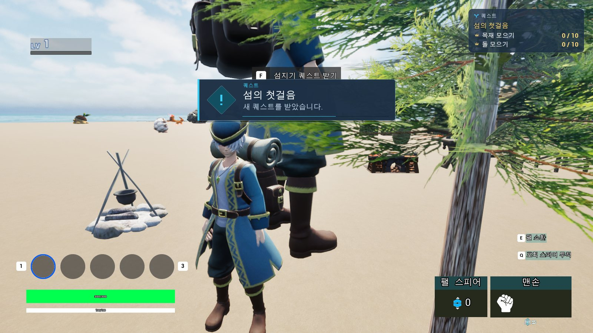 | 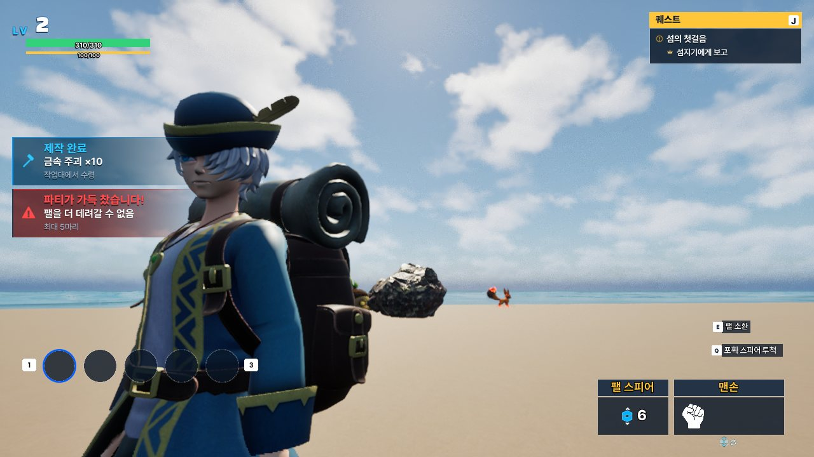 |

도감 등록 장면에서도 **왼쪽 Feed(퀘스트), 중앙 Headline(도감), 상단 Title(지역)**이 같은 화면에 나타납니다. 서로 다른 기능의 알림이지만 각각의 슬롯 정책에 따라 표시됩니다.

~~~cpp
// NoticeSubsystem.cpp — Push()의 표시 정책 분기
if (Settings.Order == ENoticeOrder::Stack)
{
    if (UNoticeWidget* Widget = State.bUnavailable
            ? nullptr : WidgetFor(Slot))
        Widget->ShowFrom(Channel, Data);
    return;
}
if (Settings.Order == ENoticeOrder::ReplaceShowing)
{
    State.Waiting.Reset();
    State.bShowing = false;
}
// TakeTurns는 Waiting에 추가하고 PresentNext()에서 순차 출력
~~~

`Feed`는 각 카드가 자신의 표시 시간을 처리하고 `UDynamicEntryBox`에서 사라집니다. 반면 `Headline`은 `OnFinished` 후 `PresentNext()`가 다음 알림을 꺼냅니다. 위치·스타일·출력 정책은 `DefaultGame.ini`와 `UNoticeStyle`에서 설정합니다.

`Channel`은 같은 슬롯 안에서 알림의 출처를 구분하는 데 사용합니다. 예를 들어 던전 UI는 `Dungeon` 채널로 지역 알림을 게시하고, 종료 시 `Clear("Dungeon")`으로 해당 채널의 표시·대기 알림만 정리합니다. 다른 기능이 보낸 알림은 유지합니다.

| 레벨업 Headline | 지역명 Title |
|---|---|
| 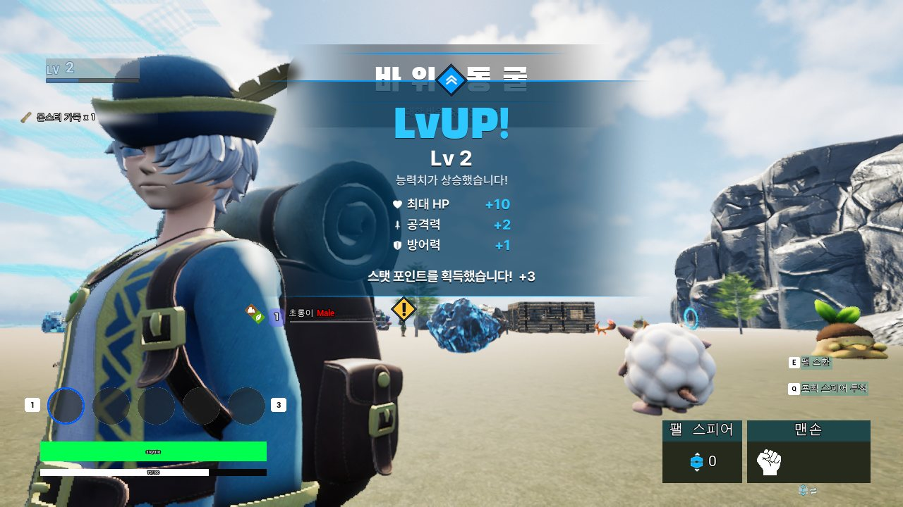 | 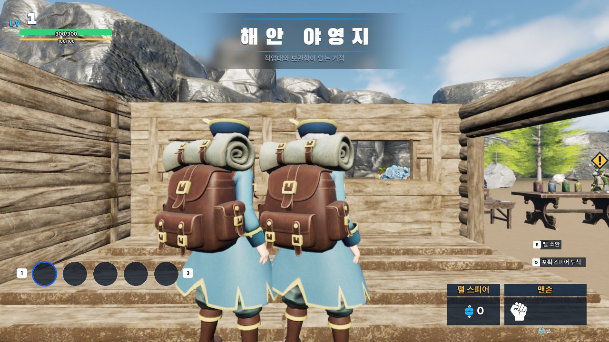 |

## Enhanced Input에서 키 안내 만들기

화면마다 키 문자열을 직접 지정하지 않고 `UInputAction`을 전달하도록 바꿨습니다. `UInputHintSubsystem::GlyphFor`는 `QueryKeysMappedToAction`에서 **현재 장치에 해당하는 키**를 찾고, `DA_InputGlyphs`에서 모양·문구를 조회합니다. 등록된 글리프가 없으면 엔진의 키 표시 이름을 사용합니다.

~~~cpp
// InputHintSubsystem.cpp — GlyphFor() 발췌
for (const FKey& Key : Input->QueryKeysMappedToAction(Action))
{
    if (Key.IsGamepadKey() != bPad) continue;
    if (const FInputGlyph* Glyph = LoadedGlyphs
            ? LoadedGlyphs->Glyphs.Find(Key) : nullptr)
        OutGlyph = *Glyph;
    else
        OutGlyph.Label = Key.GetDisplayName(false);
    return true;
}
~~~

키보드·마우스 입력과 게임패드 입력은 Slate `IInputProcessor`에서 관찰합니다. 스틱의 미세한 흔들림 때문에 장치가 자꾸 바뀌지 않도록 아날로그 입력은 일정 크기 이상일 때만 게임패드 사용으로 판단합니다. Enhanced Input의 `ControlMappingsRebuiltDelegate`도 구독합니다.

`UKeyHintWidget`은 `OnChanged`를 받아 `Refresh()`로 표시 문구와 모양·크기를 갱신합니다. 자신이 어느 키로 매핑됐는지 하드코딩하지 않으며, 현재 장치에 매핑이 없으면 위젯을 숨깁니다.

| 키보드·마우스 | 게임패드 |
|---|---|
|  | 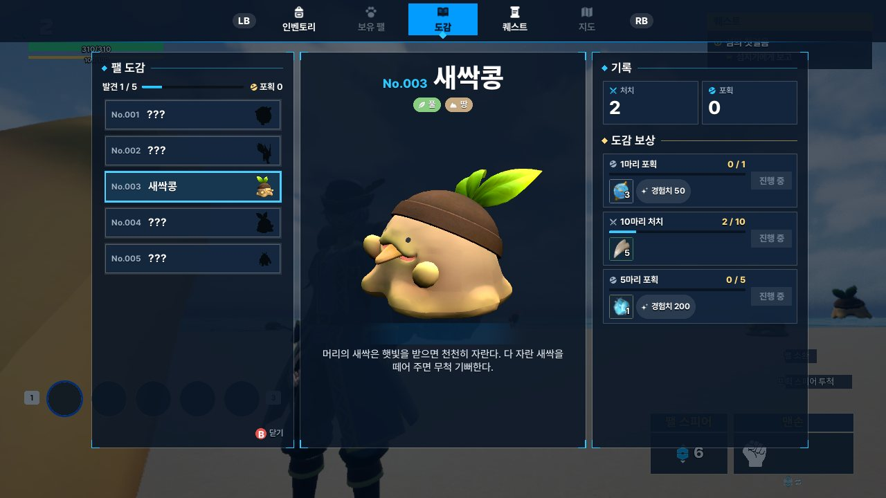 |

## C++ Widget과 Widget Blueprint 연결

게임플레이 데이터 조회·목록 구성·입력 이벤트는 C++ Widget에서 처리하고, Widget Blueprint에서는 레이아웃과 스타일을 구성했습니다. 화면을 수정할 때 **C++ `BindWidget`의 이름·타입과 Widget Tree**가 맞는지 확인했습니다.

예를 들어 도감은 `PageGrid`로 종 목록, `TierBox`로 보상 목록을 구성합니다. 보상 Row의 `ProgressBar`·`RewardBox`·`ClaimButton`은 각각 진행도·보상 아이템·수령 요청에 연결됩니다.

~~~cpp
// MonsterDexWidget.h — 실제 BindWidget 발췌
// UMonsterDexWidget
UPROPERTY(meta=(BindWidget)) TObjectPtr<UDynamicEntryBox> PageGrid;
UPROPERTY(meta=(BindWidget)) TObjectPtr<UDynamicEntryBox> TierBox;
// UMonsterDexTierWidget
UPROPERTY(meta=(BindWidget)) TObjectPtr<UProgressBar> ProgressBar;
UPROPERTY(meta=(BindWidget)) TObjectPtr<UDynamicEntryBox> RewardBox;
UPROPERTY(meta=(BindWidget)) TObjectPtr<UButton> ClaimButton;
~~~

| WBP_MonsterDex Widget Tree | WBP_MonsterDexTier Widget Tree |
|---|---|
|  |  |

도감은 `MonsterDexView::Build`에서 데이터 정의와 플레이어 기록을 결합해 화면에 전달하고, 퀘스트는 `QuestView::Build`가 일지·NPC 대화·HUD 추적기에 공통으로 사용할 값을 구성합니다. 게임플레이 로직을 Widget Blueprint에 복사하지 않고, C++에서 만든 표시 데이터를 각 화면에서 사용합니다.

도감·퀘스트·던전 결과의 보상 아이템은 인벤토리의 `USlotWidget::AddReadOnly`로 표시합니다. 같은 슬롯 Widget Blueprint를 쓰되, `ShowItem()`에서 드래그를 비활성화해 읽기 전용으로 사용합니다.

## 던전 HUD·결과 화면은 별도 수명으로 관리

| Dungeon Result — 이전 | Dungeon Result — v2 |
|---|---|
| 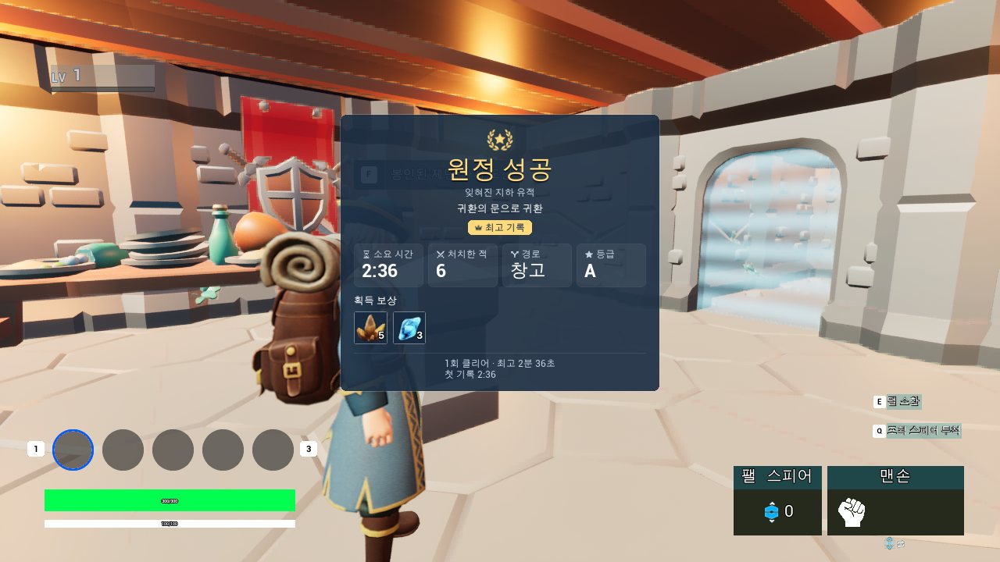 | 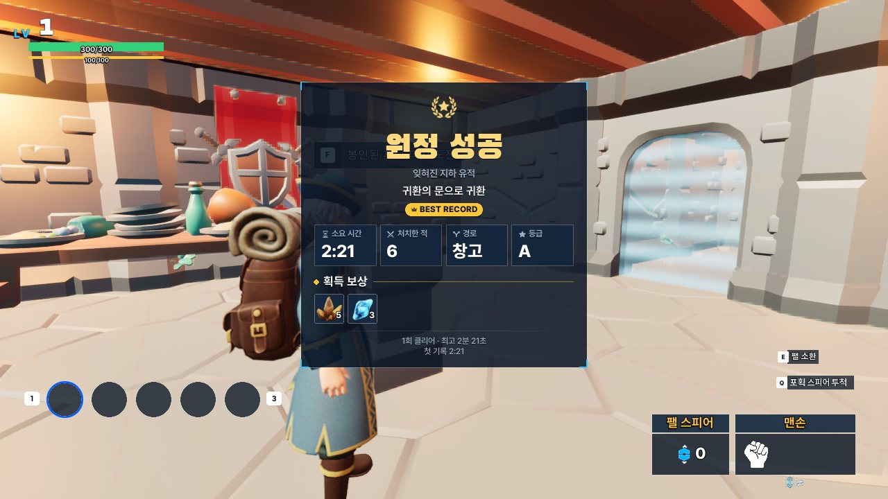 |

던전 HUD·Result는 인벤토리처럼 입력을 점유하는 메뉴가 아니므로 일반 `UUIStackSubsystem`에 넣지 않았습니다. `UDungeonStagePresenter`가 게임 상태와 콘텐츠 데이터를 `FDungeonStageViewData`로 가공하고, `UDungeonUIRouterSubsystem`이 던전 상태에 따라 HUD와 Result Widget을 생성·교체합니다.

`UDungeonUIRouterSubsystem`은 소프트 클래스 참조를 비동기 로드합니다. 로딩 중 던전에서 나가거나 새로운 화면을 요청할 수 있으므로, 콜백에서 현재 요청을 확인해야 합니다.

~~~cpp
// DungeonUIRouterSubsystem.cpp — Attach()의 비동기 로드 발췌
const int32 Expected = Generation;
RegistryLoad = UAssetManager::GetStreamableManager().RequestAsyncLoad(
    RegistryAsset.ToSoftObjectPath(),
    FStreamableDelegate::CreateWeakLambda(this, [this, Expected]()
    {
        if (Expected != Generation) return;
        Registry = RegistryAsset.Get();
        RefreshWidget();
    }));
~~~

`Detach()`에서 `Generation`을 증가시키고 Presenter 구독·Widget·로드 핸들을 정리합니다. 따라서 이전 요청의 콜백이 늦게 실행돼도 더 이상 유효하지 않은 화면을 만들지 않습니다. 같은 HUD가 유지되는 동안은 새 위젯을 만들지 않고 `ApplyViewData()`로 내용을 갱신합니다.

| Field HUD — 이전 | Field HUD — v2 |
|---|---|
| 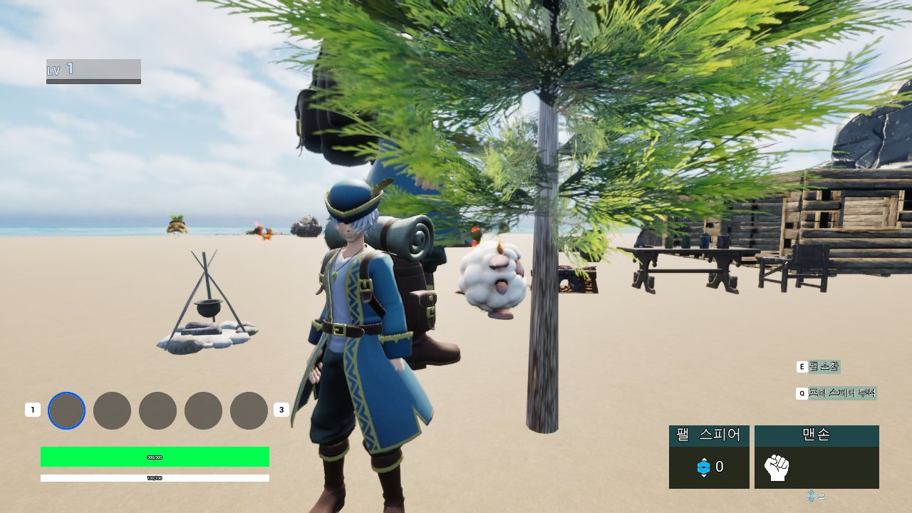 | 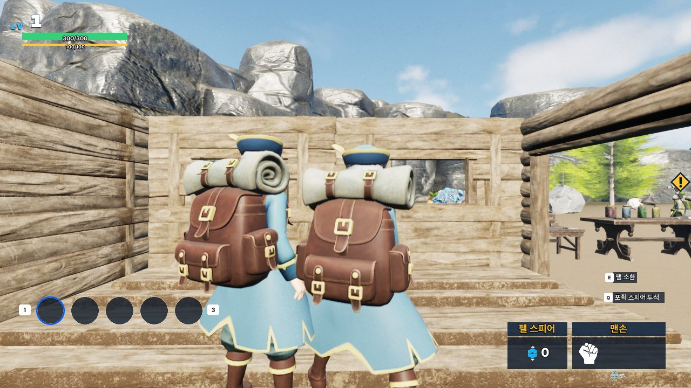 |

## 에디터에서 Widget Blueprint 수정

UMG 화면 저작에는 [AgentMcp](https://github.com/chungheonLee0325/AgentMcp)를 사용했습니다. 에디터에서 Widget Tree와 속성을 확인하고, C++ `BindWidget`에 맞춰 수정한 후 다시 읽어 실제 적용값을 확인했습니다. 그다음 Compile·Save와 PIE 화면으로 Widget의 입력·표시를 확인했습니다.

기존 Widget의 데이터·이벤트 연결을 유지한 채 레이아웃을 변경한 화면도 있고, 도감·퀘스트처럼 새로 구성한 Widget Tree도 있습니다. Editor 도구 자체의 구현과 작업 과정은 [14. Unreal Editor Automation & Verification](14_Unreal_Editor_Automation_Verification.md)에 정리했습니다.

## 관련 코드

- [UIStackSubsystem.cpp](https://github.com/chungheonLee0325/Sonheim/blob/main/Sonheim/Source/Sonheim/UI/System/UIStackSubsystem.cpp) — 화면 Stack·입력 복원
- [NoticeSubsystem.cpp](https://github.com/chungheonLee0325/Sonheim/blob/main/Sonheim/Source/Sonheim/UI/Notice/NoticeSubsystem.cpp) · [NoticeWidget.cpp](https://github.com/chungheonLee0325/Sonheim/blob/main/Sonheim/Source/Sonheim/UI/Notice/NoticeWidget.cpp) — 알림 표시 정책·수명
- [InputHintSubsystem.cpp](https://github.com/chungheonLee0325/Sonheim/blob/main/Sonheim/Source/Sonheim/UI/Input/InputHintSubsystem.cpp) · [KeyHintWidget.cpp](https://github.com/chungheonLee0325/Sonheim/blob/main/Sonheim/Source/Sonheim/UI/Input/KeyHintWidget.cpp) — 액션 매핑·키 안내
- [DungeonUIRouterSubsystem.cpp](https://github.com/chungheonLee0325/Sonheim/blob/main/Sonheim/Source/Sonheim/UI/Dungeon/DungeonUIRouterSubsystem.cpp) — 던전 HUD·Result 생성·갱신
- [MonsterDexWidget.h](https://github.com/chungheonLee0325/Sonheim/blob/main/Sonheim/Source/Sonheim/UI/MonsterDex/MonsterDexWidget.h) · [QuestWidget.cpp](https://github.com/chungheonLee0325/Sonheim/blob/main/Sonheim/Source/Sonheim/UI/Quest/QuestWidget.cpp) — C++ 데이터·이벤트와 Widget 연결
- [SlotWidget.cpp](https://github.com/chungheonLee0325/Sonheim/blob/main/Sonheim/Source/Sonheim/UI/Widget/Player/Inventory/SlotWidget.cpp) · [DefaultGame.ini](https://github.com/chungheonLee0325/Sonheim/blob/main/Sonheim/Config/DefaultGame.ini) — 읽기 전용 보상 슬롯·화면별 설정
- [11. Client State Presentation](11_Client_State_Presentation_Pipeline.md) · [16. MonsterDex](16_MonsterDex_System.md) · [17. Quest](17_Quest_System.md)
