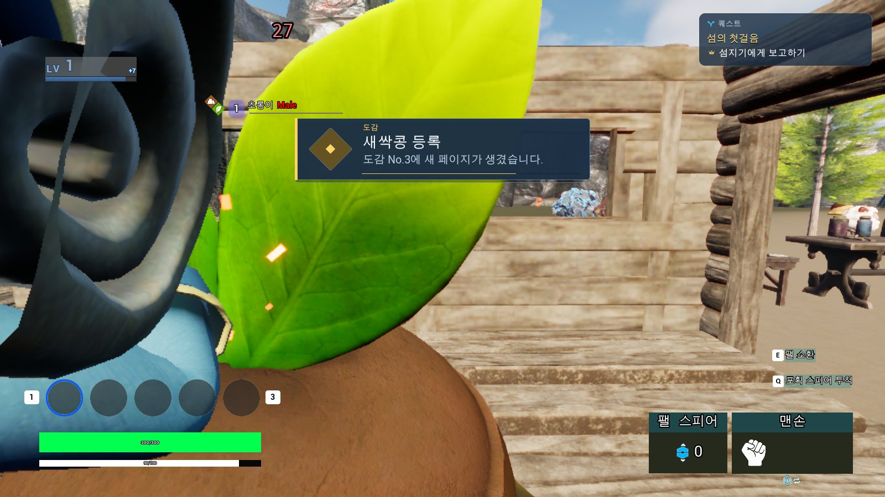
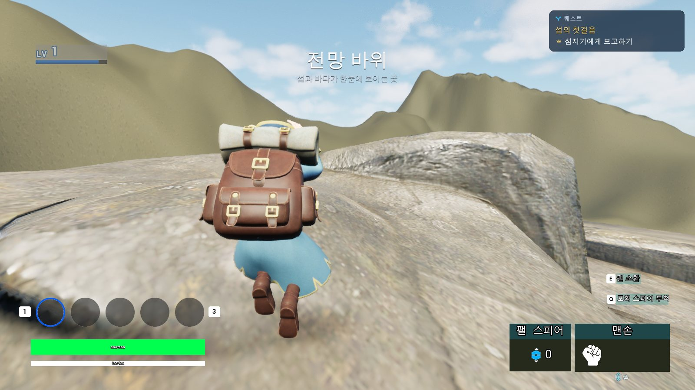
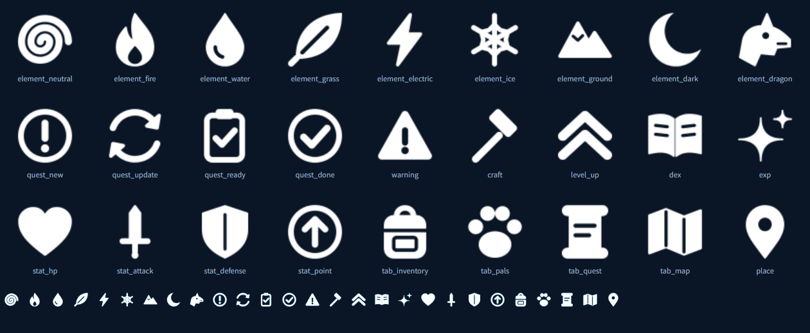

# 18. UMG v2 Migration & Editor Verification

기존 UMG 화면의 스타일을 개편하면서 **화면마다 나뉘어 있던 입력·커서 제어를 통합하고, 알림의 표시 위치와 순서를 용도별로 분리**했습니다. C++ Widget의 `BindWidget` 연결과 기존 게임플레이 처리는 유지하면서 Widget Blueprint를 수정하고, AgentMcp를 이용해 에디터에서 결과를 확인했습니다.

이 문서는 **v1 → v2에서 달라진 화면과 실제 변경·검증 과정**을 다룹니다. 상태 복제와 ViewData 구조는 [[11. UI Architecture & Client Presentation|11_Client_State_Presentation_Pipeline]], 도감·퀘스트 규칙은 [[16. MonsterDex System|16_MonsterDex_System]]과 [[17. Quest System|17_Quest_System]]에서 설명합니다.

## 대표 변경 결과

| Dungeon HUD — 이전 | Dungeon HUD — v2 |
|---|---|
|  |  |

*던전 목표·진행 상태·HUD 정보를 새 레이아웃에 맞춰 재배치했습니다. 던전의 실제 진행 데이터는 기존 Snapshot·Presenter 흐름을 사용합니다.*

| 알림 — 이전 | Feed — v2 |
|---|---|
|  |  |

*기존 알림을 좌측의 카드형 Feed로 개편했습니다. v2 Feed는 여러 알림을 동시에 표시하는 `Stack` 정책을 사용합니다.*

### 변경 사항 한눈에 보기

| 항목 | 적용 내용 |
|---|---|
| **일반 메뉴 입력** | `UUIStackSubsystem`에서 화면 열기·닫기, 최상단 입력 모드, 커서, 게임플레이 입력 차단을 관리 |
| **알림** | `UNoticeSubsystem`에서 `Feed / Headline / Title`과 서로 다른 표시 정책 적용 |
| **키 안내** | `UInputHintSubsystem`에서 Enhanced Input 매핑과 마지막 입력 장치로 글리프 선택 |
| **화면 구성** | 인벤토리·도감·퀘스트·던전 및 HUD의 Widget Blueprint 레이아웃·스타일 수정 |
| **아이템 보상 표시** | `USlotWidget::AddReadOnly`로 아이콘·수량 등 기존 슬롯 표현 재사용 |
| **에디터 작업·확인** | AgentMcp를 사용해 Widget Tree·`BindWidget` 확인, 수정 결과 재조회, Compile/Save, PIE 화면 점검 |

## 목차

- [일반 메뉴의 입력·커서 정책 통합](#일반-메뉴의-입력커서-정책-통합)
- [알림 영역 분리](#알림-영역-분리)
- [Enhanced Input 기반 키 안내](#enhanced-input-기반-키-안내)
- [Widget Blueprint 화면 개편](#widget-blueprint-화면-개편)
- [AgentMcp로 저작·검증](#agentmcp로-저작검증)
- [적용 범위와 관련 코드](#적용-범위와-관련-코드)

---

## 일반 메뉴의 입력·커서 정책 통합

### 화면을 닫는 순서와 무관하게 입력 복원

이전에는 인벤토리·제작·보관함 같은 화면이 각각 입력 모드나 마우스 표시를 바꿀 경우, 화면이 겹친 상태에서 하나를 닫으면 **아직 열린 화면의 입력 정책이 유지되지 않을 수 있었습니다.**

이를 위해 `UUIStackSubsystem : ULocalPlayerSubsystem`에서 일반 메뉴를 `FUIStackEntry`로 관리하고, 화면을 열거나 닫을 때마다 **남아 있는 최상단 화면의 규칙**을 다시 적용하도록 구성했습니다.

~~~mermaid
flowchart TB
    OPEN["Open · Close · CloseTop"] --> STACK["UUIStackSubsystem 화면 스택"]
    RULE["DefaultGame.ini FUIScreenRule"] --> STACK
    STACK --> TOP["최상단 화면 조회"]
    TOP --> APPLY["ApplyInputState"]
    APPLY --> CURSOR["커서 표시"]
    APPLY --> MODE["GameOnly / GameAndUI / UIOnly"]
    APPLY --> BLOCK["게임플레이 입력 차단"]
    APPLY --> IMC["메뉴 Input Mapping Context"]
~~~

`FUIScreenRule`은 화면 ID·ZOrder·입력 모드·커서·게임플레이 입력 차단 여부를 설정합니다. 현재 `DefaultGame.ini`에서는 Menu, Container, Crafting, MonsterDex, QuestDialog, QuestJournal에 `GameAndUI`와 `bBlockGameInput=True`를 사용합니다.

~~~cpp
// UIStackSubsystem.cpp — ApplyInputState 내부 핵심 처리
PC->SetShowMouseCursor(Rule.bShowMouse);
Hints->SetMenuInput(Rule.bBlockGameInput);

switch (Rule.InputMode)
{
case EUIStackInputMode::UIOnly:
    PC->SetInputMode(FInputModeUIOnly());
    break;
case EUIStackInputMode::GameAndUI:
    PC->SetInputMode(FInputModeGameAndUI());
    break;
default:
    PC->SetInputMode(FInputModeGameOnly());
}
~~~

*실제 `GameAndUI` 분기에는 커서 캡처 중 숨김 방지를 위한 설정도 적용됩니다. 위 코드는 정책 변경 지점만 발췌한 것입니다.*

여기서 **`GameAndUI`는 UI·게임 입력을 모두 받을 수 있는 모드이고, `bBlockGameInput`은 실제 이동·공격·상호작용 등을 제한할지 결정하는 별도 정책**입니다. 일반 메뉴를 닫아 스택이 비면 `GameOnly`·커서 숨김으로 복원합니다.

또한 인벤토리와 능력치처럼 함께 열리는 위젯은 하나의 스택 항목으로 다룹니다. 이미 Viewport에서 제거된 화면은 `Prune`으로 정리합니다.

**중첩 메뉴 종료 후 입력 복원 — 플레이 영상**

https://github.com/user-attachments/assets/f9936033-7251-4304-b1cb-842750c13c59

메뉴를 중첩해서 열고 닫을 때 최상단 화면의 입력 모드와 커서를 적용하고, 모든 메뉴가 닫히면 게임플레이 입력으로 복원하는 동작을 보여줍니다.

던전 HUD·결과 화면은 이 스택이 아니라 `UDungeonUIRouterSubsystem`에서 관리합니다. 기존 일반 메뉴의 입력 정책을 덮어쓰지 않도록 **현재 던전 HUD·Result는 비모달 `GameOnly` 정책**을 사용합니다.

---

## 알림 영역 분리

기존 알림 화면에서 **짧게 쌓이는 진행 알림, 중요한 달성 알림, 지역 이름**을 서로 다른 화면 영역으로 분리했습니다. 현재 `DefaultGame.ini`의 슬롯별 정책은 다음과 같습니다.

| 슬롯 | 화면 위치·대표 상황 | 표시 정책 |
|---|---|---|
| **Feed** | 좌측 — 퀘스트 수락·진행, 제작 완료, 경고 | `Stack` — 새 카드를 즉시 추가 |
| **Headline** | 중앙 — 레벨업, 몬스터 첫 발견 등 주요 달성 | `TakeTurns` — 하나씩 표시, 대기 최대 3건 |
| **Title** | 화면 상단 — 지역 진입·장소 이름 | `ReplaceShowing` — 최신 제목으로 교체 |

### 도감 첫 발견 장면으로 확인하는 세 알림 영역

| 도감 알림 — 이전 | 도감 첫 발견 — v2 |
|---|---|
|  |  |

*개편 후 화면에는 **좌측 Feed(퀘스트 수락)**, **중앙 Headline(새로운 팰 발견!)**, **상단 Title(지역명)**이 동시에 표시됩니다. 도감 첫 발견의 Headline과 퀘스트 수락의 Feed는 서로 다른 알림입니다.*

*좌측 Feed, 중앙 Headline, 상단 Title의 배치 영역을 표시했습니다.*

### 레벨업 Headline

*레벨업은 중앙 Headline에서 능력치 변화와 스탯 포인트를 함께 표시합니다.*

### 지역명 Title

| 지역명 — 이전 | 지역명 Title — v2 |
|---|---|
|  |  |

알림을 만든 기능은 `FNoticeData`와 `ENoticeSlot`, `Channel`을 `UNoticeSubsystem::Push`로 전달합니다. 슬롯별 Widget Blueprint·`UNoticeStyle`·출력 순서·ZOrder는 `FNoticeSlotSettings`에서 설정합니다.

`Channel`은 던전과 같은 기능이 종료됐을 때 자신이 보낸 알림만 정리하는 데 사용합니다. `Clear("Dungeon")`은 다른 기능의 Feed·Headline·Title 알림을 함께 지우지 않습니다.

표시 데이터와 알림의 UI 연결 구조는 [[11. UI Architecture & Client Presentation|11_Client_State_Presentation_Pipeline]]에 정리했습니다.

---

## Enhanced Input 기반 키 안내

기존에 키 이름을 직접 써 넣는 대신, `UInputHintSubsystem`이 **실제 `UInputAction`에 연결된 키와 최근 사용 입력 장치**를 기준으로 글리프를 선택하도록 변경했습니다.

~~~text
Enhanced Input · InputAction
             +
최근 사용 장치 (키보드·마우스 / 게임패드)
             ↓
UInputHintSubsystem::GlyphFor
             ↓
WBP_KeyHint
~~~

| 키보드·마우스 입력 안내 | 게임패드 입력 안내 |
|---|---|
|  |  |

`UInputHintSubsystem`은 Slate 입력으로 장치 변경을 감지하고, `ControlMappingsRebuiltDelegate`를 통해 Enhanced Input 매핑 변경을 반영합니다. 해당 장치의 키가 아이콘 세트에 있으면 아이콘을, 없으면 키 이름을 표시합니다.

`UUIStackSubsystem::SetMenuInput` 연결을 통해 메뉴 전용 `IMC_Menu`를 켜고 끕니다. 메뉴 탭은 키보드 Q/E 또는 게임패드 LB/RB로 전환할 수 있도록 구성했습니다.

---

## Widget Blueprint 화면 개편

C++ `UUserWidget`은 **데이터 조회·Delegate·입력 처리와 `BindWidget` 멤버**를 유지하고, 실제 Widget Blueprint에서 화면 배치와 스타일을 변경했습니다.

작업 방식도 기존 위젯의 구조에 따라 달리 적용했습니다.

- **기존 BP와 이벤트가 연결된 화면:** 전체 Widget Tree를 교체하기보다 기존 위젯의 속성과 배치를 수정해 연결을 유지했습니다.
- **새 화면·구성 변경이 큰 화면:** C++의 `BindWidget` 이름·타입을 확인하면서 목록·상세·보상 영역 등을 구성했습니다.
- **아이템 보상:** 도감·퀘스트 등의 보상에 `USlotWidget::AddReadOnly`를 사용해 기존 아이템 슬롯의 아이콘·수량 표시를 재사용했습니다.
- **공통 시각 요소:** 서체·아이콘·알림 스타일을 화면별 용도에 맞게 정리했습니다.

### 인벤토리·퀘스트 화면

| Inventory — 이전 | Inventory — v2 |
|---|---|
|  |  |

| Quest Journal — 이전 | Quest Journal — v2 |
|---|---|
|  |  |

### 던전 결과·필드 HUD

| Dungeon Result — 이전 | Dungeon Result — v2 |
|---|---|
|  |  |

| Field HUD — 이전 | Field HUD — v2 |
|---|---|
|  |  |

*화면 개편에 함께 사용한 UI 아이콘 세트입니다.*

### Widget Tree와 C++ BindWidget 연결

**WBP_MonsterDex** — 목록·선택 상세·기록·보상 영역의 Widget Tree를 확인합니다.

**WBP_MonsterDexTier** — 보상 조건·진행도·아이템 슬롯·수령 버튼을 연결한 위젯입니다.

위와 같은 화면은 단순한 이미지 교체가 아니라, **C++이 참조하는 Widget Tree의 이름·타입을 유지하면서 실제 게임 상태를 표시하는 작업**이었습니다. 도감과 퀘스트의 데이터 갱신 구조 자체는 각 시스템 문서에서 설명합니다.

---

## AgentMcp로 저작·검증

UMG 개편에는 Unreal Editor에 연결한 [AgentMcp](https://github.com/chungheonLee0325/AgentMcp)를 활용했습니다. 화면 레퍼런스·기능 요구사항을 정하고, 에디터의 Widget Blueprint를 읽고 수정한 다음 **변경한 결과를 다시 조회하고 PIE에서 화면을 확인**하는 순서로 진행했습니다.

~~~mermaid
flowchart LR
    A["기존 Widget / C++ BindWidget 확인"] --> B["Widget Tree·속성·스타일 수정"]
    B --> C["Editor Read-back"]
    C --> D["Compile / Save"]
    D --> E["PIE · 실제 화면 확인"]
    E --> F{"레이아웃·동작 확인"}
    F -->|"수정 필요"| B
    F -->|"확인"| G["캡처 · 문서 반영"]
~~~

| 확인 대상 | 확인 방법 |
|---|---|
| **C++ 연결** | `BindWidget / BindWidgetOptional` 멤버와 실제 Widget Tree 이름·타입 비교 |
| **에디터 변경 반영** | 수정 후 Read-back, Blueprint Compile/Save |
| **게임 동작** | PIE에서 인벤토리·도감·퀘스트·던전 화면 열기 및 값 갱신 확인 |
| **시각적 결과** | 실제 게임 화면 캡처와 전후 비교 |

UI 작업에서 중요한 검증 대상은 **에디터에서 위젯을 만들었다는 사실보다, 기존 데이터·버튼·보상 슬롯이 새 위젯에서도 정상 연결되는지**입니다. 에디터 자동화 도구의 구현과 더 넓은 검증 흐름은 [[14. Unreal Editor Automation & Verification|14_Unreal_Editor_Automation_Verification]]에서 다룹니다.

---

## 적용 범위와 관련 코드

| 관리 기능 | 실제 담당 | 역할 |
|---|---|---|
| 일반 메뉴·입력 | `UUIStackSubsystem` | Screen Stack과 커서·입력 정책 |
| 던전 HUD·결과 | `UDungeonUIRouterSubsystem` | 비모달 던전 화면·비동기 Widget 수명 |
| 알림 출력 | `UNoticeSubsystem` | 슬롯별 표시 순서와 채널 정리 |
| 키 안내 | `UInputHintSubsystem` | 액션 매핑과 입력 장치별 글리프 |
| C++ / Blueprint 연결 | 각 `UUserWidget`의 `BindWidget` | 게임플레이 데이터·이벤트와 화면 구조 연결 |

- [UIStackSubsystem.cpp](https://github.com/chungheonLee0325/Sonheim/blob/feat-ui-dex/Sonheim/Source/Sonheim/UI/System/UIStackSubsystem.cpp) — 중첩 메뉴 입력 복원
- [InputHintSubsystem.cpp](https://github.com/chungheonLee0325/Sonheim/blob/feat-ui-dex/Sonheim/Source/Sonheim/UI/Input/InputHintSubsystem.cpp) — 입력 안내
- [NoticeSubsystem.cpp](https://github.com/chungheonLee0325/Sonheim/blob/feat-ui-dex/Sonheim/Source/Sonheim/UI/Notice/NoticeSubsystem.cpp) — 알림 슬롯과 표시 정책
- [DungeonUIRouterSubsystem.cpp](https://github.com/chungheonLee0325/Sonheim/blob/feat-ui-dex/Sonheim/Source/Sonheim/UI/Dungeon/DungeonUIRouterSubsystem.cpp) — 던전 HUD·결과 수명
- [SlotWidget.cpp](https://github.com/chungheonLee0325/Sonheim/blob/feat-ui-dex/Sonheim/Source/Sonheim/UI/Widget/Player/Inventory/SlotWidget.cpp) — 읽기 전용 아이템 보상 슬롯
- [MonsterDexWidget.h](https://github.com/chungheonLee0325/Sonheim/blob/feat-ui-dex/Sonheim/Source/Sonheim/UI/MonsterDex/MonsterDexWidget.h) · [QuestWidget.h](https://github.com/chungheonLee0325/Sonheim/blob/feat-ui-dex/Sonheim/Source/Sonheim/UI/Quest/QuestWidget.h) — `BindWidget` 화면 구성
- [DefaultGame.ini](https://github.com/chungheonLee0325/Sonheim/blob/feat-ui-dex/Sonheim/Config/DefaultGame.ini) — 화면·알림 슬롯 설정
- [[11. UI Architecture & Client Presentation|11_Client_State_Presentation_Pipeline]] — UI 데이터 흐름
- [[14. Unreal Editor Automation & Verification|14_Unreal_Editor_Automation_Verification]] — Editor 도구·검증
- [[16. MonsterDex System|16_MonsterDex_System]] · [[17. Quest System|17_Quest_System]] — 도감·퀘스트 구현
