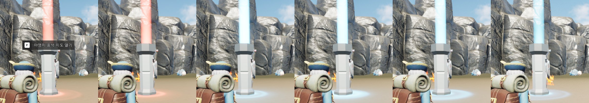

# 19. World Map & Fast Travel

섬을 탐험한 범위를 지도와 미니맵에 표시하고, 발견한 표석을 통해 빠른 이동할 수 있도록 구현했습니다. 지역 발견은 퀘스트·도감에도 사용합니다.

## 게임 화면

| 전체 지도 (M) | 필드 미니맵 |
|---|---|
|  |  |
| 탐험한 영역만 열리고, 오른쪽에서 활성화한 표석을 선택합니다. | 북쪽을 위로 고정하고 플레이어 방향과 퀘스트 목적지를 표시합니다. |

| 표석 활성화 전·후 | 도감에서 서식지 찾기 |
|---|---|
|  |  |
| 표석에서 F를 눌러 활성화합니다. 활성화 여부와 빛기둥 색은 플레이어마다 다릅니다. | 도감의 '지도에서 보기'로 해당 몬스터의 서식지를 표시합니다. |

## 월드 위치를 지도에 맞추기

지도 이미지는 레벨의 직교 `SceneCapture2D` 캡처를 바탕으로 만들었습니다. 원본과 수정본을 겹쳐 지형 위치를 확인하고, 캡처 월드 범위를 `DA_WorldMap`에 기록했습니다.

지도는 위쪽이 월드 +X, 오른쪽이 +Y입니다. 이 변환을 지도·미니맵·마커에 따로 구현하지 않고 `UWorldMapDefinition`에서 공유합니다.

~~~cpp
// WorldMapDefinition.h
FVector2D ToUV(const FVector& World) const
{
    return FVector2D(
        (World.Y - WorldMin.Y) / (WorldMax.Y - WorldMin.Y),
        (WorldMax.X - World.X) / (WorldMax.X - WorldMin.X));
}
~~~

`ToUV` / `ToWorld`는 화면 표시와 지도 위 위치 선택에 사용합니다. `Shows`는 플레이어가 섬 지도 범위에 있는지 확인할 때 사용하며, 지도 밖에 배치한 던전에서는 미니맵을 숨기고 빠른 이동 요청도 거부합니다.

## 지역 발견과 탐험 안개는 별도로 기록

지역 ID와 탐험 범위는 별도로 관리합니다. `ARegionZone`은 지역 이름·퀘스트 `Reach` 목표·도감 서식지에 사용하고, 안개는 Pawn이 지나간 위치를 기준으로 격자에 기록합니다. 지역 전체를 발견 처리하는 방식과 달리, 큰 지역 안에서도 **실제 이동 범위만** 지도에 표시할 수 있습니다.

### 서버 기록과 소유자 복제

`UWorldMapComponent`는 PlayerState에 붙어 있습니다. 서버가 0.25초마다 Pawn 위치를 읽어 주변 40m에 해당하는 칸을 발견 처리합니다.

~~~cpp
// WorldMapComponent.cpp — Explore() 발췌
for (const int32 Cell : Definition->CellsNear(Pawn->GetActorLocation()))
{
    if (IsExplored(Cell)) continue;
    Explored[Cell / 8] |= 1 << (Cell % 8);
    bChanged = true;
}
if (!bChanged) return;
OnMapChanged.Broadcast();
bUnstored = true;
~~~

안개 기록은 64×64칸의 비트 배열입니다. 원본 데이터는 **4,096비트(512바이트)**이고, `Discovered`(지역·표석 ID)와 `Explored`(탐험 비트)는 모두 `COND_OwnerOnly`로 복제합니다. 탐험 위치를 클라이언트에서 보고받지 않고 서버의 Pawn 위치로 결정합니다.

저장은 호스트 SaveGame의 `WorldMap` 슬롯에 모았습니다. 탐험 칸이 변경됐을 때 마지막 저장에서 5초 이상 지났으면 기록하고, 컴포넌트 종료 시 남은 변경도 저장합니다. 이미 발견한 지역·표석은 발견 시 바로 저장합니다.

스폰 위치의 지역이 기록되지 않는 경우도 수정했습니다. 지역 안에서 Pawn이 생성되면 BeginOverlap만으로는 발견 처리가 되지 않으므로, `OnPawnSet`에서 모든 `ARegionZone`의 포함 여부를 한 번 확인합니다. 저장 데이터를 읽을 때도 스폰 직후 기록한 탐험 칸이 지워지지 않도록 비트 OR로 합칩니다.

### 안개가 걷히는 화면

클라이언트의 `UMapFog`는 탐험 기록을 64×64 `PF_G8` 텍스처로 바꿉니다. 한 칸의 값은 미발견 0, 발견 255입니다. 새로 발견한 칸은 약 1.2초 동안 현재 값에서 목표 값으로 이동시킵니다.

~~~cpp
// MapFog.cpp — Apply() 발췌
const int32 Step =
    FMath::Max(1, FMath::RoundToInt(255.f * DeltaSeconds / FadeSeconds));

for (int32 Cell = 0; Cell < Shown.Num(); ++Cell)
{
    if (Shown[Cell] == Target[Cell]) continue;
    Shown[Cell] = Shown[Cell] < Target[Cell]
        ? FMath::Min(Shown[Cell] + Step, (int32)Target[Cell])
        : FMath::Max(Shown[Cell] - Step, (int32)Target[Cell]);
}
Upload();
~~~

페이드 진행 상태는 텍스처 전체의 혼합 비율이 아니라 **각 칸의 `Shown` 값**으로 보관합니다. 서버의 발견 기록이 갱신돼도 기존 칸의 밝기 변화는 이어지고 새 칸만 새 목표값으로 이동합니다. 지도를 처음 열 때는 이미 발견한 칸을 즉시 표시합니다.

`M_UI_Map` 머티리얼에서는 안개 텍스처를 보간하고 노이즈를 섞어 격자 경계를 흐립니다. 미니맵은 원형 마스크, 전체 지도는 사각 뷰로 표시하지만, 같은 지도 이미지와 안개 처리 경로를 사용합니다.

## 미니맵·전체 지도·마커

지도 마커는 `UMapMarkerComponent`가 BeginPlay/EndPlay에서 `UWorldMapSubsystem`에 등록·해제합니다. 마커를 그리는 쪽은 목록에서 위치·종류·발견 조건을 읽으므로 액터 클래스별 표시 분기를 둘 필요가 없습니다. 아이콘·색상·크기는 `DA_WorldMap.MarkerStyles`를 사용합니다. 활성화한 표석의 **목록 UI**는 별도로 `AFastTravelPoint`를 조회합니다.

- **미니맵:** 북쪽 고정, 플레이어 화살표만 회전. 멀리 있는 추적 퀘스트 목적지는 원형 테두리에 붙여 표시합니다.
- **전체 지도:** 마우스 드래그·휠, 게임패드 스틱·트리거로 이동·확대. 화면 비율에 따라 가로/세로 표시 범위를 다르게 계산해 지도 이미지가 늘어나지 않도록 했습니다.
- **마커:** 퀘스트 목적지·플레이어·표석·NPC·던전 순으로 표시 우선순위를 구분하고, 퀘스트 핀은 아래쪽 끝이 목표 위치를 가리키게 했습니다. `FMapIconLayer`는 `UImage`를 재사용하며 위치·크기·ZOrder를 갱신합니다.

추적 퀘스트의 목적지는 일반 마커와 별도로 퀘스트 기록에서 계산합니다. `Reach`는 지역 중심, `Talk`/`Deliver`는 NPC, `ClearDungeon`은 던전 포탈을 사용합니다. 완료 보고 대기 중이면 보고 대상 위치를 표시합니다.

전체 지도는 기존 `UUIStackSubsystem`의 지도 탭으로 열고 닫습니다. 메뉴 탭 상태·키 입력 안내는 다른 인벤토리/도감/퀘스트 탭과 같은 흐름을 사용합니다.

## 빠른 이동 표석

`AFastTravelPoint`는 기존 `IInteractableInterface`를 구현합니다. F 상호작용을 받으면 서버가 활성화 기록을 갱신하고, 이미 활성화한 표석인 경우 해당 플레이어에게 지도 탭을 엽니다.

`AFastTravelPoint::Interact`는 서버에서 생존·거리·상태를 확인하고 처음 활성화할 때 `PointId`를 발견 기록에 추가합니다. 지도에서 목적지를 선택하면 `ServerFastTravel(PointId)`를 요청합니다.

~~~cpp
// WorldMapComponent.cpp — ServerFastTravel_Implementation() 발췌
if (!IsDiscovered(PointId) || !IsValid(Player) || Player->IsDie())
    return;

if (!Map || !Map->GetDefinition() ||
    !Map->GetDefinition()->Shows(Player->GetActorLocation()))
    return;

for (TActorIterator<AFastTravelPoint> It(GetWorld()); It; ++It)
    if (It->PointId == PointId) { It->Receive(Player); return; }
~~~

**이동은 서버에서 확정**합니다. 서버는 활성화 여부·생존 상태·현재 위치가 지도 범위 안인지 확인한 뒤 대상 표석의 `Arrival` 위치로 이동시킵니다. 던전은 지도 범위 밖이어서 이동 요청을 거부하며, 기존 포탈을 통한 종료 절차와 충돌하지 않습니다. 이동 후 컨트롤러 회전과 화면 페이드를 적용합니다.

표석의 활성화 기록은 플레이어별 `UWorldMapComponent`에 보관됩니다. 각 클라이언트는 자신의 기록을 조회해 빛기둥을 빨강/파랑으로 표시하므로, **공유 Actor에 플레이어 공통 색상 상태를 복제하지 않습니다.** 활성화 직후에는 빛기둥·바닥 링 머티리얼의 `Flash` 값과 점광원 밝기를 짧게 변화시킵니다.

## 도감에서 서식지 보기

도감 정의 데이터에 지역 ID 목록(`Habitats`)을 추가했습니다. 발견한 몬스터만 서식지를 보여주고, 플레이어가 아직 찾지 못한 지역 이름은 `???`로 표시합니다.

`UMonsterDexWidget::ShowHabitat`에서 서식지 목록과 몬스터 이름을 복사한 뒤 지도 탭을 열고, `UWorldMapWidget::ShowHabitat`으로 전달합니다. 도감 탭이 닫히면서 선택 페이지가 바뀔 수 있으므로 **탭 전환 전에 표시 데이터를 확보**합니다. 지도는 서식지 위치들을 포함하도록 중심과 확대 범위를 조정합니다.

서식지 ID는 현재 몬스터 배치를 기준으로 정의 데이터에 기입했습니다. 배치가 바뀌면 해당 목록도 갱신해야 합니다.

## 확인한 동작과 시연 자료

PR #4의 `verify_map` 5/5에서 Listen Server와 클라이언트의 지역·안개 발견, 표석 활성화 전 이동 거부 및 활성화 후 이동, 지도 탭의 입력, 도감에서 지도 전환, 새 세션의 저장 복원을 확인했습니다. `verify_ui_stack` 6/6 및 `verify_dex` 3/3도 실행했습니다. `verify_quest`는 이 변경에서 다시 실행하지 않았습니다.

게임플레이 영상은 별도로 촬영해 추가할 예정입니다. 정지 화면만으로는 안개의 칸별 페이드와 표석 이동 전후의 입력·화면 전환을 확인하기 어렵습니다.

## 코드

- [WorldMapDefinition.h](https://github.com/chungheonLee0325/Sonheim/blob/feat-world-map/Sonheim/Source/Sonheim/Map/WorldMapDefinition.h) — 좌표 변환·지도 범위·마커 스타일
- [WorldMapComponent.cpp](https://github.com/chungheonLee0325/Sonheim/blob/feat-world-map/Sonheim/Source/Sonheim/AreaObject/Player/Utility/WorldMapComponent.cpp) — 탐험 기록·OwnerOnly 복제·저장·서버 빠른 이동
- [MapFog.cpp](https://github.com/chungheonLee0325/Sonheim/blob/feat-world-map/Sonheim/Source/Sonheim/Map/MapFog.cpp) — 64×64 텍스처·칸별 페이드
- [MapView.cpp](https://github.com/chungheonLee0325/Sonheim/blob/feat-world-map/Sonheim/Source/Sonheim/Map/MapView.cpp) · [MapMarkerComponent.cpp](https://github.com/chungheonLee0325/Sonheim/blob/feat-world-map/Sonheim/Source/Sonheim/Map/MapMarkerComponent.cpp) — 마커 등록·배치·재사용
- [WorldMapWidget.cpp](https://github.com/chungheonLee0325/Sonheim/blob/feat-world-map/Sonheim/Source/Sonheim/UI/Map/WorldMapWidget.cpp) · [MinimapWidget.cpp](https://github.com/chungheonLee0325/Sonheim/blob/feat-world-map/Sonheim/Source/Sonheim/UI/Map/MinimapWidget.cpp) — 전체 지도·미니맵
- [FastTravelPoint.cpp](https://github.com/chungheonLee0325/Sonheim/blob/feat-world-map/Sonheim/Source/Sonheim/GameObject/Map/FastTravelPoint.cpp) — 활성화·플레이어별 표시·도착 처리
- [16. MonsterDex System](16_MonsterDex_System.md) · [17. Quest System](17_Quest_System.md) · [18. UMG v2 Migration](18_UMG_v2_Migration.md)
