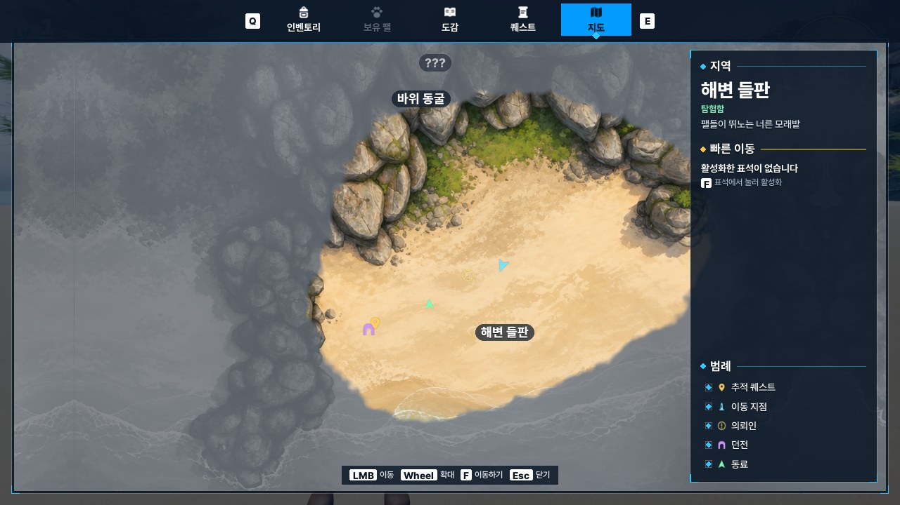
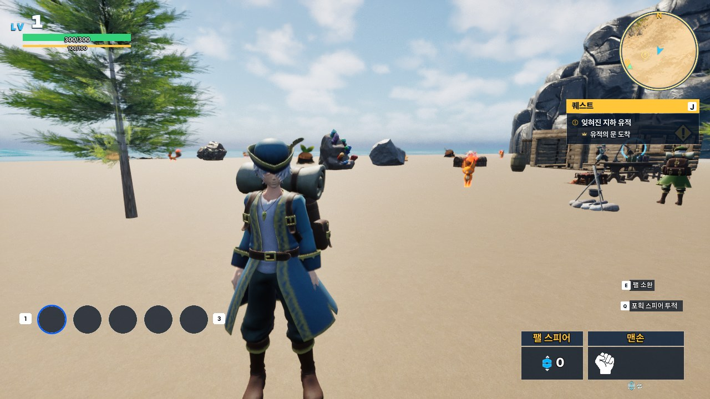
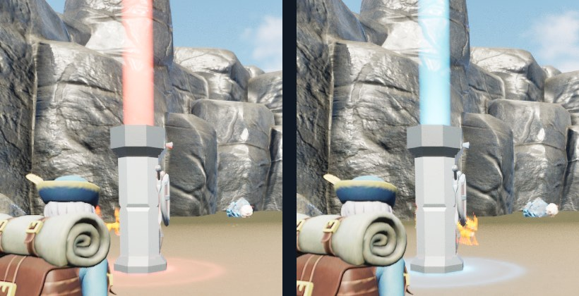
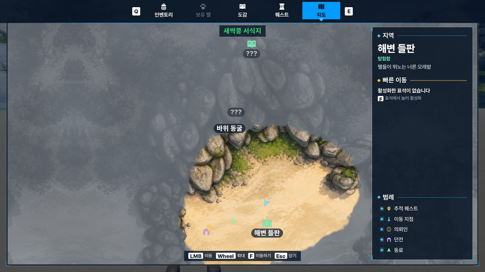
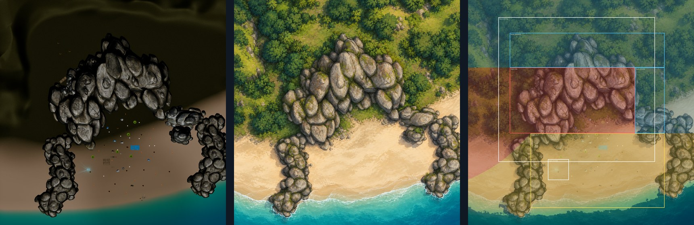
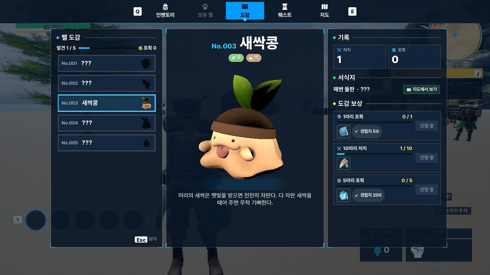

# 19. World Map & Fast Travel

탐험한 지역을 미니맵과 전체 지도에 표시하고, 플레이어별 발견 기록을 저장·복제해 빠른 이동과 도감 서식지에 사용합니다.

## 게임 화면

| 전체 지도 | 필드 미니맵 |
|---|---|
|  |  |

| 빠른 이동 표석 | 도감 서식지 표시 |
|---|---|
|  |  |

## 플레이어별 지도 상태와 서버 동기화

지도에는 두 종류의 기록이 있습니다.

| 기록 | 데이터 | 용도 |
|---|---|---|
| `Discovered` | `TArray<FName>` | 발견한 지역 ID, 활성화한 표석 ID |
| `Explored` | `TArray<uint8>` | 탐험한 64×64 지도 칸의 비트 배열 |

둘 다 `PlayerState`에 붙은 `UWorldMapComponent`에서 관리합니다. **서버가 기록을 변경하고 소유 클라이언트에만 복제**하며, 호스트의 `WorldMap` SaveGame에 플레이어 키별로 저장합니다.

~~~cpp
// WorldMapComponent.cpp — 복제 대상
DOREPLIFETIME_CONDITION(UWorldMapComponent, Discovered, COND_OwnerOnly);
DOREPLIFETIME_CONDITION(UWorldMapComponent, Explored, COND_OwnerOnly);
~~~

~~~mermaid
flowchart LR
    subgraph Server["Listen Server"]
        P["Pawn 위치 · 지역 진입 표석 상호작용"] --> C["PlayerState UWorldMapComponent"]
        C --> D["Discovered / Explored"]
        D --> S["UWorldMapSubsystem StorePlayer(PlayerKey)"]
        S --> G[("WorldMap SaveGame")]
    end
    subgraph Client["해당 플레이어의 클라이언트"]
        R["OwnerOnly 복제 OnRep → OnMapChanged"] --> U["전체 지도 · 미니맵"]
        R --> V["활성 표석 목록 · 표시 상태"]
    end
    D -->|"COND_OwnerOnly"| R
~~~

이 구조에서는 다른 플레이어의 탐험 칸이나 활성화한 표석이 내 지도에 섞이지 않습니다. 클라이언트는 복제 알림(`OnMapChanged`)을 받아 지도를 다시 그립니다. **서버의 기록과 UI가 사용하는 표시 데이터는 분리**돼 있습니다.

저장 시 `UWorldMapSubsystem::StorePlayer`가 `PlayerKey`에 해당하는 `Discovered`·`Explored`를 기록합니다. 지역이나 표석을 처음 발견하면 바로 저장하고, 탐험 칸은 변경 후 마지막 저장으로부터 5초 이상 지났을 때 저장합니다. 컴포넌트 종료 시 남은 변경도 저장합니다.

지역 발견은 `ARegionZone` 진입 이벤트를 사용합니다. 다만 지역 안에서 Pawn이 생성되면 BeginOverlap이 발생하지 않을 수 있어 `OnPawnSet`에서도 포함된 지역을 확인합니다. 저장 기록을 나중에 읽을 때는 스폰 직후 발견한 탐험 비트가 사라지지 않도록 OR로 합칩니다.

## 빠른 이동 요청과 플레이어별 활성화 상태

표석은 월드에 있는 `AFastTravelPoint` Actor이고, **활성화 기록은 표석 Actor가 아닌 각 플레이어의 `UWorldMapComponent`에 저장**합니다.

1. 표석과 상호작용하면 서버 `AFastTravelPoint::Interact`가 거리·생존 상태를 확인하고 `Discover(PointId)`로 활성화 ID를 기록합니다.
2. `Discovered`가 소유 클라이언트에 복제되면 지도는 활성화한 표석만 목록에 넣고, 월드 표석의 표시도 해당 플레이어 기록으로 결정합니다.
3. 지도에서 표석을 선택하면 클라이언트가 `ServerFastTravel(PointId)`을 호출합니다. **클라이언트의 선택 결과만으로 이동시키지 않고 서버에서 다시 검증**합니다.

~~~cpp
// WorldMapComponent.cpp — ServerFastTravel_Implementation() 발췌
if (!GetOwner()->HasAuthority() || !IsDiscovered(PointId) ||
    !IsValid(Player) || Player->IsDie()) return;

if (!Map || !Map->GetDefinition() ||
    !Map->GetDefinition()->Shows(Player->GetActorLocation())) return;

for (TActorIterator<AFastTravelPoint> It(GetWorld()); It; ++It)
    if (It->PointId == PointId) { It->Receive(Player); return; }
~~~

서버는 활성화한 목적지인지, 플레이어가 이동할 수 있는 상태인지, 현재 위치가 섬 지도 범위인지 검사합니다. 던전은 지도 범위 밖이므로 기존 포탈을 거치지 않고 빠져나가는 요청을 막습니다. 조건을 통과하면 목적지 표석의 `Arrival` 위치로 `TeleportTo`하고, 소유 클라이언트의 회전과 화면 전환을 처리합니다.

~~~mermaid
sequenceDiagram
    participant P as 플레이어
    participant A as 서버: 표석 Actor
    participant S as 서버: WorldMapComponent
    participant G as WorldMap SaveGame
    participant C as 소유 클라이언트

    P->>A: 표석 상호작용
    A->>S: Discover(PointId)
    S->>G: StorePlayer(PlayerKey, Discovered, Explored)
    S-->>C: Discovered 복제 (OwnerOnly)
    C->>S: ServerFastTravel(PointId)
    S->>S: 발견 여부 · 생존 · 현재 지도 범위 검사
    S->>A: 목적지 PointId 탐색 후 Receive(Player)
    A->>P: TeleportTo(Arrival)
    A-->>C: 시점 회전 · 화면 페이드
~~~

**플레이어 A와 B가 같은 표석을 보더라도 활성화 여부는 다를 수 있습니다.** 표석은 공용 Actor로 두고, 표시 색은 각 클라이언트가 자신의 `Discovered`에서 결정합니다. 별도의 플레이어 공통 활성화 상태를 표석에 복제하지 않습니다.

## 탐험 안개: 512바이트 기록에서 화면까지

지역 ID는 퀘스트의 `Reach`·도감 서식지·지역 이름에 사용하고, 실제 탐험 범위는 별도의 64×64 격자로 기록합니다. 큰 지역을 한 번 발견해도 지도의 안개가 전부 걷히지 않도록 한 것입니다.

서버 `UWorldMapComponent::Explore`는 **0.25초마다 Pawn 위치 주변 4,000cm(40m)** 에 해당하는 칸을 찾습니다. 각 칸을 1비트로 저장하므로 **4,096비트 = 512바이트**입니다. 이 수치는 비트 배열 원본 크기이며 실제 네트워크 전송량을 뜻하지는 않습니다.

~~~cpp
// WorldMapComponent.cpp — 새로 탐험한 칸 표시
for (const int32 Cell : Definition->CellsNear(Pawn->GetActorLocation()))
{
    if (IsExplored(Cell)) continue;
    Explored[Cell / 8] |= 1 << (Cell % 8);
    bChanged = true;
}
~~~

클라이언트는 복제받은 비트를 `UMapFog::Show`에서 **64×64 `PF_G8` 텍스처의 목표값(`Target`)** 으로 바꿉니다. 화면에 표시하는 값(`Shown`)은 별도로 유지하고, 새 탐험 칸만 약 1.2초에 걸쳐 밝아지도록 갱신합니다.

~~~cpp
// MapFog.cpp — Apply() 발췌
const int32 Step = FMath::Max(
    1, FMath::RoundToInt(255.f * DeltaSeconds / FadeSeconds));

for (int32 Cell = 0; Cell < Shown.Num(); ++Cell)
{
    if (Shown[Cell] == Target[Cell]) continue;
    Shown[Cell] = Shown[Cell] < Target[Cell]
        ? FMath::Min(Shown[Cell] + Step, (int32)Target[Cell])
        : FMath::Max(Shown[Cell] - Step, (int32)Target[Cell]);
}
Upload(); // UpdateTextureRegions
~~~

새 `Explored` 데이터가 들어와도 `Shown`을 초기화하지 않으므로, 앞서 걷히던 칸은 그대로 이어서 밝아집니다. 처음 지도를 열 때는 이미 탐험한 칸을 페이드 없이 표시합니다. `M_UI_Map`은 이 텍스처를 받아 격자 경계를 보간·노이즈 처리하고, 미니맵과 전체 지도에서 공통으로 사용합니다.

## 같은 월드 좌표를 두 지도에 표시

지도 이미지는 레벨을 직교 `SceneCapture2D`로 촬영한 뒤 지형을 유지하며 다듬었습니다. 캡처 범위와 방향(월드 +X = 지도 위쪽, +Y = 오른쪽)을 `DA_WorldMap`에 기록했습니다.

~~~cpp
// WorldMapDefinition.h
FVector2D ToUV(const FVector& World) const
{
    return FVector2D(
        (World.Y - WorldMin.Y) / (WorldMax.Y - WorldMin.Y),
        (WorldMax.X - World.X) / (WorldMax.X - WorldMin.X));
}
~~~

`UWorldMapDefinition::ToUV` / `ToWorld`에서 좌표 변환을 공통 처리합니다. 미니맵은 현재 Pawn 위치를 중심으로 좁은 범위를 표시하고, 전체 지도는 드래그·확대와 화면 비율에 맞춰 표시 범위를 계산합니다. 두 위젯은 같은 지도 정의·안개·마커 데이터를 사용합니다.

`UMapMarkerComponent`가 월드 Actor를 `UWorldMapSubsystem`에 등록하면 각 지도는 해당 목록에서 마커를 배치합니다. 아이콘·크기는 `DA_WorldMap.MarkerStyles`에서 정하고, `FMapIconLayer`가 `UImage`를 재사용합니다. 퀘스트 목적지는 별도로 퀘스트 기록을 읽어 `Reach` 지역 중심, `Talk/Deliver` NPC, `ClearDungeon` 포탈 위치로 변환합니다. 미니맵 밖의 목적지는 테두리에 고정해 방향만 표시합니다.

## 도감 서식지 연결

도감 데이터의 `Habitats`에는 지역 ID를 저장합니다. `UMonsterDexWidget`은 페이지에서 서식지 목록과 몬스터 이름을 복사한 뒤 지도 탭으로 전환하고, `UWorldMapWidget::ShowHabitat`에 전달합니다. 전환 과정에서 도감 위젯이 닫혀도 필요한 값이 유지되도록 **탭 전환 전에 데이터 복사**를 끝냅니다. 지도는 서식지 위치가 함께 들어오도록 중심·확대 범위를 계산합니다.

## 관련 코드

- [WorldMapComponent.cpp](https://github.com/chungheonLee0325/Sonheim/blob/feat-world-map/Sonheim/Source/Sonheim/AreaObject/Player/Utility/WorldMapComponent.cpp) — 플레이어별 복제·저장·서버 빠른 이동
- [WorldMapSubsystem.cpp](https://github.com/chungheonLee0325/Sonheim/blob/feat-world-map/Sonheim/Source/Sonheim/Map/WorldMapSubsystem.cpp) — SaveGame·마커 목록
- [FastTravelPoint.cpp](https://github.com/chungheonLee0325/Sonheim/blob/feat-world-map/Sonheim/Source/Sonheim/GameObject/Map/FastTravelPoint.cpp) — 활성화·도착 처리
- [MapFog.cpp](https://github.com/chungheonLee0325/Sonheim/blob/feat-world-map/Sonheim/Source/Sonheim/Map/MapFog.cpp) — 텍스처 갱신·칸별 페이드
- [WorldMapDefinition.h](https://github.com/chungheonLee0325/Sonheim/blob/feat-world-map/Sonheim/Source/Sonheim/Map/WorldMapDefinition.h) — 월드↔지도 좌표
- [WorldMapWidget.cpp](https://github.com/chungheonLee0325/Sonheim/blob/feat-world-map/Sonheim/Source/Sonheim/UI/Map/WorldMapWidget.cpp) · [MinimapWidget.cpp](https://github.com/chungheonLee0325/Sonheim/blob/feat-world-map/Sonheim/Source/Sonheim/UI/Map/MinimapWidget.cpp) — 전체 지도·미니맵
- [MapMarkerComponent.cpp](https://github.com/chungheonLee0325/Sonheim/blob/feat-world-map/Sonheim/Source/Sonheim/Map/MapMarkerComponent.cpp) · [MapView.cpp](https://github.com/chungheonLee0325/Sonheim/blob/feat-world-map/Sonheim/Source/Sonheim/Map/MapView.cpp) — 마커 구성·퀘스트 목적지
- [16. MonsterDex System](16_MonsterDex_System.md) · [17. Quest System](17_Quest_System.md) · [18. UMG v2 Migration](18_UMG_v2_Migration.md)
