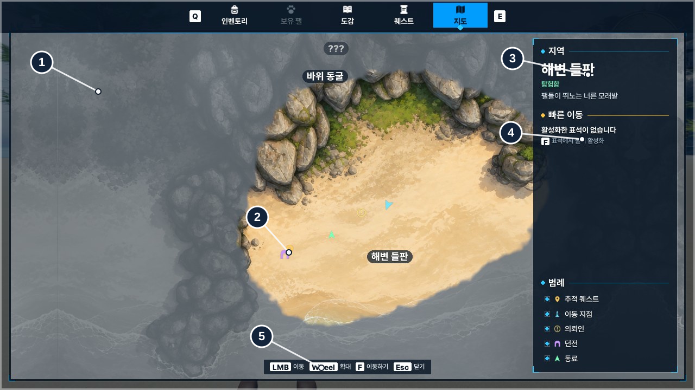

# 19. World Map & Fast Travel

섬 지도를 HUD 미니맵과 메뉴의 전체 지도에 추가했습니다. 지도에는 플레이어 위치, 퀘스트 목적지, 발견 지역, 탐험 범위, 활성화한 빠른 이동 지점을 표시합니다. 도감에서 몬스터 서식지를 선택하면 해당 위치로 지도를 열 수도 있습니다.

## 게임 화면

| 전체 지도 | 필드 미니맵 |
|---|---|
|  |  |

| 빠른 이동 지점 | 도감에서 서식지 보기 |
|---|---|
|  |  |

지도 화면에 번호로 표시한 영역은 다음 코드에서 처리합니다.

| 표시 영역 | 화면에 반영하는 데이터·처리 |
|---|---|
| **① 지도와 안개** | `Explored` 탐험 기록을 `UMapFog` 텍스처로 변환하고, `M_UI_Map` 머티리얼에 적용 |
| **② 마커** | 월드 Actor·퀘스트 목표 위치를 지도 좌표로 바꾸고 `FMapIconLayer`에서 `UImage`로 배치 |
| **③ 지역 정보** | 커서 아래 지점을 `RegionAt()`으로 조회하고 발견 여부에 따라 지역명·설명을 변경 |
| **④ 빠른 이동** | `Discovered`를 기준으로 활성 표석 목록을 구성하고 선택한 `PointId`로 이동 요청. 이 캡처는 활성 표석이 없는 상태 |
| **⑤ 지도 입력** | `WorldMapWidget`에서 드래그·휠 확대를 처리하고, 기존 메뉴 탭·입력 안내와 함께 사용 |

## 게임 데이터에서 지도 UI까지

지도는 여러 시스템의 값을 함께 보여줍니다. 탐험 여부는 `UWorldMapComponent`, 퀘스트 목표는 `UQuestComponent`, 월드의 표시 대상은 `UMapMarkerComponent`에서 가져옵니다. 위젯은 이 데이터를 지도에 필요한 **위치·아이콘·텍스트·표시 여부**로 가공합니다.

~~~mermaid
flowchart LR
    A["월드 Actor RegionZone · MapMarkerComponent"] --> V["SonheimMap 지역·마커·목표 위치"]
    B["QuestComponent 추적 상태·목표"] --> V
    C["WorldMapComponent 발견 ID · 탐험 비트"] --> W["WorldMapWidget · MinimapWidget"]
    V --> W
    D["DA_WorldMap 좌표 범위·마커 스타일"] --> W
    W --> E["전체 지도 지역·표석 목록·범례·서식지"]
    W --> F["미니맵 플레이어·주변 마커·목표 방향"]
~~~

### 상태 변경과 화면 갱신

`UWorldMapWidget`은 지도 화면이 열릴 때 `OnMapChanged`와 `OnQuestsChanged`에 `Redraw()`를 연결합니다.

~~~cpp
// WorldMapWidget.cpp — NativeConstruct / Redraw 발췌
if (Places.IsValid())
    Places->OnMapChanged.AddUniqueDynamic(this, &UWorldMapWidget::Redraw);
if (Quests.IsValid())
    Quests->OnQuestsChanged.AddUniqueDynamic(this, &UWorldMapWidget::Redraw);

// Redraw() — Map 유효성 확인 후
Fog->Show(Places.IsValid() ? Places->GetExplored() : TArray<uint8>(),
          Map->FogCells);
QuestPlaces = SonheimMap::TrackedQuestPlaces(GetWorld(), Regions, Quests.Get());
~~~

위 코드는 변경 경로를 보여주는 **발췌**입니다. `Redraw()`에서는 탐험 안개 데이터와 퀘스트 목적지를 갱신하고, `Discovered`를 기준으로 빠른 이동 목록을 다시 구성합니다. 미니맵은 PlayerState가 HUD보다 늦게 준비될 수 있어 `NativeTick`에서 컴포넌트 연결을 확인한 후 같은 Delegate를 바인딩합니다.

모든 요소를 이벤트로만 갱신하지는 않습니다. **변경이 발생한 데이터**(탐험 기록·퀘스트 목표·목록)는 Delegate로, **계속 변하는 화면 위치**(플레이어·마커 위치, 뷰 영역)는 Tick에서 처리합니다. 전체 지도는 `PlaceMarkers()`, 미니맵은 `PlaceMarkers()`와 플레이어 중심 갱신을 사용합니다.

## 실제 월드 위치를 UI 좌표로 바꾸기

지도 이미지는 실제 레벨을 직교 `SceneCapture2D`로 촬영한 다음 지형 형태를 유지해 다듬었습니다. 원본과 지도 이미지를 겹쳐 위치를 확인하고, 캡처한 월드 범위를 `DA_WorldMap`에 설정했습니다.

이 이미지의 위쪽은 월드 +X, 오른쪽은 +Y입니다. 좌표 변환을 위젯마다 구현하지 않고 `UWorldMapDefinition::ToUV`에서 처리합니다.

~~~cpp
// WorldMapDefinition.h
FVector2D ToUV(const FVector& World) const
{
    return FVector2D(
        (World.Y - WorldMin.Y) / (WorldMax.Y - WorldMin.Y),
        (WorldMax.X - World.X) / (WorldMax.X - WorldMin.X));
}
~~~

미니맵은 플레이어의 UV를 중심으로 70m 범위를 표시합니다. 전체 지도는 UV로 계산한 `Center`와 세로 표시 범위 `Span`을 사용하고, 실제 위젯의 가로·세로 비율에 맞춰 가로 범위를 결정합니다. 그래서 넓은 화면에서도 지도 이미지가 늘어나지 않습니다.

~~~cpp
// WorldMapWidget.cpp — 표시 범위와 커서 기준 확대
FVector2D UWorldMapWidget::ViewSize() const
{
    const FVector2D Size = MapImage->GetCachedGeometry().GetLocalSize();
    return FVector2D(Size.Y > 0.0 ? Span * Size.X / Size.Y : Span, Span);
}

void UWorldMapWidget::Zoom(float Factor, const FVector2D& AroundUV)
{
    const float Next = FMath::Clamp(Span * Factor, MinSpan, MaxSpan);
    Center = AroundUV + (Center - AroundUV) * (Next / Span);
    Span = Next;
    ApplyView();
}
~~~

`Zoom()`에서 확대 후 중심을 보정하므로 **마우스 커서가 가리키던 위치를 유지한 채 확대**할 수 있습니다. 드래그는 화면 이동량을 `ViewSize()`의 UV 이동량으로 바꾸고, 게임패드는 왼쪽 스틱·트리거 입력을 같은 `Center`·`Span` 값에 반영합니다. 입력 장치별 처리는 달라도 화면 계산은 공유합니다.

전체 지도는 기존 `UUIStackSubsystem`의 메뉴 탭으로 등록했습니다. `PlayerController`에서 M 키와 메뉴 확인·닫기 입력을 연결하고, 게임패드 메뉴 입력은 `IMC_Menu`를 사용합니다. 따라서 지도만 별도의 입력 모드나 커서 정책을 관리하지 않습니다.

## 마커와 퀘스트 목적지

지도에 표시할 Actor는 `UMapMarkerComponent`를 붙여 `UWorldMapSubsystem`에 등록합니다. 지도 위젯은 등록된 목록에서 위치·종류·`DiscoveryId`를 읽고, `DA_WorldMap.MarkerStyles`에서 아이콘과 크기를 가져옵니다. 새로운 표시 대상이 생겨도 지도 위젯에 해당 Actor 클래스를 추가할 필요가 없습니다.

퀘스트 목적지는 별도로 **진행 중인 목표를 월드 위치로 변환**합니다. `SonheimMap::TrackedQuestPlaces()`가 담당합니다.

| 퀘스트 목표 | 지도에서 사용하는 위치 |
|---|---|
| `Reach` | 대상 `ARegionZone`의 대표 위치 |
| `Talk` / `Deliver` | `IQuestTarget`을 구현한 NPC·대상 Actor |
| `ClearDungeon` | 던전 마커 위치 |
| 완료 보고 대기 | 보상·완료 보고 대상 위치 |

이 위치들을 지도에서는 핀으로 표시하고, 미니맵에서는 표시 범위를 벗어난 목적지를 원형 테두리에 붙여 **방향을 유지**합니다.

마커의 화면 표현은 `FMapIconLayer`가 관리합니다. `UImage`를 매번 새로 만들지 않고, 기존 이미지를 재사용하면서 Brush·위치·크기·ZOrder를 갱신합니다. `UWorldMapWidget::PlaceMarkers()`에서는 종류별 레이어, 핀 아래쪽 정렬, 마우스 오버 시 강조·이름 표시를 처리합니다. 지역 이름은 마커에 가려지지 않도록 위치를 조정하고, 작은 지역은 확대했을 때만 표시합니다.

## 탐험 기록을 안개 머티리얼로 표시하기

지역 이름이 발견됐는지와 **지도에서 실제로 걸어본 범위**는 별도 상태로 둡니다. 지역은 `Discovered`(ID 목록), 탐험 범위는 `Explored`(64×64 비트 배열)에 기록합니다.

`UWorldMapComponent`가 서버에서 0.25초 간격으로 Pawn 주변 40m의 탐험 칸을 표시합니다. 64×64칸은 원본 비트 데이터로 512바이트입니다. 해당 상태를 `COND_OwnerOnly`로 소유 클라이언트에 전달하고, 클라이언트 `UMapFog`가 화면용 64×64 `PF_G8` 텍스처를 만듭니다.

~~~mermaid
flowchart LR
    P["Pawn 위치"] --> A["탐험 셀 인덱스"]
    A --> B["Explored 비트 배열 64 × 64 / 512 B"]
    B -->|"OwnerOnly"| C["UMapFog Target / Shown"]
    C --> D["PF_G8 텍스처"]
    D --> E["M_UI_Map 미니맵·전체 지도"]
~~~

서버의 탐험 기록은 **발견 여부만 저장**합니다. 화면에서 안개가 얼마나 걷혔는지는 클라이언트의 `UMapFog`가 `Shown`과 `Target`으로 관리합니다. 새 기록이 들어와도 기존 `Shown`은 유지하므로 이미 밝아지던 칸은 계속 진행하고, 새로 발견한 칸만 페이드가 시작됩니다.

`M_UI_Map`은 이 텍스처를 샘플링해 보간·노이즈로 격자 경계를 처리합니다. 미니맵과 전체 지도는 같은 머티리얼 애셋을 사용하되 **각자 별도의 Dynamic Material Instance와 `UMapFog`**를 가집니다. 미니맵에는 원형 마스크를, 전체 지도에는 화면 비율을 반영한 사각 뷰를 적용합니다.

탐험과 발견 기록은 PlayerState의 `UWorldMapComponent`에 두고 호스트의 `WorldMap` SaveGame에 플레이어 키별로 저장합니다. 게임에 다시 접속하면 저장된 지역·표석·탐험 칸을 불러와 지도를 구성합니다.

## 빠른 이동: UI 선택을 게임플레이 동작으로 연결

표석 `AFastTravelPoint`는 공용 Actor지만, `PointId`의 활성화 기록은 각 플레이어의 `UWorldMapComponent`가 보유합니다. 상호작용은 기존 `IInteractableInterface` 경로로 받고, 서버에서 `Discover(PointId)`를 처리합니다.

`Discovered`가 복제되면 `UWorldMapWidget::Redraw()`가 활성화한 표석만 `TravelBox`에 구성합니다. `UMapTravelEntryWidget`은 `PointId`를 보유하고 클릭·마우스 오버를 상위 지도에 전달합니다. 지도에서 선택하면 `UWorldMapWidget::Travel()`이 `ServerFastTravel(PointId)`을 요청하고 지도 화면을 닫습니다.

~~~cpp
// WorldMapWidget.cpp
void UWorldMapWidget::Travel(const FName PointId)
{
    if (!Places.IsValid() || !Places->IsDiscovered(PointId)) return;
    Places->ServerFastTravel(PointId);
    UUIStackSubsystem::CloseWidget(this);
}
~~~

클라이언트의 목록 필터는 **UI 표시를 위한 처리**이고, 이동 가능 여부는 서버 `ServerFastTravel_Implementation()`이 별도로 확인합니다. 서버는 발견 여부·Pawn 생존 상태·현재 위치가 지도 범위 안인지 검사하고, 목적지 `AFastTravelPoint::Receive()`에서 `Arrival` 기준으로 `TeleportTo`를 수행합니다. 던전은 지도 범위 밖이므로 포탈을 통하지 않고 이동하는 요청을 막습니다.

표석의 활성 여부가 플레이어마다 다른 만큼, 월드의 표석 표시도 공용 Actor 상태로 복제하지 않습니다. 각 클라이언트가 자기 `Discovered` 기록을 읽어 로컬 표현을 결정합니다.

## 도감에서 지도 열기

도감의 `Habitats`(지역 ID 목록)를 `UWorldMapWidget::ShowHabitat()`에 넘겨 서식지 마커와 지역 위치를 표시합니다. 도감과 지도가 같은 메뉴 탭을 쓰므로 **화면 교체 전에 필요한 데이터를 먼저 복사**합니다.

~~~cpp
// MonsterDexWidget.cpp — ShowHabitat() 발췌
const TArray<FName> Habitats = Page->Habitats;
const FText Species = Page->Name;
Controller->OpenTab(UIScreen::WorldMap);
if (auto* Map = Cast<UWorldMapWidget>(UIStack->GetWidget(UIScreen::WorldMap)))
    Map->ShowHabitat(Habitats, Species);
~~~

`ShowHabitat()`은 서식지 ID를 지역·던전 마커의 월드 위치로 변환한 다음, 모든 서식지가 들어오도록 `Center`와 `Span`을 계산합니다. 종 발견 여부와 지역 발견 여부에 따라 도감에 표시할 이름도 구분합니다.

## 관련 코드

- [WorldMapWidget.cpp](https://github.com/chungheonLee0325/Sonheim/blob/feat-world-map/Sonheim/Source/Sonheim/UI/Map/WorldMapWidget.cpp) · [MinimapWidget.cpp](https://github.com/chungheonLee0325/Sonheim/blob/feat-world-map/Sonheim/Source/Sonheim/UI/Map/MinimapWidget.cpp) — 두 지도 위젯·뷰 처리·입력
- [MapView.cpp](https://github.com/chungheonLee0325/Sonheim/blob/feat-world-map/Sonheim/Source/Sonheim/Map/MapView.cpp) · [MapMarkerComponent.cpp](https://github.com/chungheonLee0325/Sonheim/blob/feat-world-map/Sonheim/Source/Sonheim/Map/MapMarkerComponent.cpp) — 퀘스트 목적지 변환·마커 표시
- [WorldMapDefinition.h](https://github.com/chungheonLee0325/Sonheim/blob/feat-world-map/Sonheim/Source/Sonheim/Map/WorldMapDefinition.h) · [MapFog.cpp](https://github.com/chungheonLee0325/Sonheim/blob/feat-world-map/Sonheim/Source/Sonheim/Map/MapFog.cpp) — 좌표·탐험 안개 렌더링
- [WorldMapComponent.cpp](https://github.com/chungheonLee0325/Sonheim/blob/feat-world-map/Sonheim/Source/Sonheim/AreaObject/Player/Utility/WorldMapComponent.cpp) · [WorldMapSubsystem.cpp](https://github.com/chungheonLee0325/Sonheim/blob/feat-world-map/Sonheim/Source/Sonheim/Map/WorldMapSubsystem.cpp) — 플레이어별 발견·복제·저장
- [FastTravelPoint.cpp](https://github.com/chungheonLee0325/Sonheim/blob/feat-world-map/Sonheim/Source/Sonheim/GameObject/Map/FastTravelPoint.cpp) · [MonsterDexWidget.cpp](https://github.com/chungheonLee0325/Sonheim/blob/feat-world-map/Sonheim/Source/Sonheim/UI/MonsterDex/MonsterDexWidget.cpp) — 빠른 이동·도감 화면 연동
- [16. MonsterDex System](16_MonsterDex_System.md) · [17. Quest System](17_Quest_System.md) · [18. UMG v2 Migration](18_UMG_v2_Migration.md)
