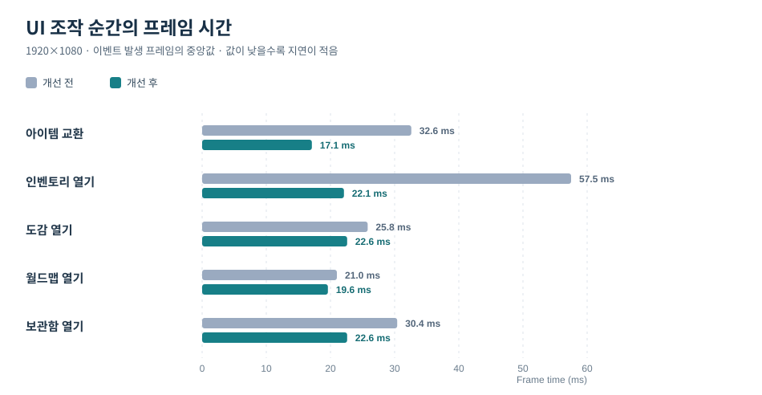

# 20. UI Performance Profiling & Optimization

인벤토리·도감·지도처럼 자주 사용하는 UI에서 **평상시 프레임 시간보다 화면을 열거나 아이템을 교환하는 순간의 지연**에 주목했습니다. 동일한 플레이 상황을 반복할 수 있는 측정 장면을 만들고, Unreal Insights와 CSV 이벤트 기록으로 비용이 발생하는 경로를 확인한 뒤 UI 갱신과 화면 수명 관리를 수정했습니다.

주요 결과는 아이템 교환 프레임 **32.6 → 17.1ms**, 인벤토리 열기 **57.5 → 22.1ms**입니다. 모두 1920×1080 환경에서 기록한 *조작 이벤트가 발생한 프레임의 중앙값*이며, 전체 게임의 평균 FPS 개선을 뜻하지는 않습니다.

이 문서는 기존 [18. UMG v2 Migration](18_UMG_v2_Migration.md)에서 만든 UIStack·인벤토리·도감 화면을 대상으로 **측정 → 원인 분석 → 구조 수정 → 재측정**한 내용을 다룹니다. 측정과 분석은 [Agent MCP](https://github.com/chungheonLee0325/AgentMcp)의 성능 도구와 `perf-investigation` 스킬로 묶어, AI 에이전트가 다른 UI에도 같은 절차를 반복할 수 있게 했습니다.

## 개선 전후

| 조작 | 개선 전 Frame (Game Thread) | 개선 후 Frame (Game Thread) |
|---|---:|---:|
| 아이템 교환 | 32.6ms (19.4ms) | **17.1ms (3.0ms)** |
| 인벤토리 열기 | 57.5ms (44.6ms) | **22.1ms (8.2ms)** |
| 도감 열기 | 25.8ms (12.4ms) | **22.6ms (8.6ms)** |
| 월드맵 열기 | 21.0ms (7.4ms) | **19.6ms (5.6ms)** |
| 보관함 열기 | 30.4ms (16.9ms) | **22.6ms (9.2ms)** |

*PR #6의 이벤트별 측정 중앙값입니다. Game Thread는 괄호 안에 구분했습니다. 실행 환경 및 장면의 영향을 받는 수치이므로 다른 프로젝트의 고정 성능값으로 일반화하지 않습니다.*

*위 그래프는 표의 측정값으로 직접 구성한 비교 자료이며, Unreal Insights 원본 화면 캡처는 아닙니다.*

> **측정 조건.** RTX 2070 SUPER, 1920×1080, VSync와 프레임 제한을 끈 독립 실행 게임(`-game`)에서 장면마다 3회 측정한 중앙값입니다. 측정 전에 워밍업 실행을 한 번 버리고, 실행 중 다른 프로세스의 CPU 부하를 1초마다 샘플링해 평균 10%를 넘은 실행은 다시 돌립니다. 개선 전후 차이는 양쪽 측정의 실행 간 편차보다 클 때만 결과로 보며, 0.5ms 미만의 차이는 6회씩 측정합니다. 화면의 첫 열기(에셋 로드와 첫 생성)와 다시 열기는 따로 봅니다.

조작에 따라 병목이 달랐습니다. Unreal Insights 트레이스에서 각 조작 프레임의 게임 스레드 시간을 타이머별로 합산한 결과입니다(개선 전, 조작 1회당).

| 조작 | 트레이스가 가리킨 비용 |
|---|---|
| 아이템 교환 | `UInventoryWidget::UpdateInventoryFromData` 본문 18.1ms, 교환 1회에 `SWidget::Invalidate` 11,635회 |
| 인벤토리 열기 | 위젯 생성(`ConstructObject`·`InstanceSubobjects`)이 대부분. 슬롯 `BP_Slot_C` 42개, 아이템마다 `BP_ToolTip` 생성(16.3ms 포함), 메뉴 탭 바 재생성 |
| 다시 연 인벤토리 (개선 후) | 위젯 생성 없이 Slate 트리 재구성과 `NativeConstruct`만 남음 (`PerfUI Open Menu` 자체 시간 5.5ms) |

도감은 화면 열기 비용과 별도로 **3D 프리뷰의 매 프레임 SceneCapture 렌더링 비용**도 조사했습니다.

## 실제 조작 프레임을 측정하기

평균 프레임 시간만 보면 1회성으로 발생하는 화면 열기·드래그·교환의 지연을 놓치기 쉽습니다. 그래서 `UPerfScenarioSubsystem : UGameInstanceSubsystem`에 개발 빌드용 시나리오를 구현했습니다.

- 플레이어 위치와 시선을 일정하게 맞춰 배경 렌더링 차이를 줄입니다.
- `-PerfScenes`, `-PerfWarmup`, `-PerfSeconds`, `-PerfRun`으로 장면·워밍업·수집 시간을 지정합니다.
- `HUD`, `Inventory`, `Dex`, `Map`, `OpenClose`, `InvSwap`, `DragSwap`, `Chest` 등 실제 UI 작업에 해당하는 장면을 반복합니다.
- CSV 이벤트(`PerfUI/Open Menu`, `PerfUI/Swap` 등)와 CPU Trace Scope로 **이벤트 발생 시점과 해당 프레임**을 찾아 비교합니다.
- CSV 캡처가 끝나면 비동기 파일 쓰기 완료를 확인하고 다음 장면으로 넘어갑니다.

~~~text
-PerfScenes=OpenClose,InvSwap,DragSwap,Chest
-PerfWarmup=3 -PerfSeconds=10 -PerfLabel=after -PerfRun=1
~~~

`OpenClose`는 인벤토리·도감·지도를 차례로 여닫고, `InvSwap`은 인벤토리 컴포넌트에 교환 요청을 전달합니다. `DragSwap`은 `FSlateApplication`에 Press → Move → Drop 입력을 전달해 **실제 UMG 드래그 경로**(드래그 감지, 드래그 비주얼 생성, 칸 강조, 드롭 후 `UpdateInventoryFromData`)를 통과합니다. 두 교환 장면은 측정하는 코드 경로가 서로 다르므로 구분했습니다. 개선 후 드래그 장면의 이벤트 프레임은 최대 17.9ms, 게임 스레드는 최대 5.6ms입니다.

측정 시나리오의 목적은 모든 플레이 상황을 완벽하게 재현하는 것이 아니라 **동일 조작을 반복해 개선 전후를 비교하고, Insights에서 원인을 추적할 수 있게 하는 것**입니다.

[측정 장면 구현 — PerfScenarioSubsystem.cpp](https://github.com/chungheonLee0325/Sonheim/blob/feat-ui-perf/Sonheim/Source/Sonheim/Utilities/PerfScenarioSubsystem.cpp)

## 인벤토리: 데이터 갱신과 슬롯 렌더링 분리

### 원인 — 하나의 아이템만 바뀌어도 슬롯 전체 갱신

기존 `UInventoryWidget::UpdateInventoryFromData()`는 인벤토리 변경 Delegate를 받으면 **모든 슬롯을 먼저 비우고**, 각 슬롯에 아이템 정보를 다시 설정했습니다. 교환으로 실제 데이터가 바뀐 슬롯이 두 개여도 42칸 전부에 같은 비용이 발생했습니다.

비용의 대부분은 툴팁이었습니다. `ClearSlot()`이 `SetToolTip(nullptr)`로 툴팁을 떼고, 이어서 `SetItemData()`가 툴팁 내용을 다시 채운 뒤 `SetToolTip()`으로 다시 붙였습니다. 툴팁을 붙일 때마다 Slate 위젯이 다시 연결되므로, 교환 한 번에 `SWidget::Invalidate`가 11,635회 일어났습니다. 또 빈 칸을 만나면 갱신을 멈추는 조기 반환이 있어, 빈 칸 뒤의 아이템이 갱신되지 않는 문제도 함께 있었습니다.

### 수정 — 슬롯은 마지막 표시 상태를 보유

전체 데이터 배열을 전달하는 인터페이스는 유지하되, 실제 화면 변경 여부를 **각 슬롯 위젯이 판단**하도록 바꿨습니다.

~~~cpp
// SlotWidget.cpp — 발췌
void USlotWidget::SetItemData(const FItemData* ItemData, int32 NewQuantity)
{
    if (ItemData == ShownItem && NewQuantity == Quantity) return;
    ClearSlot();
    // …
    ShownItem = ItemData;
    ItemID = ItemData->ItemID;
    Quantity = NewQuantity;
    if (IsHovered()) RefreshToolTip();
}
~~~

`UInventoryWidget::UpdateInventoryFromData()`는 모든 슬롯을 순회하지만, `USlotWidget`의 **아이템 데이터 포인터와 수량**이 같으면 Brush·텍스트·Visibility를 다시 건드리지 않습니다. 빈 칸 역시 이미 빈 상태라면 `ClearSlot()`을 생략합니다. 교환이라면 실제로 다시 그리는 칸은 두 개입니다.

리슨 서버의 클라이언트에서는 교환 한 번에 `OnInventoryChanged`가 두 번 옵니다. 예측(`PerformClientPrediction_SwapItems`)이 한 번, 서버 결과가 복제된 `OnRep_RepItems`가 한 번입니다. 두 번째 호출은 예측과 같은 데이터이므로 바뀌는 칸이 없어, 클라이언트의 교환 게임 스레드 시간도 중앙값 3.5ms로 호스트와 같습니다.

이 방식은 데이터의 변경 인덱스를 따로 받는 델타 이벤트가 아닙니다. **데이터 순회는 유지하고, 실제 UMG 속성 갱신 비용을 줄이는 방식**입니다. 현재 아이템 정의 데이터의 포인터가 안정적으로 유지되는 구조를 전제로 합니다.

### 툴팁은 필요할 때 생성

변경 전에는 슬롯 데이터를 설정하는 과정에서 툴팁을 준비했습니다. 수정 후에는 `NativeOnMouseEnter()`에서 `RefreshToolTip()`을 호출해, 플레이어가 실제로 아이템에 마우스를 올렸을 때 생성·초기화합니다. 호버 중 아이템이 바뀌는 경우도 `SetItemData()`에서 갱신합니다.

아이템 수가 많은 화면을 여는 순간에 **사용하지 않을 툴팁을 미리 만드는 비용**을 피하는 선택입니다.

[InventoryWidget.cpp](https://github.com/chungheonLee0325/Sonheim/blob/feat-ui-perf/Sonheim/Source/Sonheim/UI/Widget/Player/Inventory/InventoryWidget.cpp) · [SlotWidget.cpp](https://github.com/chungheonLee0325/Sonheim/blob/feat-ui-perf/Sonheim/Source/Sonheim/UI/Widget/Player/Inventory/SlotWidget.cpp)

## UIStack: 닫힌 화면의 UObject 재사용

### 기존 비용과 선택한 방식

UIStack은 화면을 닫을 때 `RemoveFromParent()`로 Viewport에서 제거했습니다. 이후 메뉴를 다시 열면 `CreateWidget`과 슬롯·탭 구성 비용이 반복됐습니다. 메뉴 상단의 탭 바도 탭이 하나도 없으면 지웠다가 다음 열기에 새로 만들고, 탭 항목은 엔트리 박스에서 삭제 후 다시 생성했습니다.

이번 변경에서는 `FUIScreenRule::bKeepWhenClosed`를 추가해 **자주 다시 여는 화면에만 재사용 정책**을 적용했습니다. 현재 설정 대상은 메뉴, 보관함, 도감, 월드맵입니다.

~~~mermaid
flowchart LR
    A["Open CreateWidget 또는 Kept 조회"] --> B["Viewport 표시 Stack에 등록"]
    B --> C["Close RemoveFromParent"]
    C --> D{"bKeepWhenClosed"}
    D -->|true| E["Kept에 UObject 유지"]
    D -->|false| F["참조 해제 가능"]
    E -->|재오픈| G["OwningPlayer · Class 검사"]
    G -->|일치| B
    G -->|불일치| A
~~~

화면을 **Collapsed로 계속 Viewport에 남기는 방식은 아닙니다.** 닫을 때 Viewport에서 떼어 `NativeDestruct()`가 실행되도록 하고, UIStack의 `Kept` 배열에서 UObject만 유지합니다. 다시 열 때 OwningPlayer와 Widget Class를 검사해 재사용 가능하면 `AddToViewport()`로 복귀시킵니다. 이때 `NativeConstruct()`는 다시 실행되므로 바인딩과 화면 재진입 상태를 고려해야 합니다.

### 한 번 만드는 상태와 열 때마다 갱신할 상태 구분

- **재사용하는 것:** 인벤토리 슬롯 그리드, 탭 엔트리 풀, 월드맵의 지역 라벨과 탐험 안개 객체.
- **재오픈 시 갱신하는 것:** 현재 플레이어 데이터, 지도 중심·표시 상태, 보관함 내용 및 Delegate 연결.
- **닫을 때 해제하는 것:** 도감 3D 프리뷰 Stage와 오래된 Render Target을 가리키는 Brush 참조.

예를 들어 월드맵은 최초 `NativeConstruct()`에서만 지역·라벨을 만들고, 다시 열 때에는 현재 플레이어의 지도·퀘스트 상태를 연결하고 `Redraw()`합니다. 탭 바도 화면이 닫혔다고 UObject를 지우지 않고, 재오픈 시 다시 표시합니다.

재사용은 **생성 비용 대신 메모리를 점유**합니다. 화면을 닫고 `obj gc` 후 `obj list`로 남은 객체를 비교하면, 탭 화면(메뉴·도감·지도)은 위젯 객체 메모리가 약 **1.8MB**, 보관함 화면은 약 **0.94MB** 늘어납니다. Slate 위젯 트리는 Viewport에서 떼어질 때 해제되므로 남는 것은 UObject입니다. 렌더 타깃과 동적 머티리얼 수는 보관하지 않을 때와 같습니다.

다시 연 화면에도 Slate 트리 재구성과 `NativeConstruct` 비용은 남습니다. 평상시 게임 스레드가 약 2.7ms인 장면에서 다시 연 프레임은 메뉴 8.2ms, 보관함 9.2ms입니다. 화면을 Collapsed로 숨기면 이 비용도 없어지지만, 닫힌 화면의 Slate 트리를 메모리에 계속 두고 `NativeConstruct`·`NativeDestruct` 대신 별도의 표시·숨김 처리를 화면마다 두어야 합니다. 현재 구조는 이 비용을 감수하고 기존 위젯 수명 주기를 유지합니다.

[UIStackSubsystem.cpp](https://github.com/chungheonLee0325/Sonheim/blob/feat-ui-perf/Sonheim/Source/Sonheim/UI/System/UIStackSubsystem.cpp) · [DefaultGame.ini](https://github.com/chungheonLee0325/Sonheim/blob/feat-ui-perf/Sonheim/Config/DefaultGame.ini) · [WorldMapWidget.cpp](https://github.com/chungheonLee0325/Sonheim/blob/feat-ui-perf/Sonheim/Source/Sonheim/UI/Map/WorldMapWidget.cpp)

## 보관함: 재사용 화면의 Delegate와 표시 데이터 관리

보관함은 UIStack에서 화면을 재사용하도록 변경하면서, **언제 데이터를 구독하고 해제하는지**를 함께 수정했습니다.

기존에는 `PlayerController`가 보관함 UI의 인벤토리 Delegate 바인딩과 해제를 직접 관리했습니다. 하지만 Tab 입력으로 UIStack이 먼저 화면을 닫으면 `Client_CloseContainerUI`가 이미 닫힌 위젯을 찾지 못해 `RemoveDynamic`이 실행되지 않았습니다. 그래서 보관함을 열고 닫을 때마다 `OnInventoryChanged`에 묶인 객체가 3 → 4 → 5 → 6으로 늘었습니다.

수정 후에는 `UContainerInteractionWidget`이 `OpenContainer()`에서 플레이어 인벤토리 Delegate를 연결하고 `NativeDestruct()`에서 해제합니다. 화면을 다시 열 때 중복 등록하지 않도록 `AddUniqueDynamic`을 사용했습니다. 열고 닫기를 반복해도 묶인 객체 수는 호스트 2, 클라이언트 1로 유지됩니다.

~~~text
보관함 열기
  → UIStack 화면 표시/재사용
  → ContainerInteractionWidget::OpenContainer
  → InventoryComponent Delegate 연결 + 현재 보관함 표시

보관함 닫기 (닫기 버튼 또는 Tab)
  → UIStack에서 화면 제거
  → NativeDestruct
  → 보관함 종료 처리 + InventoryComponent Delegate 해제
~~~

`UContainerWidget`은 슬롯 그리드 크기가 같으면 다시 만들지 않고, 새로운 `ContainerComponent`를 연결하면 **현재 보관함 내용을 즉시 갱신**합니다. 서로 다른 보관함을 연속해서 열어도 이전 보관함의 슬롯 표현이 남지 않게 하기 위한 처리입니다.

같은 취지로 인벤토리·플레이어 스탯 등 반복적으로 연결될 수 있는 이벤트도 `AddUniqueDynamic`을 사용합니다. 여기서 중요한 점은 단순히 중복 등록을 막는 것뿐 아니라, **화면 수명에 맞는 등록·해제 책임을 UI가 가지도록 옮긴 것**입니다.

[ContainerInteractionWidget.cpp](https://github.com/chungheonLee0325/Sonheim/blob/feat-ui-perf/Sonheim/Source/Sonheim/UI/Widget/GameObject/ContainerInteractionWidget.cpp) · [ContainerWidget.cpp](https://github.com/chungheonLee0325/Sonheim/blob/feat-ui-perf/Sonheim/Source/Sonheim/UI/Widget/GameObject/ContainerWidget.cpp)

## 도감: SceneCapture 비용과 화면 종료 리소스 분리

도감의 3D 프리뷰는 별도 `AMonsterDexStage`와 `SceneCaptureComponent2D`를 사용합니다. 프리뷰에는 몬스터 메시와 전용 조명을 표시하므로, 메인 월드의 모든 렌더링 효과가 필요하지 않습니다.

`ProfileGPU`로 캡처 한 프레임을 나눠 보면, 캡처 비용 2.67ms의 대부분은 Lumen이 아니라 메인 월드와 같은 고정 패스(Virtual Shadow Map 약 0.5ms, Nanite 약 0.45ms, AO 약 0.11ms, 태양광 그림자 투영)였습니다. 그래서 `AMonsterDexStage`의 `ShowFlagSettings`에서 기존 대기·안개·구름 등에 더해 Dynamic Shadows, Ambient Occlusion, Nanite Meshes, Lumen GI/Reflections 등 사용하지 않는 패스를 비활성화했습니다. `ProfileGPU`에서 관찰한 해당 캡처의 패스 비용은 **2.67 → 1.35ms**로 줄었습니다.

같은 변경의 반복 장면 측정에서는 **Frame -0.83ms / GPU -0.62ms**를 기록했습니다. `ProfileGPU` 수치는 한 캡처의 패스 비용 분석이고, 장면 측정은 별도의 실행에서 수집한 전체 프레임 통계이므로 두 감소량을 동일 지표로 해석하지 않습니다. 또한 위 표의 *도감 열기 이벤트 프레임*과도 별개의 측정입니다.

또한 도감 화면을 닫으면 Stage Actor는 파괴되지만, **재사용되는 위젯의 Image Brush가 이전 Render Target을 참조할 수 있습니다.** `obj refs`로 확인하면 프리뷰 Image와 엔트리 박스 풀에 들어간 목록 셀의 Brush가 파괴된 Stage의 렌더 타깃 7개(약 8.9MB)를 붙잡고 있었습니다. 이를 위해 `UMonsterDexWidget::NativeDestruct()`에서 프리뷰 Image와 현재 도감 목록 셀의 Brush 참조를 비우고, Stage 관련 참조도 초기화합니다. 닫힌 도감이 붙잡는 렌더 타깃은 0개이며, 다음 열기에는 새로운 Stage와 프리뷰가 연결됩니다.

### 제외한 최적화

`SceneCapture` 갱신을 30Hz로 제한하는 변경도 비교했으나, 6회씩 반복한 측정에서 Frame **-0.01ms**, GPU **+0.08ms**로 시간은 줄지 않고 GPU 메모리는 **+142MB** 늘어 적용하지 않았습니다.

같은 방식으로 측정했지만 고치지 않은 비용도 있습니다.

| 후보 | 측정 결과 | 판단 |
|---|---|---|
| Slate draw call (HUD 57 → 인벤토리 121) | 렌더 스레드 +0.008ms, GPU의 UI 패스 0.2ms 이하 | 프레임 편차(±0.6ms)보다 작아 그대로 둠 |
| 전리품 5개 줍기 | 해당 프레임 +2.2ms (아이템마다 퀘스트 추적기 갱신과 팝업 생성) | 한 프레임 비용이라 그대로 둠 |
| 제작대 열기 / 퀘스트 선택 / 데미지 숫자 20개 | +3ms / +1.1ms / +0.6ms | 예산 안이라 그대로 둠 |

[MonsterDexStage.cpp](https://github.com/chungheonLee0325/Sonheim/blob/feat-ui-perf/Sonheim/Source/Sonheim/UI/MonsterDex/MonsterDexStage.cpp) · [MonsterDexWidget.cpp](https://github.com/chungheonLee0325/Sonheim/blob/feat-ui-perf/Sonheim/Source/Sonheim/UI/MonsterDex/MonsterDexWidget.cpp)

## 함께 수정한 UI 이벤트 처리

Feed 알림에서 `RowBox->GetAllEntries()`를 순회하면서 항목을 제거하면 순회 중 원본 배열이 변경됩니다. 개발 빌드에서는 이 과정에서 ensure가 발생했고, 콜스택을 기록한 프레임이 **806ms**까지 지연됐습니다. 순회 대상 컬렉션을 변경하는 코드는 항목 접근과 반복 과정에도 위험이 있어, `StopChannel()`과 `NativeTick()`에서 **목록 복사본을 순회하며 제거**하도록 수정했습니다. Shipping 빌드에서의 재현 여부는 확인하지 않았습니다.

~~~cpp
// NoticeWidget.cpp — 실제 변경 코드 발췌
for (UUserWidget* Entry : TArray<UUserWidget*>(RowBox->GetAllEntries()))
{
    if (!Entry->IsVisible()) RowBox->RemoveEntry(Entry);
}
~~~

[NoticeWidget.cpp](https://github.com/chungheonLee0325/Sonheim/blob/feat-ui-perf/Sonheim/Source/Sonheim/UI/Notice/NoticeWidget.cpp)

## AI 에이전트가 반복할 수 있는 성능 조사 환경

측정·분석 절차는 이 프로젝트 안의 스크립트로 끝내지 않고 [Agent MCP](https://github.com/chungheonLee0325/AgentMcp)에 도구와 스킬로 넣었습니다. Agent MCP는 Unreal Editor 안에서 MCP 서버를 실행해 Claude Code·Codex 같은 코딩 에이전트가 프로젝트를 조사·수정·검증하게 하는 에디터 플러그인입니다.

| 구성 | 역할 |
|---|---|
| [`perf-investigation` 스킬](https://github.com/chungheonLee0325/AgentMcp/blob/main/Plugins/AgentMcp/Skills/perf-investigation/SKILL.md) | 장면 → 기준 측정 → 순간 표시 → 트레이스 → 원인 → 수정 → 재측정 절차, [장면 실행기 계약](https://github.com/chungheonLee0325/AgentMcp/blob/main/Plugins/AgentMcp/Skills/perf-investigation/references/scene-runner.md)과 골격 코드, 측정 규칙 |
| [`scripts/run.py`](https://github.com/chungheonLee0325/AgentMcp/blob/main/Plugins/AgentMcp/Skills/perf-investigation/scripts/run.py) · [`preflight.py`](https://github.com/chungheonLee0325/AgentMcp/blob/main/Plugins/AgentMcp/Skills/perf-investigation/scripts/preflight.py) | 에디터를 닫은 상태에서 독립 실행 게임으로 측정. 측정 전 머신 점검, 워밍업, 백그라운드 부하 샘플링과 방해받은 실행의 재실행, 실행마다 `GameUserSettings.ini` 복원 |
| [`perf_summarize_csv`](https://github.com/chungheonLee0325/AgentMcp/blob/main/Plugins/AgentMcp/Source/AgentMcpTools/Private/Toolsets/AgentMcpPerfTools.cpp) | 장면별 실행 평균의 중앙값·편차·95번째 백분위와 표시한 순간(`CSV_EVENT`)의 비용 |
| [`perf_compare_csv`](https://github.com/chungheonLee0325/AgentMcp/blob/main/Plugins/AgentMcp/Source/AgentMcpTools/Private/Toolsets/AgentMcpPerfTools.cpp) | 개선 전후 비교. 양쪽 편차보다 큰 변화만 표시 |
| [`perf_trace_hotspots`](https://github.com/chungheonLee0325/AgentMcp/blob/main/Plugins/AgentMcp/Source/AgentMcpTools/Private/Toolsets/AgentMcpPerfTools.cpp) | Insights를 열지 않고 트레이스를 내보내, 순간마다 타이머별 자체·포함 시간, 호출한 함수, 회차별 길이를 합산 |
| [`perf_read_gpu_profile`](https://github.com/chungheonLee0325/AgentMcp/blob/main/Plugins/AgentMcp/Source/AgentMcpTools/Private/Toolsets/AgentMcpPerfTools.cpp) | 게임 로그의 `ProfileGPU` 덤프를 패스 트리로 읽기 |

~~~text
에이전트: 장면 추가 → run.py 기준 측정 → perf_summarize_csv
        → run.py --trace → perf_trace_hotspots → 원인 코드 수정
        → run.py 재측정 → perf_compare_csv
~~~

위의 보관함 열기 비용, 보관함 바인딩 누수, 알림 피드 순회 문제는 에이전트가 이 환경으로 아직 조사하지 않았던 UI(퀘스트, 제작, 보관함, 전리품, 데미지 숫자)를 장면으로 만들어 측정하면서 찾은 것입니다. 다음 UI 작업에서도 장면을 추가하면 같은 절차로 측정·원인 분석·재측정을 반복할 수 있습니다.

## 구현에서 얻은 기준

이번 최적화는 렌더링 옵션만 조정한 작업이 아닙니다. **전체 상태 전달과 화면 속성 갱신을 분리**하고, **Widget UObject의 유지 여부와 실제 화면 표시 기간을 분리**했으며, 화면 재사용으로 생기는 Delegate·Render Target 수명도 함께 처리했습니다.

평균 FPS 외에 실제 조작 프레임을 비교했기 때문에 인벤토리 교환과 화면 재진입의 비용을 별도로 찾을 수 있었습니다. 또한 모든 실험을 채택하지 않고, 반복 측정에서 차이가 확인된 수정만 남겼습니다.

**관련 문서:** [07. Inventory & Crafting](07_Inventory_Crafting.md) · [11. UI Architecture & Client Presentation](11_Client_State_Presentation_Pipeline.md) · [16. MonsterDex System](16_MonsterDex_System.md) · [18. UMG v2 Migration](18_UMG_v2_Migration.md) · [19. World Map & Fast Travel](19_World_Map_System.md)

**개발 변경:** [PR #6 — UI 조작 순간의 끊김 측정·수정과 성능 장면 실행기](https://github.com/chungheonLee0325/Sonheim/pull/6)
