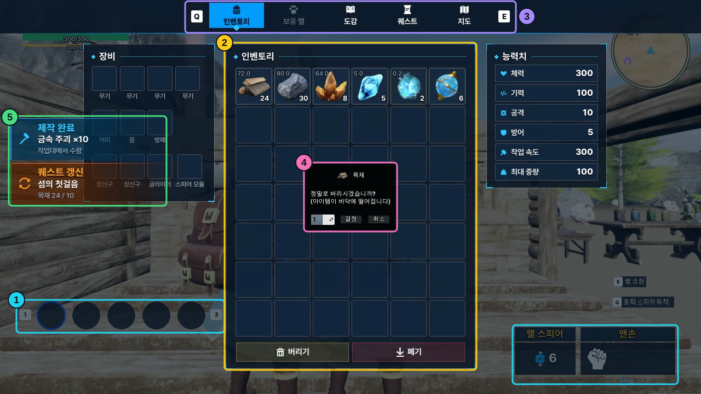

# 21. Game UI Framework

Sonheim의 화면을 게임에 묶이지 않는 UI 프레임워크 위에서 동작하도록 정리했습니다. 프레임워크는 `Sonheim/Plugins/GameUIFramework` 플러그인이며, Sonheim 모듈을 참조하지 않습니다. 플러그인은 화면을 **레이어에 배치하고, 열고 닫는 시점을 알리고, 입력 모드와 뒤로 가기를 관리**합니다. 인벤토리·도감·지도·퀘스트·알림 같은 화면 내용은 게임 모듈에 남아 플러그인의 기반 클래스를 상속합니다.

화면은 `UI.Screen.Inventory` 같은 Gameplay Tag로 엽니다. 어느 레이어에 놓일지, 입력을 어떻게 받을지, 닫은 뒤에도 유지할지는 각 Widget Blueprint의 클래스 기본값으로 정합니다. 플러그인의 화면 관리와 게임플레이 데이터 갱신은 별개입니다. UI 데이터 변환은 [11. Client State Presentation](11_Client_State_Presentation_Pipeline.md), 구현 변경은 [PR #7](https://github.com/chungheonLee0325/Sonheim/pull/7)에서 확인할 수 있습니다.

## 화면 구성

로컬 플레이어마다 루트 위젯 `WBP_UIRoot` 하나가 플레이어 화면에 붙고, 모든 UI가 이 안의 레이어에 들어갑니다. 위 번호에 해당하는 레이어와 담당 코드는 다음과 같습니다.

| 표시 영역 | 레이어·위젯 | 동작 |
|---|---|---|
| **① HUD** | `UI.Layer.HUD` (`UGameUILayer`) | 상태창·퀘스트 추적·미니맵·던전 HUD를 `AddToLayer`로 붙입니다. 입력에 관여하지 않습니다. |
| **② 메뉴 화면** | `UI.Layer.Menu` (`UGameUIStackLayer`) | 인벤토리·도감·지도·퀘스트·보관함·제작대. 맨 위 화면 하나만 보입니다. |
| **③ 메뉴 탭바** | `UMenuTabBarWidget` | Menu 레이어의 맨 위 화면이 탭이면 표시하고 해당 탭을 강조합니다. |
| **④ 팝업** | `UI.Layer.Popup` (`UGameUIStackLayer`) | 수량 확인 팝업. 입력과 뒤로 가기를 Menu보다 먼저 받습니다. |
| **⑤ 알림** | `UI.Layer.Toast` (`UGameUILayer`) | Feed·Title·Headline 알림 위젯. HitTestInvisible이라 클릭을 받지 않습니다. |

레이어의 그리기 순서는 루트 WBP 안의 자식 순서이고, 입력 우선순위는 그 역순입니다. 화면별 Z-order 숫자는 쓰지 않습니다.

## 레이어와 위젯 종류

UI는 두 가지 기준으로 나눕니다. **레이어**는 위젯이 놓이는 자리와 그 자리의 규칙이고, **위젯 종류**는 매니저와 맺는 수명 약속입니다.

| 위젯 종류 | 여는 방식 | 닫히는 시점 | 매니저와의 약속 |
|---|---|---|---|
| HUD (`UUserWidget`) | 게임 코드가 `AddToLayer` 한 번 | 닫히지 않음 | 없음 |
| Screen (`UGameUIScreenWidget`) | 태그로 `Open` | 닫기·뒤로 가기·`CloseSelf` | `OnOpened`/`OnClosed`, `OnCovered`/`OnUncovered`, 입력 모드, 뒤로 가기, 유지 여부 |
| Popup (`UGameUIPopupWidget`) | Screen과 같음 | Screen과 같음 | Screen 약속 + 결과 콜백 한 번 |
| Toast (`UGameUIToastWidget`) | 내용을 슬롯 큐에 넣음 | 표시 시간이 끝나면 스스로 | `ShowToast`, `Stop`, `OnFinished` |

레이어는 플러그인의 `UOverlay` 파생 위젯입니다. 루트 WBP에 배치하고 디테일 패널에서 `LayerTag`를 지정하면, 루트가 초기화될 때 위젯 트리를 순회하며 태그별로 등록합니다. 플러그인은 레이어의 개수나 이름을 알지 못합니다.

~~~cpp
// GameUIRootWidget.cpp
void UGameUIRootWidget::NativeOnInitialized()
{
    Super::NativeOnInitialized();
    // The tree is walked in the order the layout draws it, so the layers come back to front.
    WidgetTree->ForEachWidget([this](UWidget* Widget)
    {
        if (UGameUILayer* Layer = Cast<UGameUILayer>(Widget)) Layers.Add(Layer);
    });
    SetLoading(false);
}
~~~

`Layers` 배열은 뒤에서 앞 순서가 됩니다. 매니저는 이 배열을 역순으로 훑어 **입력을 받는 스택 레이어 중 가장 위 레이어의 맨 위 화면**을 찾고, 그 화면의 클래스 기본값으로 입력 모드와 마우스 커서를 적용합니다.

화면의 레이어도 태그로 지정합니다. 화면 태그(`UI.Screen.*`)는 화면의 이름이고, 레이어(`UI.Layer.*`)는 그 화면의 속성입니다. 그래서 화면을 다른 레이어로 옮겨도 화면 태그를 참조하는 레지스트리·탭바·코드는 바뀌지 않습니다.

## 스택 레이어: 맨 위 화면만 표시하기

`UGameUIStackLayer`는 열린 화면을 스택으로 관리합니다. 새 화면이 올라오면 아래 화면은 `Collapsed`가 되고 `OnCovered`를 받습니다. 위 화면이 닫히면 원래 Visibility로 돌아오고 `OnUncovered`를 받습니다. 가려진 화면은 닫힌 것이 아니므로 `OnClosed`는 부르지 않습니다.

~~~cpp
// GameUILayer.cpp — 발췌
void UGameUIStackLayer::PushScreen(UGameUIScreenWidget* Screen)
{
    // …
    Cover(Top);
    Screens.Add(Screen);
    AddLayerWidget(Screen);
    Screen->NativeOnOpened();
}

void UGameUIStackLayer::RemoveScreen(UGameUIScreenWidget* Screen)
{
    const int32 Index = Screens.IndexOfByKey(Screen);
    if (Index == INDEX_NONE) return;
    const bool bWasTop = Index == Screens.Num() - 1;
    // Out of the stack first: a closing screen may close others through the manager.
    Screens.RemoveAt(Index);
    if (!bWasTop) Screen->SetVisibility(Screen->UncoveredVisibility);
    Screen->NativeOnClosed();
    Screen->RemoveFromParent();
    if (bWasTop) Uncover(GetTop());
}
~~~

`RemoveScreen()`은 화면을 스택에서 먼저 빼고 `OnClosed`를 부릅니다. 보관함처럼 닫히는 화면이 서버 RPC나 다른 화면 닫기를 일으켜 매니저가 다시 호출되더라도, 이미 빠진 화면을 두 번 처리하지 않습니다.

뒤로 가기 입력(`IA_UI_Close`, Esc·게임패드 B)은 `HandleBack()`으로 맨 위 화면에 전달되고, 화면의 `Back` 설정에 따라 처리됩니다.

~~~cpp
// GameUIManagerSubsystem.cpp
bool UGameUIManagerSubsystem::HandleBack()
{
    UGameUIScreenWidget* Top = GetTopScreen();
    if (!Top) return false;
    switch (Top->Back)
    {
    case EGameUIBack::Close:
        CloseScreen(Top);
        return true;
    case EGameUIBack::Custom:
        return Top->NativeOnBack();
    default:
        return true;
    }
}
~~~

팝업이 떠 있으면 Popup 레이어의 맨 위 화면이 뒤로 가기를 먼저 받으므로, Esc는 아래 인벤토리가 아니라 팝업만 닫습니다.

## 태그로 화면 열기

화면 태그와 Widget Blueprint 클래스의 연결은 `DA_UIScreens`(`UGameUIScreenRegistry`)에 있고, 레지스트리 위치는 프로젝트 설정 **Game > Game UI**(`UGameUISettings`)에서 지정합니다. 레지스트리는 클래스를 `TSoftClassPtr`로 갖기 때문에, 레지스트리를 불러와도 화면 클래스는 함께 로드되지 않습니다.

| 화면 태그 | Widget Blueprint | 클래스 기본값 |
|---|---|---|
| `UI.Screen.Inventory` | `WBP_InventoryScreen` | Menu, 유지 |
| `UI.Screen.MonsterDex` | `WBP_MonsterDex` | Menu, 유지, 미리 로드 |
| `UI.Screen.WorldMap` | `WBP_WorldMap` | Menu, 유지 |
| `UI.Screen.QuestJournal` / `QuestDialog` | `WBP_QuestJournal` / `WBP_QuestDialog` | Menu |
| `UI.Screen.Container` | `WB_ContainerInteraction` | Menu, 유지 |
| `UI.Screen.Crafting` | `WB_CraftingWidget` | Menu |
| `UI.Popup.ItemQuantity` | `WBP_ConfirmWidget` | Popup |

`Open()`은 화면의 상태에 따라 네 가지로 처리합니다.

~~~mermaid
flowchart TD
    O["Open(Tag, OnReady)"] --> A{"이미 열림?"}
    A -->|예| B["스택 맨 위로 · OnReady"]
    A -->|아니오| C{"같은 Tag 로딩 중?"}
    C -->|예| D["OnReady를 대기 목록에 추가"]
    C -->|아니오| E{"클래스와 미리 로드 에셋이 메모리에 있음?"}
    E -->|예| F["FinishOpen 같은 프레임에 열림"]
    E -->|아니오| G["로딩 표시 · 게임 입력 차단 클래스 → 미리 로드 에셋 비동기 로드"]
    G --> F
    F --> H["유지된 위젯 재사용 또는 CreateWidget PushScreen → OnOpened → OnReady"]
~~~

~~~cpp
// GameUIManagerSubsystem.cpp — Open 발췌
FPendingOpen& Open = Pending.Add(Screen);
Open.Id = ++LastOpenId;
if (OnReady) Open.Waiting.Add(MoveTemp(OnReady));
if (IsLoaded(*Entry))
{
    FinishOpen(Screen, Entry->Class.Get());
    return;
}
// …
if (UGameUIRootWidget* Layout = GetRoot()) Layout->SetLoading(true);
ApplyInputState();
const TSoftClassPtr<UGameUIScreenWidget> Class = Entry->Class;
// An opening that Close dropped, or that a later Open replaced, is not finished.
Load(*Entry, [this, Screen, Class, Id = Open.Id]
{
    if (const FPendingOpen* Still = Pending.Find(Screen); Still && Still->Id == Id) FinishOpen(Screen, Class.Get());
});
~~~

로딩 중에 `Close(Tag)`를 부르면 `Pending`에서 해당 항목이 빠지고, 로드가 끝나도 화면을 열지 않습니다. 열린 화면이 없을 때 로딩 중인 화면이 있으면 `IsGameplayBlocked()`가 참이므로, 열기 키를 누른 순간부터 이동과 공격 입력이 멈춥니다.

화면에 값을 넘겨야 하는 호출자는 `OnReady` 콜백을 사용합니다. 클래스가 이미 메모리에 있으면 같은 프레임에 호출되고, 로딩이 필요하면 화면이 열린 뒤에 호출됩니다.

~~~cpp
// SonheimPlayerController.cpp — 보관함 열기 발췌
UI->Open<UContainerInteractionWidget>(UITags::Container,
    [Container = TWeakObjectPtr<ABaseContainer>(Container)](UContainerInteractionWidget& Widget)
    {
        if (Container.IsValid()) Widget.OpenContainer(Container.Get());
    });
~~~

### 도감 종 클래스 미리 로드

도감은 종마다 3D 스테이지에 표시할 캐릭터 클래스를 사용합니다. 화면 클래스는 `GatherPreloadAssets()`로 함께 로드할 에셋을 알려주며, 매니저는 클래스를 로드한 직후 클래스 기본 객체에서 이 목록을 읽어 비동기로 로드합니다.

~~~cpp
// MonsterDexWidget.cpp
void UMonsterDexWidget::GatherPreloadAssets(TArray<FSoftObjectPath>& OutPaths) const
{
    UMonsterDexSubsystem::GatherDisplayClasses(OutPaths);
}
~~~

레지스트리에서 `bPreload`를 켠 화면은 로컬 플레이어가 생성될 때 이 과정이 미리 실행됩니다. 로드 핸들은 매니저가 계속 유지하므로, 도감을 처음 열 때도 종 클래스가 이미 메모리에 있습니다.

## 화면 수명: 열 때 연결하고 닫을 때 해제하기

화면의 열기·닫기 작업은 `NativeConstruct`/`NativeDestruct`가 아니라 매니저가 부르는 `NativeOnOpened`/`NativeOnClosed`에서 처리합니다.

| 시점 | 함수 | 처리할 작업 |
|---|---|---|
| 위젯을 처음 만들 때 한 번 | `NativeOnInitialized` | 버튼 바인딩, 지도 지역 이름 생성 |
| 레이어에 붙은 직후, 열 때마다 | `NativeOnOpened` | 데이터 구독, View 생성, 렌더 타깃 연결 |
| 레이어에서 떼기 직전, 닫을 때마다 | `NativeOnClosed` | 구독 해제, 렌더 타깃·Brush·풀링된 엔트리 해제 |

`bKeepWhenClosed`를 켠 화면(인벤토리·도감·지도·보관함)은 닫아도 위젯 UObject를 매니저의 `Kept` 배열에 남기고, 다시 열 때 재사용합니다. 레이어에서 떼었다가 다시 붙이므로 Slate 위젯은 새로 만들어지고 `NativeConstruct`도 다시 실행됩니다. 재사용 비용과 효과는 [20. Agent MCP 기반 UI 성능 분석과 최적화](20_UI_Performance_Profiling.md)에 정리했습니다.

인벤토리 화면은 열려 있는 동안에만 가방 변경을 구독합니다.

~~~cpp
// InventoryScreenWidget.cpp
void UInventoryScreenWidget::NativeOnOpened()
{
    Super::NativeOnOpened();
    ASonheimPlayerState* State = GetOwningPlayerState<ASonheimPlayerState>();
    Bag = State ? State->m_InventoryComponent : nullptr;
    if (!Bag.IsValid()) return;
    // Only the slots whose item changed while the screen was closed redraw.
    Inventory->SetInventoryComponent(Bag.Get());
    Bag->OnInventoryChanged.AddUniqueDynamic(Inventory, &UInventoryWidget::UpdateInventoryFromData);
    Bag->OnEquipmentChanged.AddUniqueDynamic(Inventory, &UInventoryWidget::UpdateEquipmentFromData);
    PlayerStat->InitializePlayerStatWidget(State);
}

void UInventoryScreenWidget::NativeOnClosed()
{
    if (Bag.IsValid())
    {
        Bag->OnInventoryChanged.RemoveDynamic(Inventory, &UInventoryWidget::UpdateInventoryFromData);
        Bag->OnEquipmentChanged.RemoveDynamic(Inventory, &UInventoryWidget::UpdateEquipmentFromData);
    }
    Bag = nullptr;
    Super::NativeOnClosed();
}
~~~

다시 열면 `SetInventoryComponent()`가 현재 가방을 슬롯에 전달합니다. 슬롯은 마지막 표시 상태와 비교해 바뀐 칸만 다시 그리므로, 닫혀 있던 동안의 변경도 해당 슬롯만 갱신됩니다. 지도 화면도 같은 방식으로 `OnOpened`에서 `OnMapChanged`·`OnQuestsChanged`를 구독하고 `OnClosed`에서 해제합니다.

지도 위젯은 `SonheimMap::BuildView()`가 만든 `FWorldMapView`(찾은 장소, 탐험한 칸, 퀘스트 위치, 이동 지점)만 받아 그립니다. 컴포넌트와 Actor를 읽는 작업은 View를 만들 때 한 번에 처리합니다.

## 팝업: 결과를 한 번만 전달하기

`UGameUIPopupWidget`은 Screen을 상속하고, 여는 쪽에 결과를 한 번만 전달합니다. 확인·취소 버튼, 뒤로 가기, 다른 이유로 닫히는 경우가 모두 `Finish()`를 거칩니다.

~~~cpp
// GameUIPopupWidget.cpp
void UGameUIPopupWidget::Finish(const bool bConfirmed)
{
    if (bAnswered) return;
    bAnswered = true;
    // Unbound first, so an opener that opens another popup from its answer gets a clean delegate on it.
    const FOnGameUIPopupResult Answer = OnResult;
    OnResult.Unbind();
    Answer.ExecuteIfBound(*this, bConfirmed);
    CloseSelf();
}

void UGameUIPopupWidget::NativeOnClosed()
{
    // Closed without an answer: the opener still hears back, as a cancel. CloseSelf finds the popup already out of its layer.
    Finish(false);
    Super::NativeOnClosed();
}
~~~

결과 값은 파생 클래스가 갖습니다. 인벤토리에서 아이템을 버리기·폐기 영역에 놓으면 `FItemQuantityView`(아이콘·이름·최대 수량·폐기 여부)를 만들어 팝업을 열고, 확인 결과를 받으면 팝업의 `GetCount()`로 수량을 읽어 서버에 요청합니다. 팝업은 아이템 데이터를 직접 조회하지 않습니다.

~~~cpp
// InventoryWidget.cpp — HandleTrashDrop 발췌
UI->Open<UConfirmWidget>(UITags::ItemQuantity, [this, View, SlotIndex, bDiscardMode](UConfirmWidget& Popup)
{
    Popup.Setup(View);
    Popup.OnResult.BindWeakLambda(this, [this, SlotIndex, bDiscardMode](UGameUIPopupWidget& Answered, const bool bConfirmed)
    {
        if (bConfirmed) OnConfirmTrashAction(SlotIndex, CastChecked<UConfirmWidget>(&Answered)->GetCount(), bDiscardMode);
    });
});
~~~

## 알림: Toast 레이어의 슬롯 큐

알림의 표시 순서는 플러그인의 `UGameUIToastSubsystem`이 관리합니다. 슬롯은 `UI.Toast.*` 태그로 설정에 등록하고, 슬롯마다 위젯 클래스와 순서 정책을 지정합니다.

| 슬롯 | 위젯 | 순서 정책 |
|---|---|---|
| `UI.Toast.Title` | `WBP_NoticeTitle` | `ReplaceShowing` — 새 알림이 표시 중인 알림을 바로 교체 |
| `UI.Toast.Feed` | `WBP_NoticeFeed` | `Stack` — 대기 없이 위젯이 여러 줄을 함께 표시 |
| `UI.Toast.Headline` | `WBP_NoticeHeadline` | `TakeTurns` — 차례대로 표시, 최대 3개 대기 |

알림 내용은 `FInstancedStruct`로 전달합니다. 플러그인은 내용의 타입을 알지 못하고, 게임의 `UNoticeWidget`이 `UGameUIToastWidget`을 상속해 `FNoticeData`를 꺼내 그립니다.

~~~cpp
// NoticeSubsystem.cpp
void UNoticeSubsystem::Push(const ENoticeSlot Slot, const FName Channel, const FNoticeData& Data)
{
    if (Data.Title.IsEmpty()) return;
    const FGameplayTag Tag = Slot == ENoticeSlot::Title ? UITags::ToastTitle : Slot == ENoticeSlot::Headline ? UITags::ToastHeadline : UITags::ToastFeed;
    if (UGameUIToastSubsystem* Toasts = GetLocalPlayer()->GetSubsystem<UGameUIToastSubsystem>()) Toasts->Push(Tag, Channel, FInstancedStruct::Make(Data));
}

// NoticeWidget.cpp
void UNoticeWidget::ShowToast(const FName Channel, const FInstancedStruct& Payload)
{
    if (const FNoticeData* Data = Payload.GetPtr<FNoticeData>()) ShowFrom(Channel, *Data);
}
~~~

`Channel`은 알림을 보낸 쪽을 구분합니다. 던전 진행이 끝나면 던전 채널의 알림만 `Clear(Channel)`로 대기 목록과 표시 중인 위젯에서 회수하고, 다른 시스템의 알림은 그대로 둡니다. 슬롯 위젯은 첫 알림이 들어올 때 설정 순서대로 Toast 레이어에 함께 생성되므로, 위젯이 만들어진 시점과 관계없이 그리기 순서가 유지됩니다.

## 플러그인과 게임 모듈의 연결 지점

플러그인은 Sonheim 모듈을 참조하지 않습니다. 게임 쪽은 다음 연결 지점으로만 동작에 참여합니다.

| 연결 지점 | 플러그인이 제공하는 것 | Sonheim 쪽 처리 |
|---|---|---|
| 입력 상태 | `OnInputStateChanged(bool bBlockGameplay)` | `UInputHintSubsystem`이 메뉴용 입력 매핑 `IMC_Menu`를 켜고 끔 |
| 맨 위 화면 변경 | `OnTopScreenChanged(FGameplayTag)` | `UMenuTabBarWidget`이 Menu 레이어의 맨 위 화면을 확인해 표시·강조 |
| 뒤로 가기 | `HandleBack()` | `IA_UI_Close` 입력에서 호출 |
| 화면 내용 | `UGameUIScreenWidget`·`UGameUIPopupWidget` 가상 함수 | 각 화면 위젯이 상속 |
| 알림 내용 | `FInstancedStruct` + `UGameUIToastWidget` | `FNoticeData`를 담아 보내고 `UNoticeWidget`이 그림 |
| 미리 로드 | `GatherPreloadAssets()` | 도감이 종 클래스 경로를 전달 |
| HUD | `AddToLayer(Layer, Widget)` | `PlayerController`와 던전 라우터가 HUD 위젯을 추가 |

게임 플레이 입력의 차단 여부는 `IsGameplayBlocked()`로 확인합니다. 이동·공격·상호작용 입력과 퀘스트 제공자 표시가 이 값을 참조합니다.

## 관련 코드

- 플러그인: [GameUIManagerSubsystem](../../Sonheim/Plugins/GameUIFramework/Source/GameUIFramework/Private/GameUIManagerSubsystem.cpp) · [GameUILayer](../../Sonheim/Plugins/GameUIFramework/Source/GameUIFramework/Private/GameUILayer.cpp) · [GameUIScreenWidget](../../Sonheim/Plugins/GameUIFramework/Source/GameUIFramework/Public/GameUIScreenWidget.h) · [GameUIPopupWidget](../../Sonheim/Plugins/GameUIFramework/Source/GameUIFramework/Private/GameUIPopupWidget.cpp) · [GameUIToastSubsystem](../../Sonheim/Plugins/GameUIFramework/Source/GameUIFramework/Private/GameUIToastSubsystem.cpp) · [GameUISettings](../../Sonheim/Plugins/GameUIFramework/Source/GameUIFramework/Public/GameUISettings.h)
- 게임: [UITags](../../Sonheim/Source/Sonheim/UI/System/UITags.cpp) · [InventoryScreenWidget](../../Sonheim/Source/Sonheim/UI/Widget/Player/Inventory/InventoryScreenWidget.cpp) · [MenuTabWidget](../../Sonheim/Source/Sonheim/UI/System/MenuTabWidget.cpp) · [NoticeSubsystem](../../Sonheim/Source/Sonheim/UI/Notice/NoticeSubsystem.cpp) · [SonheimPlayerController](../../Sonheim/Source/Sonheim/AreaObject/Player/SonheimPlayerController.cpp)
- 설정: [DefaultGame.ini](../../Sonheim/Config/DefaultGame.ini) `[/Script/GameUIFramework.GameUISettings]`
- 설계 문서: [Doc/UIFramework/Design.md](../UIFramework/Design.md)
