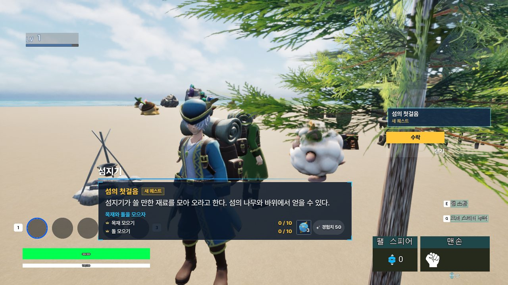
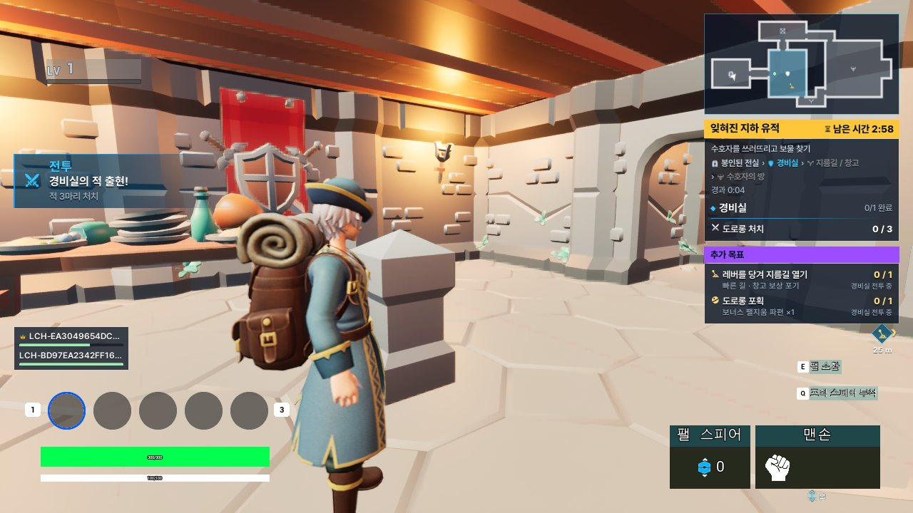
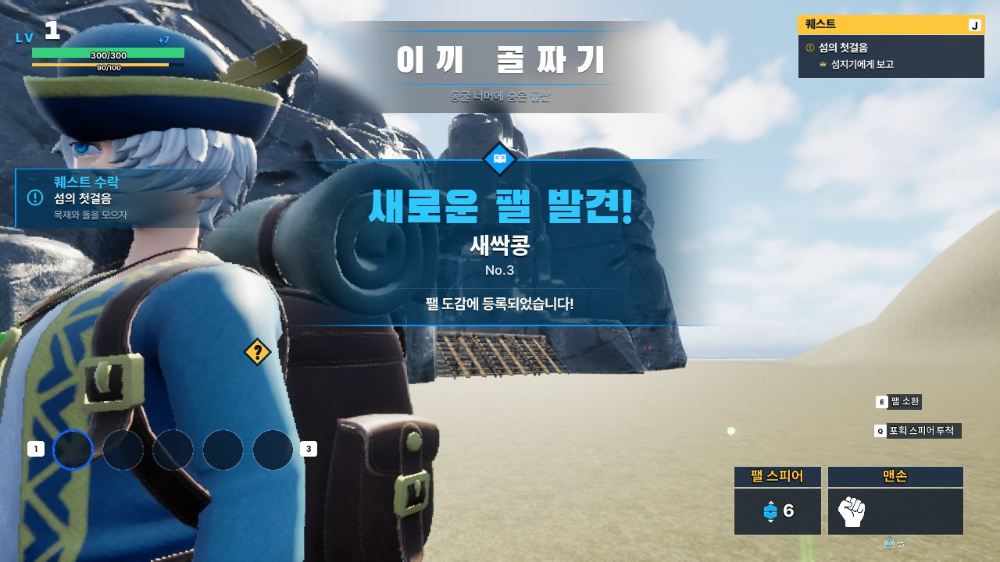

# Sonheim Engineering Wiki

**Unreal Engine 5.5 · C++ · Listen Server 기반 멀티플레이 액션 어드벤처**

전투·제작·포획으로 시작한 게임플레이를 **몬스터 도감·퀘스트·분기 던전·보스 전투**까지 확장했습니다. 이 Wiki에는 실제 게임 화면과 함께 **C++ 구현, 서버 동기화, 데이터 설계, UI 작업 과정**을 정리했습니다.

**처음 방문했다면 [01. Project Overview](01_Project_Overview.md)에서 전체 게임플레이와 개발 범위를 확인할 수 있습니다.**

[전체 플레이 데모](https://www.youtube.com/watch?v=TDRRWp6M_9E) · [Sonheim GitHub](https://github.com/chungheonLee0325/Sonheim) · [코드 중심 저장소](https://github.com/chungheonLee0325/Sonheim.Source)

---

## 대표 구현

| **MonsterDex — 발견·기록·보상** | **Quest — NPC·단계·월드 변화** |
|---|---|
|  |  |
| 처음 처치·포획한 몬스터를 도감에 등록하고, 3D 프리뷰·단계별 보상·플레이어별 기록으로 연결합니다. **[16. MonsterDex System](16_MonsterDex_System.md)** | NPC에서 수락한 목표가 전투·포획·제작·탐험 이벤트로 진행되고, 자재 전달은 월드 오브젝트의 모습도 바꿉니다. **[17. Quest System](17_Quest_System.md)** |

| **Forgotten Ruins — 분기 던전** | **UMG v2 — HUD·알림 공통화** |
|---|---|
|  |  |
| 레버·웨이브·보스·보상을 Stage 규칙으로 연결하고 서버 Snapshot으로 진행을 공유합니다. **[09. Branching Dungeon Runtime](09_Branching_Dungeon_Runtime.md)** · **[10. Boss Encounter Runtime](10_Boss_Encounter_Runtime.md)** | 중첩 메뉴 입력, 공통 알림 슬롯, 키보드·패드 안내와 Widget Blueprint 화면을 개편했습니다. **[18. UMG v2 Migration](18_UMG_v2_Migration.md)** |

| **World Map — 탐험 안개·빠른 이동** | **빠른 이동 표석 — 상호작용 활성화** |
|---|---|
|  |  |
| 탐험 기록·퀘스트 목표를 전체 지도와 미니맵에 표시하고, 공통 좌표 변환·마커·안개 처리를 사용합니다. **[19. World Map & Fast Travel](19_World_Map_System.md)** | 플레이어별 활성화 기록으로 빠른 이동 목록을 구성하고, 선택한 목적지로 이동하는 흐름을 연결했습니다. **[19. World Map & Fast Travel](19_World_Map_System.md)** |

**시연 영상:** [도감 첫 발견](https://github.com/user-attachments/assets/d1d96b5f-1076-4e29-872d-3399a540acac) · [퀘스트 수락부터 완료까지](https://github.com/user-attachments/assets/356d1438-7c3c-417d-8bd4-b8dcb7a3efb6) · [던전 지름길 분기](https://github.com/user-attachments/assets/29858da6-7d13-4297-9d71-41f53272a952) · [보스 패턴](https://github.com/user-attachments/assets/cd81b345-d192-4374-9573-904b561f40bd) · [지도 탐험·안개](https://github.com/user-attachments/assets/d87819c4-dd46-496e-b314-dc4a624dc1e9) · [표석 활성화·빠른 이동](https://github.com/user-attachments/assets/588c9b6b-05d3-4048-9a93-99fa6ec5d54a)

---

## 핵심 기술 빠르게 찾기

| 관심 기술 | 확인할 구현 |
|---|---|
| **C++ 캐릭터·컴포넌트 설계** | [02. Gameplay Architecture](02_Gameplay_Architecture.md) · [04. Player & Character Systems](04_Player_Character_Systems.md) · [06. World Interaction Systems](06_World_Interaction_Systems.md) |
| **전투와 데이터 기반 패턴** | [05. Combat, Skill & Animation](05_Combat_Skill_Animation.md) · [10. Boss Encounter Runtime](10_Boss_Encounter_Runtime.md) |
| **아이템·제작·Partner** | [07. Inventory & Crafting](07_Inventory_Crafting.md) · [08. Pal Capture & Partner Lifecycle](08_Pal_Capture_Partner_Lifecycle.md) |
| **서버 권위·복제** | [12. Multiplayer Synchronization](12_Multiplayer_Synchronization.md) — RPC, FastArray, UObject, OwnerOnly, Snapshot |
| **UI 상태와 화면 수명** | [11. UI Architecture & Client Presentation](11_Client_State_Presentation_Pipeline.md) · [18. UMG v2 Migration](18_UMG_v2_Migration.md) |
| **지도·안개·머티리얼 UI** | [19. World Map & Fast Travel](19_World_Map_System.md) — 좌표·뷰 변환, 퀘스트 마커, UImage 재사용, 탐험 안개 머티리얼 |
| **콘텐츠 데이터·검증** | [03. Data & Content Architecture](03_Data_Content_Architecture.md) · [13. Content Authoring & Validation](13_Content_Authoring_Validation.md) |
| **에디터 자동화·개발 이력** | [14. Unreal Editor Automation & Verification](14_Unreal_Editor_Automation_Verification.md) · [15. Development History & Retrospective](15_Development_History_Retrospective.md) |

**구현의 공통 기준:** 서버가 게임플레이 결과를 확정하고, PlayerState·Pawn·World Subsystem에 원본 상태를 분리합니다. UI는 변경 Delegate 또는 복제된 상태를 표시 데이터로 변환해 갱신합니다. 시스템 전체 흐름은 [01. Project Overview](01_Project_Overview.md), 객체별 책임은 [02. Gameplay Architecture](02_Gameplay_Architecture.md)에서 설명합니다.

---

## 전체 기술 문서

### 01–03 · 프로젝트와 설계

| 문서 | 내용 |
|---|---|
| [01. Project Overview](01_Project_Overview.md) | 게임플레이 데모, 새 콘텐츠와 시스템 연결 |
| [02. Gameplay Architecture](02_Gameplay_Architecture.md) | PlayerState·Pawn·Subsystem의 소유권과 실행 경계 |
| [03. Data & Content Architecture](03_Data_Content_Architecture.md) | DataTable·DataAsset·GameplayTag·StringTable |

### 04–08 · 게임플레이 기반

| 문서 | 내용 |
|---|---|
| [04. Player & Character Systems](04_Player_Character_Systems.md) | 장비 변경·스탯·행동 상태·Condition |
| [05. Combat, Skill & Animation](05_Combat_Skill_Animation.md) | 서버 스킬 실행, Animation Notify·피해 판정 |
| [06. World Interaction Systems](06_World_Interaction_Systems.md) | `IInteractableInterface` 다형성·감지·Hold |
| [07. Inventory & Crafting](07_Inventory_Crafting.md) | FastArray·공유 보관함·협동 제작 |
| [08. Pal Capture & Partner Lifecycle](08_Pal_Capture_Partner_Lifecycle.md) | 포획 서버 판정·보유 목록·Partner FSM |

### 09–12 · 통합 콘텐츠와 멀티플레이

| 문서 | 내용 |
|---|---|
| [09. Branching Dungeon Runtime](09_Branching_Dungeon_Runtime.md) | 분기 규칙·이벤트 큐·목표·장벽·기록 |
| [10. Boss Encounter Runtime](10_Boss_Encounter_Runtime.md) | PatternClock·텔레그래프·Break·포획 |
| [11. UI Architecture & Client Presentation](11_Client_State_Presentation_Pipeline.md) | UI Stack·Notice·던전 Presenter/ViewData |
| [12. Multiplayer Synchronization](12_Multiplayer_Synchronization.md) | 요청과 상태의 분리·복제·예측·RPC |

### 13–15 · 제작 도구와 변경 이력

| 문서 | 내용 |
|---|---|
| [13. Content Authoring & Validation](13_Content_Authoring_Validation.md) | Stage Graph·전환 순서·Boss Pattern 검증 |
| [14. Unreal Editor Automation & Verification](14_Unreal_Editor_Automation_Verification.md) | AgentMcp로 Inspect·Edit·Compile·PIE 확인 |
| [15. Development History & Retrospective](15_Development_History_Retrospective.md) | 실제 커밋으로 확인하는 시스템 구조 개선 |

### 16–19 · 도감·퀘스트·UI·지도 확장

| 문서 | 내용 |
|---|---|
| [16. MonsterDex System](16_MonsterDex_System.md) | 종별 처치·포획 기록, 보상·3D 프리뷰 |
| [17. Quest System](17_Quest_System.md) | 단계별 목표·NPC·월드 오브젝트·보상 |
| [18. UMG v2 Migration & Editor Verification](18_UMG_v2_Migration.md) | 화면 개편 전후, 입력 정책·알림·에디터 검증 |
| [19. World Map & Fast Travel](19_World_Map_System.md) | 탐험 안개·미니맵·지도 탭·빠른 이동 표석·도감 서식지 |

---

## 저장소

[**Sonheim**](https://github.com/chungheonLee0325/Sonheim) — 전체 Unreal Engine 프로젝트 · [**Sonheim.Source**](https://github.com/chungheonLee0325/Sonheim.Source) — 코드 중심 검토 · [**AgentMcp**](https://github.com/chungheonLee0325/AgentMcp) — UE Editor MCP 플러그인
