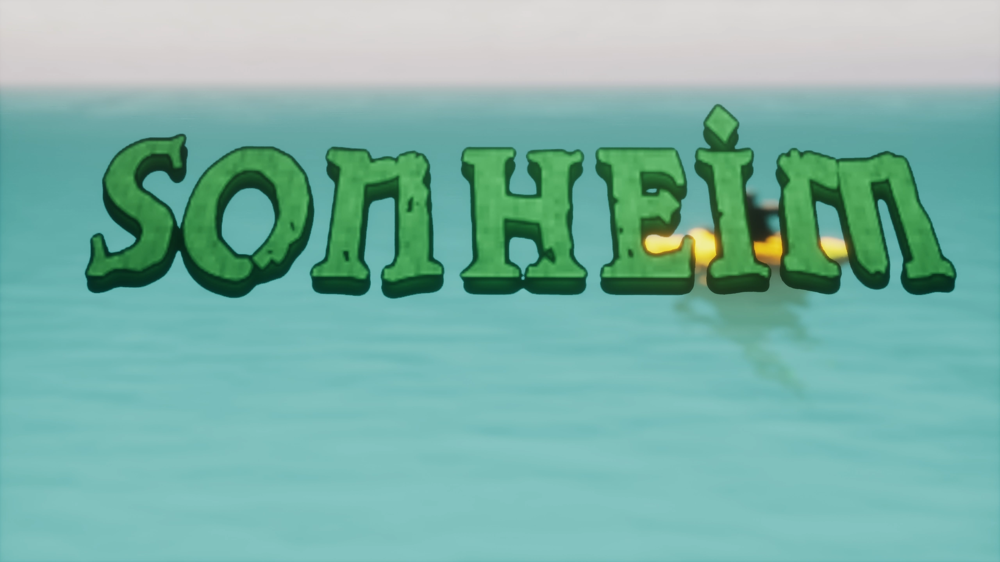

# Sonheim — Multiplayer Action Adventure

**Unreal Engine 5.5 / C++ 기반 서버 권위 멀티플레이 액션 어드벤처.**

전투·탐험·아이템 수집·장비·협동 제작·몬스터 포획/Partner를 구현하고, **MonsterDex·Quest·월드맵·UMG v2**를 추가했습니다. 분기형 던전 *Forgotten Ruins*에서는 기존 시스템을 함께 사용해 웨이브·지름길·보스·보상·기록까지 하나의 Run으로 진행합니다.

초기 2인 팀 개발 이후 게임플레이와 콘텐츠를 확장하며 서버 상태, 데이터 정의, UI 표현의 역할을 분리했습니다.

[**전체 게임플레이 데모**](https://www.youtube.com/watch?v=TDRRWp6M_9E) · [**Project Overview**](Doc/Wiki/01_Project_Overview.md) · [**기술 문서 전체 목록**](Doc/Wiki/Home.md) · [**Source-only Mirror**](https://github.com/chungheonLee0325/Sonheim.Source)

## Gameplay Demo

*이미지를 클릭하면 전체 프로젝트 플레이 영상으로 이동합니다.*

## MonsterDex · Quest · UI

| **MonsterDex — 발견·기록·보상** | **Quest — NPC·단계·월드 변화** |
|:---|:---|
|  |  |
| 처음 처치하거나 포획한 몬스터를 도감에 등록하고, 발견 여부·3D 프리뷰·보상 진행도를 표시합니다. | NPC에서 수락한 목표를 전투·포획·제작·탐험으로 진행하며, 자재 전달로 실제 월드 오브젝트의 상태도 변경합니다. |
| [구현 상세](Doc/Wiki/16_MonsterDex_System.md) · [도감 등록 시연](https://github.com/user-attachments/assets/d1d96b5f-1076-4e29-872d-3399a540acac) | [구현 상세](Doc/Wiki/17_Quest_System.md) · [수락부터 완료까지 시연](https://github.com/user-attachments/assets/356d1438-7c3c-417d-8bd4-b8dcb7a3efb6) |

### UMG v2 — 메뉴·알림·화면 개편

- **GameUIFramework:** 메뉴·팝업·HUD·알림을 레이어로 분리하고, 화면별 입력·커서·수명 정책을 플러그인으로 관리
- **Notice:** 도감·퀘스트·제작·지역 알림 데이터를 `Feed / Headline / Title` 슬롯으로 전달하고 표시 순서를 관리
- **Input Hint:** 키보드·게임패드 입력 장치에 맞는 안내 갱신
- **Dungeon UI:** 서버 GameState Snapshot → Presenter → ViewData → HUD·미니맵·결과

[화면 개편 전후](Doc/Wiki/18_UMG_v2_Migration.md) · [게임 데이터→UI 흐름](Doc/Wiki/11_Client_State_Presentation_Pipeline.md) · [UI 프레임워크 구현](Doc/Wiki/21_UI_Framework.md)

### World Map — 탐험 기록·미니맵·빠른 이동

플레이어별 탐험 안개를 전체 지도와 HUD 미니맵에 공통 적용하고, 퀘스트 위치·도감 서식지·활성화한 빠른 이동 표석을 표시합니다. [지도 시스템 구현](Doc/Wiki/19_World_Map_System.md)

### UI 조작 프레임 분석

인벤토리 교환과 화면 열기에서 발생하는 순간적인 지연을 CSV·Unreal Insights로 조사했습니다. 1920×1080, RTX 2070 SUPER 측정에서 교환 이벤트 프레임은 **32.6 → 17.1ms**, 인벤토리 열기는 **57.5 → 22.1ms**로 감소했습니다. [측정과 수정](Doc/Wiki/20_UI_Performance_Profiling.md)

---

## Selected Gameplay

### Forgotten Ruins — Branching Dungeon & Boss

**레버 입력 → 서버 RunTag 기록 → Wave 완료 → 조건에 따른 지름길/추가 웨이브 전환**으로 진행하는 분기형 던전입니다. 스테이지별 장벽·목표·보스 전투와 최종 보상·클리어 기록을 하나의 실행 상태로 관리합니다.

[지름길 분기 플레이](https://github.com/user-attachments/assets/29858da6-7d13-4297-9d71-41f53272a952) · [추가 웨이브 분기](https://github.com/user-attachments/assets/af8228c3-f403-41e1-947b-ba3f3d3f5da6) · [던전 Runtime 구현](Doc/Wiki/09_Branching_Dungeon_Runtime.md)

보스는 **패턴별 타이밍·텔레그래프·타격 범위**를 DataAsset에서 정의하고, 전용 FSM이 Phase·Break/Down·Resting을 처리합니다. Resting에서는 기존 Pal 포획 시스템을 재사용합니다.

[보스 텔레그래프·타격 시연](https://github.com/user-attachments/assets/cd81b345-d192-4374-9573-904b561f40bd) · [보스 구현](Doc/Wiki/10_Boss_Encounter_Runtime.md)

### Inventory · Collaborative Crafting · Partner

- **Inventory & Crafting:** FastArray 기반 슬롯·장비와 월드 보관함. 여러 플레이어가 하나의 제작 작업에 참여하며 부분 완료·수령·미완료 수량 환불을 처리합니다. [제작 시연](https://github.com/user-attachments/assets/df9a30d1-8d52-4b86-9f18-790474fdbda2) · [구현](Doc/Wiki/07_Inventory_Crafting.md)
- **Pal Capture & Partner:** 서버가 포획을 판정하고 소유 목록을 갱신합니다. 포획된 몬스터 Actor를 비활성화·소환하며 같은 Actor의 Partner AI를 활용합니다. [포획 시연](https://github.com/user-attachments/assets/57246d79-bd3b-473f-85fc-762670023729) · [구현](Doc/Wiki/08_Pal_Capture_Partner_Lifecycle.md)
- **Combat & Skills:** 장비에 따른 스탯/Skill Grant 전환, Animation Notify 기반 공격 시점, 근접 Sweep과 서버 피해 처리를 구현했습니다. [구현](Doc/Wiki/05_Combat_Skill_Animation.md)

---

## Engineering Highlights

| 기술 | 실제 적용 |
|---|---|
| **Server Authority / Replication** | Listen Server, Server RPC, Actor·UObject 복제, OwnerOnly FastArray, 던전 GameState Snapshot |
| **State Ownership** | PlayerState의 Inventory·Pal·Dex·Quest 기록과 Pawn의 캐릭터 동작 분리 |
| **Data-driven Content** | DataTable의 반복 데이터, Dungeon PrimaryDataAsset의 Stage/Branch, Boss DataAsset의 Pattern/Strike |
| **Event-driven Progression** | `PlayerState::ReportDeed`로 처치·포획·제작·지역·던전 결과를 퀘스트와 도감 기록에 연결 |
| **Authoring & Validation** | 던전 Stage Graph·분기 조건·Group 생산 경로와 보스 타격 시간·Montage Section 검증 |
| **UI State & Lifecycle** | [GameUIFramework](Doc/Wiki/21_UI_Framework.md)으로 레이어·입력 상태·팝업 콜백·화면 재사용 관리 |
| **UI Performance** | [조작 프레임 계측](Doc/Wiki/20_UI_Performance_Profiling.md)과 슬롯 변경분 갱신·Show Flag 조정·위젯 수명 개선 |
| **Unreal Editor Tooling** | [AgentMcp](https://github.com/chungheonLee0325/AgentMcp)로 Widget/Blueprint/Data 조회·편집, Compile·PIE·Viewport 확인 |

**기술 문서:** [전체 목차 (01–21)](Doc/Wiki/Home.md) · [프로젝트 아키텍처](Doc/Wiki/02_Gameplay_Architecture.md) · [멀티플레이 동기화](Doc/Wiki/12_Multiplayer_Synchronization.md) · [콘텐츠 검증](Doc/Wiki/13_Content_Authoring_Validation.md) · [개발 변경 이력](Doc/Wiki/15_Development_History_Retrospective.md)

---

## Source & Build

- **Engine:** Unreal Engine 5.5
- **IDE:** Visual Studio 2022 / Rider
- **프로젝트 파일:** `Sonheim/Sonheim.uproject` — 프로젝트 파일에서 Visual Studio 솔루션 생성 후 `Development Editor`로 빌드
- **멀티플레이 환경:** Listen Server + Client PIE, Steam/Null OSS
- **코드 검토:** [Sonheim.Source](https://github.com/chungheonLee0325/Sonheim.Source)
- **Editor MCP:** [AgentMcp](https://github.com/chungheonLee0325/AgentMcp)
